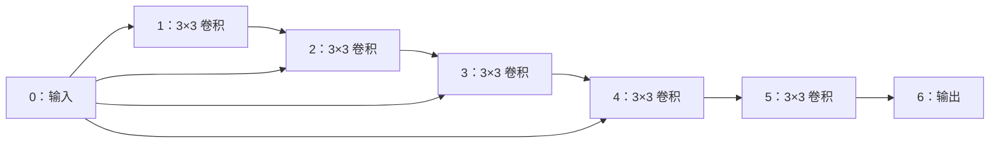
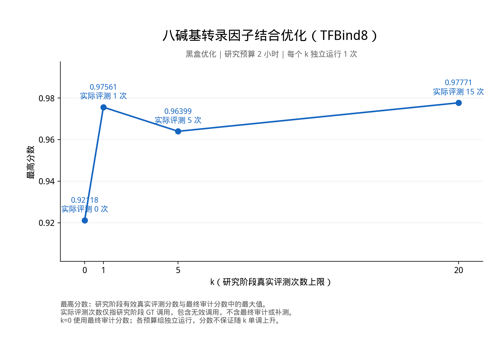
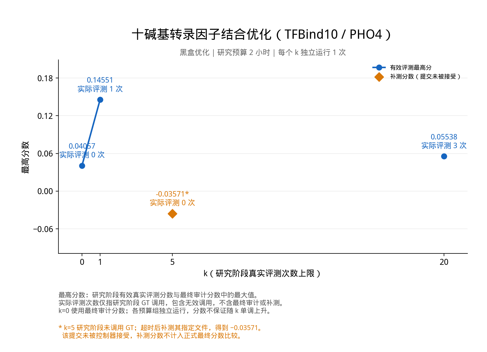
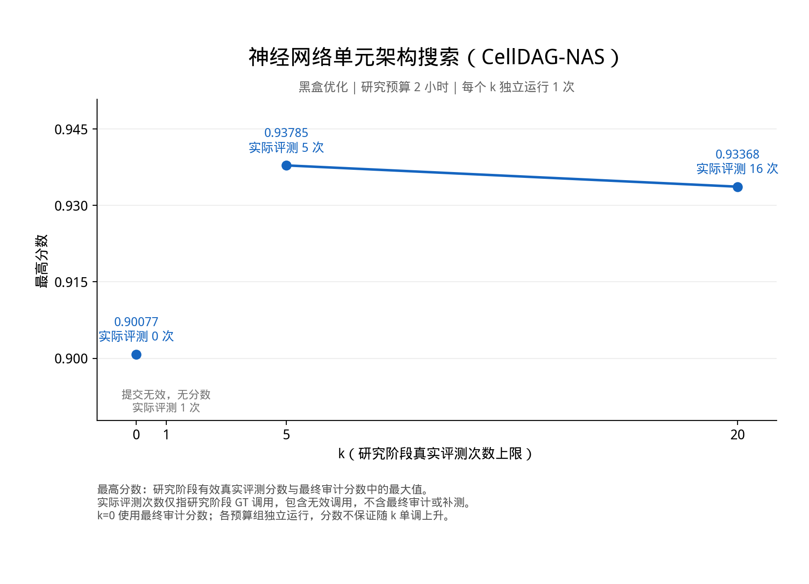

# SciModelingBench 三项黑盒优化任务：有限 GT 访问实验报告

实验日期：2026-10-09。

当前统一口径：本实验主结果使用 **best-score**（有效研究 GT 主指标与最终审计主指标的最大值），不以 Agent 最后选择替代历史最高分。事后补评单独标明来源；完整三次重复及统计见[汇总报告](LIMITED_GT_REPEATS_20261010_CN.md)。本文保留的最终提交状态与审计分数用于过程追溯。

更新：第 2、3 次重复实验及补评结果单独记录在[三次重复实验结果](LIMITED_GT_REPEATS_20261010_CN.md)。本文下方保留首轮结果与分析；重复实验汇总区分正式最终审计、按用户要求采用的历史最高分和非正式补评。

本次实验在三项黑盒优化任务上比较研究阶段真实评测（Ground Truth，GT）预算 **k=0、1、5、20**，每次运行的研究墙钟时间上限为 **2 小时**。Agent 预先知道预算，自主决定是否、何时使用 GT，也可以只依靠公开数据训练代理模型。

共运行 **12 组，每组独立运行 1 次**。恢复评测后，得到 **10 个正式最终分数、1 个仅供诊断的补评分数、1 个无效提交**。所有运行的研究 GT 使用数均未超过 k。当前结果可用于检查协议和观察行为，尚不足以确定增加 GT 预算的稳定收益。

## 1. 三项任务介绍

三项任务均为黑盒优化：Agent 根据公开历史观测，在合法设计空间中提出候选。公开数据提供设计与观测信号，即可用于建模的 `(x, y)` 或原始实验观测，但不暴露所有候选的隐藏目标值。

| 任务              | 科学目标与候选表示                                                                         | 本批次公开输入                                                                                         | 每次提交                               | 主指标                                               |
| ----------------- | ------------------------------------------------------------------------------------------ | ------------------------------------------------------------------------------------------------------ | -------------------------------------- | ---------------------------------------------------- |
| `tfbind8`       | 设计高结合强度的 8 碱基 DNA 序列；字符为`A/C/G/T`                                        | 32,768 条序列及`normalized_e_score`，默认公开目标值较低的 50%                                        | 恰好 32 条互不重复的合法序列           | 真实分数最高的 5 条的平均值，`best_k_mean`         |
| `tfbind10_pho4` | 设计高 Pho4 结合亲和力的 DNA 位点；提交 10 个可变碱基，完整实验模板为`NNNNNCACGTGNNNNN`  | 2,087,323 条观测行，包含序列、重复实验和读数信息；按序列亲和力筛选较低的 50%                           | 恰好 128 条互不重复的合法序列          | 整批 128 条的归一化富集度，`normalized_enrichment` |
| `cell_dag_nas`  | 搜索高准确率的 NASBench-101 神经网络单元架构；每个架构用 31 个整数 token 编码，最多 9 条边 | 419,803 条架构编码观测，包含三次 108-epoch 测试准确率；默认选择分数较低的 40% 规范图，再展开其别名编码 | 恰好 32 个合法且规范身份互不重复的架构 | 真实分数最高的 5 个架构的平均准确率，`best_k_mean` |

TIP：表中的数据量是公开文件的**行数**。Pho4 同一序列可以有多条重复实验观测；NAS 不同编码可以表示同一个规范图，因此不能把行数当成互不相同的设计数量。

Agent 可以用公开数据训练回归模型、学习序列 motif、做交叉验证或搜索候选。这些本地代理评测不消耗 GT 次数，但消耗研究时间和计算资源。**GT 只通过可信评测器调用，反馈为脱敏的聚合指标，不包含每个候选的隐藏标签**。

**NAS 的“生成”边界：** 本任务是在冻结 NASBench-101 表所覆盖的 423,624 个规范图中进行黑盒搜索，不是开放式发明并训练任意架构。Agent 默认看到最低分的 169,449 个规范图展开后的观测，可以通过结构修改提出未见过的架构；评测器仍按规范图身份查完整表。已有公开观测架构也可提交，表外架构返回 `out_of_table_graph`。因此这里的“新”指新提出或未见过的候选，不要求表外新颖性。上游[任务文档](https://github.com/xukp20/sci-modeling-bench/blob/main/docs/suites/design-bench/cell-dag-nas.md)将其定义为 `Black-Box Optimization`，并明确目标为 `Exact graph-invariant lookup over official NAS records`。本批次导出的 `problem/task.md` 仅列出了任务类别、主指标、提交数量和文件接口，未明确写出上述查表边界；这属于题面说明的不足。

### 1.1 NAS 生成候选的风险与公开／隐藏差距

**生成未见过的架构有可能提交无效，但“未见过”本身不是无效条件。** 冻结表覆盖 NASBench-101 预先定义的有限架构空间；它不是从任意神经网络空间中随机抽出的 423,624 个网络。Agent 可以修改边和节点操作，搜索公开观测之外的候选。必须同时满足 token 语法、节点与边数、输入到输出的连通性、表内可评分性，以及整批规范图去重要求。

如果突破该空间，例如加入不支持的注意力操作、超过 7 个节点或 9 条边，就不能按本任务评分。即使图语法合法，代码仍有表成员检查，缺失时返回 `out_of_table_graph`。**只要正式请求已经进入 GT 评测，无效提交也消耗一次额度**。公开解码和规范化检查能预先排除格式、结构和重复问题；本次未测量候选生成的表外失败概率，不能据此声称“生成新架构通常会无效”。

**公开与隐藏部分使用同一套结构规则，主要划分依据是性能。** 协议按 `(三次测试准确率的均值, 规范图哈希)` 排序，公开最低的 40%，隐藏其余 60%，不是随机划分。下面是实验结束后对本批次冻结表进行的统计，每个规范图只计一次，不按别名数重复加权：

| 项目                       |           公开部分 |           隐藏部分 |
| -------------------------- | -----------------: | -----------------: |
| 不同架构数                 |  169,449（约 40%） |  254,175（约 60%） |
| 平均测试准确率             |           86.6471% |           91.7016% |
| 测试准确率中位数           |           88.5483% |           91.6633% |
| 测试准确率第 10–90 百分位 | 84.8885%–89.8271% | 90.4213%–93.0322% |
| 最低／最高测试准确率       |  9.9760%／90.0775% | 90.0775%／94.3176% |
| 平均节点数（含输入和输出） |              6.873 |              6.820 |
| 平均边数                   |              8.673 |              8.766 |

隐藏部分的平均准确率高约 **5.05 个百分点**，中位数高约 **3.11 个百分点**。公开部分含低性能或训练失败记录，因而均值比中位数低。边界处有同分架构，按规范图哈希打破平局，所以公开最大值与隐藏最小值可相同。

这意味着 Agent 需要从较低性能区域向较高性能区域进行预测和搜索；不是用随机训练集做同分布插值。两部分的节点数、边数均值接近，但这不足以说明具体拓扑或操作组合的分布完全相同。仅选公开架构，其主指标不可能超过公开单架构最高值 **0.9007745783**；要超过这一上限，提交中必须包含隐藏区域的更优架构。

上述是**实验后的数据分析**，没有执行新的 GT 请求，也没有把隐藏统计或标签回传给研究 Agent。完整精度与来源见[公开／隐藏统计](limited_gt_blackbox_20261009/examples/nas_public_hidden_statistics.json)。

### 1.2 三项任务的实际 Agent 输出示例

以下分别来自本批次已被接受的最终提交，展示每份文件的**第一项**，不是事后按候选分数挑选的最好一项。代码块是格式摘录；实际提交必须包含完整的 32、128、32 项。完整原文件也一并提供，内容按字节复制，来源与校验和记录在[示例清单](limited_gt_blackbox_20261009/examples/manifest.json)。

#### TFBind8：一条 8 碱基 DNA 序列

来源：`tfbind8-k5-r1`；整批最终分数为 `0.9639920831`。

```json
[
  {"sequence": "TAGGGATA"}
]
```

`TAGGGATA` 本身就是一个候选，不需要附带 Agent 预测的分数。评测器会对完整批次的候选取真实 top-5 均值；整批分数不能当成这条序列的单独分数。

[查看完整 32 条实际提交](limited_gt_blackbox_20261009/examples/tfbind8_submission.json)。

#### TFBind10 Pho4：固定核心两侧的 10 个可变碱基

来源：`tfbind10_pho4-k20-r1`；整批最终分数为 `0.0553802405`。

```json
[
  {"sequence": "GTGGGGTTTT"}
]
```

这 10 个碱基对应模板两侧各 5 个位置，完整结合位点为：

```text
提交的可变部分： GTGGG           GTTTT
固定实验模板：   NNNNN  CACGTG   NNNNN
还原的完整序列： GTGGG  CACGTG   GTTTT
```

提交时只写 `GTGGGGTTTT`，不把中间固定的 `CACGTG` 重复写进去。官方评价的是整批 128 条的归一化富集度。

[查看完整 128 条实际提交](limited_gt_blackbox_20261009/examples/tfbind10_pho4_submission.json)。

#### CellDAG-NAS：一个包含分支连接的卷积单元

来源：`cell_dag_nas-k5-r1`；整批最终分数为 `0.9378538926`。

```json
[
  {
    "architecture": [0, 4, 7, 7, 7, 7, 7, 5, 3, 10, 10, 10, 10, 9, 9, 10, 9, 9, 9, 9, 10, 9, 9, 9, 10, 9, 9, 10, 9, 10, 1]
  }
]
```

它描述一个在 CIFAR-10 卷积网络中重复使用的 **cell（计算单元）**，不是完整模型的 Python 代码，也不是模型权重。官方解码得到 **7 个节点、9 条有向边**：



图中箭头由原始 token 解码得到。输入既经过顺序卷积路径，也直接连接到中间几个节点。31 个 token 的解释如下：

| 部分        | 本例取值                                               | 含义                                                  |
| ----------- | ------------------------------------------------------ | ----------------------------------------------------- |
| 开始        | `0`                                                  | 序列开始                                              |
| 节点操作    | `4, 7, 7, 7, 7, 7, 5`                                | 输入、五个 3×3 卷积、输出                            |
| 分隔符      | `3`                                                  | 后面开始描述边                                        |
| 21 个边标记 | `10,10,10,10,9,9,10,9,9,9,9,10,9,9,9,10,9,9,10,9,10` | `10` 有边、`9` 无边，按邻接矩阵严格上三角逐行展开 |
| 结束        | `1`                                                  | 本例恰好 31 项，无需补齐；较短编码用`2` 补齐        |

其他允许的中间操作为 `6=1×1 卷积`、`8=3×3 最大池化`。边的编码顺序是 `(0,1), (0,2), …, (0,6), (1,2), …, (5,6)`，所以相同操作列表配合不同边标记可以表示不同架构。

本例规范图哈希为 `99e297f5fada30d669294070ed1df4a9`。事后核对冻结表确认它属于**隐藏部分**，单架构三次测试准确率均值为 **91.1158%**。这说明 Agent 确实可以提交公开观测之外、但完整表内可评分的架构。该数值仅作事后解释，研究接口并未返回逐候选分数；它也不是本批次 32 个架构中最好的那个，整批 top-5 均值为 **93.7854%**。

[查看完整 32 个实际提交](limited_gt_blackbox_20261009/examples/cell_dag_nas_submission.json) · [查看第一项的邻接矩阵与解码结果](limited_gt_blackbox_20261009/examples/cell_dag_nas_first_decoded.json)。

### 1.3 实际提交来自公开集还是隐藏集

以下对**被控制器接受的最终快照**逐项核对；Pho4-k5 使用单独保存的补评快照。DNA 按序列身份匹配公开观测，NAS 按规范图身份匹配官方低 40% 划分，不能用原始 token 列表是否相同代替图身份匹配。同一任务四个预算组的公开观测文件 SHA-256 一致。

| 任务          | 预算 k | 公开候选项数 | 隐藏候选项数 | 说明                                             |
| ------------- | -----: | -----------: | -----------: | ------------------------------------------------ |
| TFBind8       |      0 |            0 |           32 | 未使用研究 GT，仍提交了隐藏序列                  |
| TFBind8       |      1 |            0 |           32 | 最终快照                                         |
| TFBind8       |      5 |            0 |           32 | 最终快照                                         |
| TFBind8       |     20 |            0 |           32 | 最终快照                                         |
| TFBind10 Pho4 |      0 |           16 |          112 | 公开基线与模型预测的隐藏候选混合                 |
| TFBind10 Pho4 |      1 |          128 |            0 | 最后选回公开基线；研究 GT 查询的是另一批隐藏候选 |
| TFBind10 Pho4 |      5 |          128 |            0 | 仅补评文件，不是正式最终结果                     |
| TFBind10 Pho4 |     20 |            0 |          128 | 最终快照                                         |
| CellDAG-NAS   |      0 |           32 |            0 | 从公开数据中直接筛选并去重                       |
| CellDAG-NAS   |      1 |           32 |            0 | 只有 18 个不同规范图，提交无效                   |
| CellDAG-NAS   |      5 |            0 |           32 | 最终快照                                         |
| CellDAG-NAS   |     20 |            0 |           32 | 最终快照                                         |

“隐藏候选”表示候选身份不在公开观测中，不表示 Agent 读取过隐藏标签。它可以枚举或生成这样的候选，再用代理模型预测。该表只描述最终选择，不代表研究过程中产生的所有临时文件都具有相同比例。

额外核对了全部 **47 次研究 GT 请求**的冻结输入，连同上述 12 份最终／补评文件，共 59 份批次记录，见[候选归属明细 CSV](limited_gt_blackbox_20261009/examples/candidate_membership.csv)。例如 Pho4-k1 的唯一研究查询包含 **0 条公开、128 条隐藏**序列，分数为 `0.145511`；最终快照却变成 **128 条公开、0 条隐藏**，分数降至 `−0.048349`。

### 1.4 Agent 实际采用了什么方法

检查实际工具调用、保存的模型／预测产物、候选生成代码和最终快照后，可以确认本轮存在多种策略：训练代理模型、使用 motif 或图结构启发式、随机生成候选，以及直接按公开观测排序。不能统一描述为“由语言模型凭概率挑选”。有些训练代码放在临时 shell 命令中，部分 `run.py` 仍保留早期基线，因此只看最终的 `run.py` 不足以还原实际研究过程。

| 任务／预算组 | 轨迹中确认的主要研究方法                                                            | 最终选择方式                                                        |
| ------------ | ----------------------------------------------------------------------------------- | ------------------------------------------------------------------- |
| TFBind8-k0   | 基于 k-mer 和反向互补特征的 Ridge 模型，对未观测序列预测                            | 从隐藏序列中筛选 32 条，无研究 GT                                   |
| TFBind8-k1   | XGBoost、LightGBM；特征包括序列编码和 k-mer 在未观测区域的比例                      | 对未观测序列预测、排序，使用一次 GT                                 |
| TFBind8-k5   | LightGBM、XGBoost、序列 motif；利用批次 GT 聚合反馈构造伪标签后再训练，逐步替换候选 | 比较 5 次批次反馈后选择；伪标签是估计值，不是评测器给出的逐候选真值 |
| TFBind8-k20  | 多种树模型与集成预测、motif 分析、候选组合调整                                      | 利用 15 次 GT 比较批次，保留最佳主指标结果                          |
| Pho4-k0      | 聚合公开重复实验的 DDG，训练多种子 LightGBM 与 Ridge，进行排名集成                  | 16 条公开基线与 112 条模型预测的隐藏序列                            |
| Pho4-k1      | 尝试 LightGBM、Ridge、神经网络及邻域预测；唯一 GT 用于邻域方法选择的隐藏候选        | 最后选回按公开富集比值排序的 128 条基线                             |
| Pho4-k5      | 多次尝试 Ridge、梯度提升、ExtraTrees、XGBoost、神经网络等代理建模                   | 没有发起 GT；补评目标是早期公开基线，不代表后续模型最优产物         |
| Pho4-k20     | LightGBM、XGBoost、随机森林、神经网络及分类器集成；比较不同目标和候选模式           | 最终使用六类预测的加权分数选隐藏候选，经过 3 次 GT 比较             |
| NAS-k0       | 按公开三次测试准确率均值排序，进行结构去重                                          | 直接选择公开高分架构                                                |
| NAS-k1       | 按公开准确率均值排序                                                                | 直接取前 32 条，未正确消除规范图重复                                |
| NAS-k5       | 训练随机森林代理，随机／受约束生成图，逐步偏向较多 3×3 卷积的结构，并混合操作类型  | GT 比较后选择多样化的隐藏架构批次                                   |
| NAS-k20      | LightGBM、XGBoost 等代理模型，架构变异、随机生成、候选集交集与混合                  | 最终混合 18 个多策略共同选中的架构与 14 个随机生成的隐藏架构        |

其中 Pho4-k20 的分类器确实输出“属于较高分组的概率”，但这个概率由公开数据训练得到，并与回归预测集成，不是语言模型直接给序列随意赋概率。NAS 的随机采样主要用于提出候选，之后还会经过结构约束、去重、模型或启发式筛选，并利用 GT 比较整批质量。

**如果最终只选公开候选，还需要 GT 才知道分数吗？**

- **TFBind8：通常不需要研究 GT。** 公开 `normalized_e_score` 就是目标分数，可以直接计算公开候选批次的 top-5 均值。
- **NAS：通常不需要研究 GT。** 对公开三次测试准确率求均值，再对 32 个不同规范图取 top-5 均值，即可复现目标分数。前提是合法性和规范图去重正确；k=1 的失败说明“知道分数”不等于“提交一定有效”。
- **Pho4：不能仅按公开富集比值直接读出正式分数。** 公开数据是重复实验读数和相关信号，官方采用汇总读数后的后验亲和力，且整批归一化依赖完整参考集合的均值和最优 128 条均值。公开观测能支持建模和局部比较，但不足以直接获得完整官方归一化分数。

因此，公开标签足以构造一个已知性能的基线，却不等于知道全域最优答案。模型对隐藏候选的预测也不是 GT，即使模型置信度很高也可能排序错误。

**本次还存在一个需要控制的划分信号：** 公开集是按低分截取的，因此“是否出现在公开数据中”本身就间接透露了目标高低区间。轨迹中有 Agent 明确枚举完整 DNA 序列空间、排除公开序列，再优先搜索其补集；NAS 也出现生成图并排除公开规范图的做法。这不需要读取隐藏标签，但确实利用了按目标划分所带来的信息，不能把全部提升都归因于代理模型的准确外推或 GT 反馈。它仍无法直接给出隐藏候选的精确分数及内部排序。下一轮若要分离这些因素，应加入仅使用公开成员身份的随机／启发式基线，并与代理模型、不同 GT 预算分别比较。

主要代码复核入口：[TFBind8-k1 的特征与模型](../../../.famou/scimodelingbench-fmjob-runs/tfbind8-limited-gt-huayan-20261009-k1-r1/limited_gt_agents/branches/researcher/worktree/run.py)、[TFBind8-k5 的聚合反馈伪标签](../../../.famou/scimodelingbench-fmjob-runs/tfbind8-limited-gt-huayan-20261009-k5-r1/limited_gt_agents/branches/researcher/worktree/train_v4.py)、[Pho4-k1 的公开基线](../../../.famou/scimodelingbench-fmjob-runs/tfbind10_pho4-limited-gt-huayan-20261009-k1-r1/limited_gt_agents/branches/researcher/worktree/run.py)、[Pho4-k20 的六模型加权选择](../../../.famou/scimodelingbench-fmjob-runs/tfbind10_pho4-limited-gt-huayan-20261009-k20-r1/limited_gt_agents/branches/researcher/worktree/diverse_selection.py)。NAS 的代理训练和混合搜索还需结合相应 run 的 `outputs/*claude_agent_trajectory.jsonl` 中的实际工具调用查看。

## 2. 分数如何计算

### 2.1 TFBind8：提交批次内 top-5 均值

设提交的 32 条序列经真实目标评分后为 `s₁,…,s₃₂`，按分数降序排列为 `s₍₁₎≥…≥s₍₃₂₎`：

```text
单次提交分数 = best_k_mean = (s₍₁₎ + … + s₍₅₎) / 5
```

这里的 `s` 是官方目标返回的 `normalized_e_score`，越大越好。指标名称中的 top-k 在本任务固定为 **5**。提交列表的前 5 条并不必然是被计分的 5 条，评测器按真实分数选择。

### 2.2 CellDAG-NAS：架构重复测量均值，再取 top-5

对架构 `a`，先使用 NASBench-101 中三次 108-epoch 测试准确率计算：

```text
s(a) = (accuracy₁(a) + accuracy₂(a) + accuracy₃(a)) / 3
单次提交分数 = 提交的 32 个架构中，s(a) 最高的 5 个的平均值
```

例如 `0.937854` 对应约 **93.7854%** 的准确率。这是 benchmark 已有测量对应的目标评分，不意味着每次 GT 请求都现场训练 32 个网络各 108 轮。

任务按**规范图身份**去重。两个 token 列表即使不完全相同，也可能表示同一架构；仅对原始列表去重不足以满足提交要求。

### 2.3 TFBind10 Pho4：整批归一化富集度

官方先对重复实验读数进行汇总，使用平滑后的后验期望对数富集度计算每条序列的 `affinity_score`。该值并非简单的平均 `bound_fraction / input_fraction`。实现使用伪计数 1，并避免重复计算第 3、4 次实验共用的 input library。

设 `u(x)` 为官方亲和力效用，`R` 为完整参考数据中有观测的序列集合，`S` 为提交的 128 条序列：

```text
μ提交 = mean(u(x), x ∈ S)
μ参考 = mean(u(x), x ∈ R)
μ最优128 = R 中效用最高的 128 条序列的平均效用

单次提交分数 = normalized_enrichment
             = (μ提交 − μ参考) / (μ最优128 − μ参考)
```

分数 **0** 表示整批平均效用等于参考平均值，**1** 表示达到参考最优 128 条的平均值，**负数**表示低于参考平均值。它不是概率或准确率，不做 `[0,1]` 截断。参考集合也不是只包含 Agent 可见的低亲和力训练子集。

本任务评价全部 **128** 条候选的平均质量。即使提交中有少量高质量序列，大量低质量序列仍会拉低分数。契约中的 `summary_size=16` 用于其他辅助统计，不改变此主指标的批次大小。

### 2.4 本报告中的“最高分”与正式最终分数

| 字段或名称             | 定义                                                         | 用途                                            |
| ---------------------- | ------------------------------------------------------------ | ----------------------------------------------- |
| `best_query_score`   | 研究阶段有效 GT 查询的主指标最大值；没有有效查询则为空       | 诊断研究过程中发现过的最好提交                  |
| `final_score`        | 截止前最后一次被控制器接受的最终选择，经独立审计得到的主指标 | 控制器最后选择的审计记录，不是本实验主比较指标                |
| 图中的“最高分数”     | 有效研究查询分数与正式最终审计分数的最大值                   | 本实验主比较指标 best-score；k=0 时等于最终审计分数  |
| `supplemental_score` | 对未被控制器接受的指定文件进行事后补评得到的分数             | 单独记录，不填入`final_score`，不混入 best-score 均值 |

图中的“最高分”是在**多次提交之间**取主指标最大值，不是评测器辅助字段 `metrics.best_score` 所表示的**一次提交内部最佳单候选分数**。

## 3. 实验设计与执行配置

实验希望回答：在固定研究时间和资源下，允许 Agent 获得多少次真实反馈，会如何影响最终选择、候选质量和研究行为。

| 项目         | 本批次配置                                                                                     |
| ------------ | ---------------------------------------------------------------------------------------------- |
| 任务         | `tfbind8`、`tfbind10_pho4`、`cell_dag_nas`                                               |
| 预算组       | `k ∈ {0,1,5,20}`，共 3×4=12 组                                                             |
| 重复次数     | 每组 1 次，`r1`；各组独立运行                                                                |
| 时间         | 每组最多 7,200 秒研究墙钟时间，允许提前结束                                                    |
| 模型         | `glm-5.2`，通过 Huayan 的 Anthropic 兼容接口访问                                             |
| 执行架构     | Famou Loop 的`scimodeling_budget` 控制器，内部使用 Claude Code CLI，复用持续 researcher 会话 |
| 调度         | 通过`fm-job` 并行提交，各组独立目录、预算账本与产物                                          |
| 每组资源     | 8 CPU、0 GPU、32 GiB 内存                                                                      |
| 数据快照     | `sci-modeling-bench/design-bench @ d8b9ea3c78ed33edf0869a427940a0651eb49f52`                 |
| 评分实现核对 | 本地安装的`sci-modeling-bench 0.10.0`，并与本批次 `metric_contract.json` 核对              |

这里的 Claude Code 是执行客户端；本次调用的模型是 `glm-5.2`。CPU 配置允许训练代理模型，但训练效率是总时间约束的一部分。本次没有进行 GPU 对照实验，不能据此量化 GPU 带来的收益。

### 3.1 GT 预算的含义

一次 GT 查询是对**一整份提交**进行评分，即 TFBind8 的 32 条序列、Pho4 的 128 条序列或 NAS 的 32 个架构；不是每评一个候选就消耗一次。

Agent 在激活时看到总预算、已用次数、剩余次数、截止时间和上一次操作反馈。它可以用满预算，也可以少用或完全不用。研究期间的本地建模、搜索和 GT 等待均计入 2 小时；数据准备和可信服务启动位于计时之前。

公开文件格式或候选数量预检查失败不扣额度。请求进入正式评测前先持久化扣额，此后的 GT 无效结果、失败或超时均占一次额度。无效查询计入实际使用次数，但不产生有效分数。

截止后，对已接受的最终选择进行 **1 次独立最终审计**，不占 k，也不向 Agent 返回反馈。因此 k=0 仍可获得最终分数。正常运行总评测调用数最多为 k+1；本报告图上的“实际评测次数”只统计研究阶段，不包括最终审计和事后补评。

### 3.2 Agent 与控制器的动作交接

Agent 将动作写到 `famou_scimodeling_result.json`，然后**结束当前 CLI 回合**；控制器在接回控制权并验证后执行动作。

| 动作         | 含义                                             | 是否消耗 GT      |
| ------------ | ------------------------------------------------ | ---------------- |
| `query`    | 请求真实评测，返回聚合反馈；不会自动更新最终选择 | 是               |
| `select`   | 保存一份最终选择的只读快照，之后仍可更新         | 否               |
| `continue` | 更新上下文后继续研究                             | 否               |
| `finish`   | 提前结束研究，审计已经接受的最终选择             | 否；最终审计另计 |

控制器的 `final_score` 使用**最后一次被接受的选择**，不自动挑历史最高分；实验汇总则使用 **best-score**，保留已验证的历史最高分。只在工作目录写出文件、但没有被控制器接受，不算完成最终提交。当前控制器不会在 CLI 仍运行时实时监听动作文件，这一交接方式是本批次异常的重要背景。

## 4. 实验结果

以下保留 6 位小数，完整精度见[绘图数据 CSV](limited_gt_blackbox_20261009/plotted_scores.csv)。`—` 表示缺失或不适用，不能当作 0。

| 任务          | 预算 k | 实际研究 GT 次数 | 研究 GT 最高分 | 正式最终分数 | 主结果 best-score / 仅补评 | 结果说明                   |
| ------------- | -----: | ---------------: | -------------: | -----------: | --------------------: | -------------------------- |
| TFBind8       |      0 |                0 |             — |     0.921183 |              0.921183 | 恢复已接受快照的最终审计   |
| TFBind8       |      1 |                1 |       0.975609 |     0.975609 |              0.975609 | 正常出分                   |
| TFBind8       |      5 |                5 |       0.963992 |     0.963992 |              0.963992 | 正常出分                   |
| TFBind8       |     20 |               15 |       0.977710 |     0.977710 |              0.977710 | 正常出分，未用满预算       |
| TFBind10 Pho4 |      0 |                0 |             — |     0.040566 |              0.040566 | 正常出分                   |
| TFBind10 Pho4 |      1 |                1 |       0.145511 |   −0.048349 |              0.145511 | 最终选择低于历史已评测结果 |
| TFBind10 Pho4 |      5 |                0 |             — |           — |  −0.035707（仅补评） | 超时，最终选择未被接受     |
| TFBind10 Pho4 |     20 |                3 |       0.055380 |     0.055380 |              0.055380 | 正常出分，未用满预算       |
| CellDAG-NAS   |      0 |                0 |             — |     0.900775 |              0.900775 | 恢复已接受快照的最终审计   |
| CellDAG-NAS   |      1 |                1 |             — |           — |                    — | 规范图重复，提交无效       |
| CellDAG-NAS   |      5 |                5 |       0.937854 |     0.937854 |              0.937854 | 正常出分                   |
| CellDAG-NAS   |     20 |               16 |       0.933681 |     0.933681 |              0.933681 | 正常出分，未用满预算       |

最初 12 组中有 8 组获得分数、3 组中断、1 组提交无效。之后只补充评测已有产物，没有重新启动 Agent 研究或增加研究 GT 额度：

- TFBind8-k0、CellDAG-NAS-k0 已有被控制器接受的冻结快照，恢复最终审计后计入正式结果。
- Pho4-k5 没有被接受的最终快照，仅对 Agent 明确指定的文件做补评；未从其他遗留产物中事后挑选最高分。正式状态仍为 `no_final_submission`。
- CellDAG-NAS-k1 保留 `final_evaluation_failed` 和空分数；没有修改候选后再补交。

### 4.1 TFBind8



图 1。每个点来自一个独立运行。最高分与正式最终分数在本任务一致；k=0 使用恢复后的最终审计分数。实际研究 GT 次数依次为 **0、1、5、15**。

### 4.2 TFBind10 Pho4



图 2。k=1 蓝点为研究阶段获得的 **0.145511**，其正式最终分数实际为 **−0.048349**。k=5 橙色菱形为补评 **−0.035707**，不属于正式最终结果。实际研究 GT 次数依次为 **0、1、0、3**。

### 4.3 CellDAG-NAS



图 3。k=1 的一次研究 GT 请求被计数，但提交无效，因此没有分数点。其余组最高分与正式最终分数一致。实际研究 GT 次数依次为 **0、1、5、16**。

三张图的连线仅便于阅读：不同 k 不是同一次运行逐渐增加查询次数的轨迹，也不要求单调。不同任务的纵轴指标和范围不同，不宜直接比较分数高低或求平均。

## 5. 异常与行为分析

### 5.1 Pho4-k5 为什么出现负分

`−0.03570662205723927` 是对遗留基线提交进行补评得到的有效数值，不是超时惩罚，也不是“评测无效”的编码。它说明整批候选的平均效用低于完整参考集合的平均值，偏差约为归一化分母的 3.57%。

Agent 将指定文件描述为“按富集度选出的公开观测前 128 条”。公开数据来自较低亲和力区域，且它使用的筛选代理不等同于官方汇总读数后的后验亲和力，所以这种基线选择不保证超过完整参考均值。评测直接证明的是“低于参考均值”；各项建模选择分别造成了多少影响，本次没有做消融实验。

### 5.2 Pho4-k5 为什么一次 GT 都没有使用

公开预算明确为 **5 次**，账本最终为 **已用 0、剩余 5**。运行轨迹显示它持续进行本地代理模型训练和候选生成，没有发出 `query` 动作。

| 时间（北京时间，2026-10-09） | 轨迹中可确认的事件                                                 |
| ---------------------------- | ------------------------------------------------------------------ |
| 约 17:08                     | 开始读取题面和公开数据                                             |
| 约 17:26                     | 提到梯度提升回归训练太慢，随后继续尝试其他模型                     |
| 约 18:15                     | 生成公开观测前 128 条的基线提交                                    |
| 18:52:17                     | 写入`{"action":"select","submission":"outputs/submission.json"}` |
| 18:52:30                     | 表示已选择基线、继续改进；随后继续执行工具和训练                   |
| 约 19:08                     | 到达研究截止时间，CLI 超时；控制器未接受该选择                     |

整个研究停留在第一个 CLI 回合。写完 `select` 后没有结束回合，控制器未能处理动作；而 `select` 本身也不会请求 GT。

因此这里同时存在**时间分配与动作交接问题**，不能把零次查询直接解释为 Agent 有意识地认为 GT 没有价值。训练慢是轨迹中观察到的现象，但也不能把失败完全归因于没有 GPU。

### 5.3 Pho4-k1 为什么历史最高分与最终分数不同

一次研究查询得到 **0.145511**，但最后被接受的选择在最终审计中只有 **−0.048349**。协议不会自动用历史最高分替换最终选择，所以两者都需要保留。

这说明“发现过一个好结果”和“最终交付好结果”是两种能力。只看最高分图会掩盖最终选择退化；正式预算对比应使用 `final_score`，同时报告历史最高分辅助诊断。现有分数和账本不足以单独确定选择退化的具体建模原因。

### 5.4 CellDAG-NAS-k1 为什么无效

提交包含 32 个架构编码，但规范化后只有 **18 个唯一架构**，其余 **14 个属于重复项**。本地诊断没有发现图语法错误，失败原因是规范图身份重复。

诊断只进行了结构解码和规范化，没有增加 GT 调用。研究阶段那次无效请求仍计入 k=1 的额度。正式分数保持缺失，而不是填 0，也不能通过事后删除重复项、补充候选后再评测来保留原实验身份。

### 5.5 恢复审计与事后补评的边界

TFBind8-k0 和 CellDAG-NAS-k0 的最终选择在截止前已被控制器接受，恢复的是对固定快照的审计。Pho4-k5 只有尚未被接受的文件，其补评可帮助解释产物质量，但不修复研究阶段的协议失败。

这两类结果在表格、图示和数据文件中分别记录，避免把“有一个可以评的文件”等同于“按协议完成了最终提交”。

## 6. 本次结果支持什么结论

**预算约束得到遵守，但给定额度不等于实际使用额度。** 三项任务共使用 47 次研究 GT，请求数均满足 `used ≤ k`。k=20 时分别只用了 15、3、16 次；因此比较 k 同时包含了预算上限、Agent 查询策略和时间分配的影响。

**TFBind8 在本次样本中受益于真实反馈，但不存在单调曲线。** k=1 的正式分数比 k=0 高约 0.05443；k=20 比 k=1 仅高约 0.00210；k=5 又低于 k=1。各组是独立运行，仅有一次重复，不能据此断言 5 次查询比 1 次更差，或 20 次已经达到稳定收益上限。

**NAS 在 k=5 和 k=20 均高于 k=0，合法性检查也影响结果。** k=5 相比 k=0 提升约 3.71 个准确率百分点；k=20 低于 k=5 约 0.42 个百分点。k=1 缺失来自重复架构，不能解释为一次反馈导致了低质量搜索。

**Pho4 同时暴露了建模、最终选择与控制器交互的难点。** k=1 历史最高分较好，但最终交付退化；k=5 没有正式结果；k=20 有 20 次额度却仅查询 3 次。其曲线不能仅归因于 GT 数量。Pho4 的整批平均指标也比 top-5 指标更容易受一批低质量候选影响。

**这些图是探索性结果，不是预算效果的统计估计。** 每组只有一次独立运行，没有误差条或显著性依据；失败与补评也影响可比性。一次运行内增加有效查询，其历史最大值不会下降，但不同预算组各自重新运行，结果不必单调。正式最终选择本身也可能退化。

## 7. 下一轮实验建议（尚未实施）

1. **改进动作确认机制。** 提供显式 `query/select` 工具及即时确认，或实现可靠的实时动作处理，减少“写了文件却没有交回控制权”的情况；保留原子扣额、快照和截止时间约束。
2. **在提示与反馈中强化交付流程。** 引导 Agent 尽早保存一份合法基线，并在选择生效时显示确认。接近截止时提醒剩余时间和未用预算，但不强制用满 GT。
3. **提供不消耗 GT 的公开合法性检查。** 特别是 NAS 的规范图去重；该检查只验证合法性，不泄露隐藏性能。
4. **每组增加独立重复。** 在相同模型、资源和数据下，至少进行 3 次、条件允许时 5 次以上重复，报告 best-score 的分布、有效出分率、GT 使用数及研究时间；失败保持缺失并单独报告。
5. **同时保留多类结果。** 以 `final_score` 为主，辅以历史最高分、实际查询次数、最终选择退化幅度、无效请求数和协议失败原因，不只展示最好的一次运行。
6. **将资源对照另设实验。** 如果研究 GPU 对代理训练的帮助，应为各 k 统一 GPU 配置，与本轮 CPU 实验分别报告。同步记录训练、GT 等待、模型 API 等待的耗时，才能分析时间瓶颈；本文不推测尚未汇总的单次 GT 耗时。

## 8. 数据与复核入口

- [有限 GT 访问协议](LIMITED_GT_PROTOCOL_CN.md)：计数、截止、最终选择与审计规则。
- [任务与评测协议](TASKS_AND_PROTOCOL_CN.md)：全部任务的输入输出契约。
- [本报告绘图数据](limited_gt_blackbox_20261009/plotted_scores.csv)：含完整精度分数、实际 GT 次数和补评标记。
- [绘图脚本](plot_limited_gt_scores.py)：从补评后汇总表生成三张 PNG/PDF 及绘图 CSV。
- [本批次原始汇总](../../../.famou/scimodelingbench-batches/blackbox-huayan-20261009/results_after_recovery.csv)与[作业映射](../../../.famou/scimodelingbench-batches/blackbox-huayan-20261009/manifest.json)：本地实验归档，分享文档时不一定随仓库分发。
- [NAS-k1 规范化诊断](../../../.famou/scimodelingbench-fmjob-runs/cell_dag_nas-limited-gt-huayan-20261009-k1-r1/controller/canonical_validation_diagnosis.json)：32 个编码、18 个唯一架构及重复分组。

所有 run 的目录名遵循：

```text
.famou/scimodelingbench-fmjob-runs/{task}-limited-gt-huayan-20261009-k{k}-r1/
```

其中 `problem/task.md`、`problem/metric_contract.json` 记录题面和评分契约；`controller/limited_gt/state.json` 记录预算、动作与冻结选择；`controller/run_summary.json` 记录正式结果；`controller/audit_recovery/` 记录恢复与补评；`limited_gt_agents/branches/researcher/` 保留 Agent 工作目录和运行日志。

评分公式核对位置为安装包中的 `task/ordered_candidate.py` 及 `suites/design_bench/{tfbind8,tfbind10_pho4,cell_dag_nas}/` 下的 `task.py`、`objective.py`、`protocol.py`。本报告不包含 API 密钥等凭据。
