# ScienceFlow 技术实现分析

> paper: https://arxiv.org/abs/2608.14354

## 1. 一句话概括

ScienceFlow 不是一个单一的“提示词 + Agent”程序，而是一个长程研究运行时：

```text
任务配置
  -> 多个独立研究 Worker
      -> DeepCraft Code Agent
          -> 工具调用、代码、数据和实验
      -> Evaluator
      -> Metric / Artifact Gate
      -> Stage Ledger
      -> Snapshot
      -> ESTRA 恢复或重定向
  -> Global Merge
      -> 最终 artifact 再验证
```

它的主要目标不是让 Agent 一次性回答问题，而是让一个科研工作空间能够持续运行、被验证、被保存、被恢复，并在研究方向不再有效时回到历史状态重新开始。

## 2. 源码分层

| 层 | 主要职责 | 代码位置 |
|---|---|---|
| DeepCraft Agent Runtime | LLM 对话、CodeAct/ReAct、工具调用、上下文和错误处理 | `deepcraft/agent/`、`scienceflow/core/agent/` |
| LNR Solver | 长程研究循环、Stage、状态转移、resume | `scienceflow/solver/lnr/` |
| Worker Runtime | 独立 workspace、并行 Worker、worker 级记录 | `scienceflow/solver/lnr/worker*` |
| ESTRA | 继续当前路线、重定向、恢复历史路线 | `scienceflow/solver/lnr/estra_magent/` |
| Gate / Evaluator | evaluator 调用、metric validity、artifact 和 leakage 检查 | `scienceflow/gates/` |
| Snapshot / Ledger | 保存研究状态、实验产物和可恢复快照 | `scienceflow/solver/lnr/snapshot_store.py`、`stage/` |
| Resource Runtime | 资源租约、heartbeat、OOM/停滞/超时处理 | `scienceflow/solver/lnr/resource_runtime/` |
| Global Merge | 多 Worker 候选筛选、去重、多样性和最终复评 | `scienceflow/solver/lnr/global_merge/` |
| Task Package | 任务输入、提交 schema、evaluator 和 metric contract | `tasks/`、`scienceflow/data_prep/` |

开源仓库中还包含选择、可观测性、skills safety、资源管理和运行时文档，说明 ScienceFlow 更接近一个 Agent operating runtime，而不是单个 benchmark runner。


## 3. LNR 与 CodeAct Agent 的关系

LNR 和 CodeAct 不是两个并列的 Agent，而是**外层研究编排器与内层执行 Agent**的关系：

```text
LNR Solver
└── LNR Worker
    └── DeepCraft CodeAct Agent
        ├── LLM 推理
        ├── 生成 Python / Shell / MCP 调用
        ├── 执行代码和工具
        ├── 读取 observation
        └── 生成研究 artifact
```

### 3.1 CodeAct Agent：完成当前一轮具体工作

CodeAct 是单个 Agent 的执行循环，主要解决“这一轮实验具体怎么做”：

```text
读取任务和当前上下文
    -> LLM 生成代码或工具调用
    -> Python / Shell / MCP 执行
    -> 收集 observation、日志和文件变化
    -> 回到 LLM
    -> 修改代码、继续实验或生成 artifact
```

它负责选择下一步代码或工具、编写和运行实验脚本、处理工具错误、读取实验输出，以及生成 `submission.json`、模型、预测文件或报告等 artifact。ScienceFlow 使用仓库中的 DeepCraft Agent 实现；其底层同时提供 ReAct-like 和 CodeAct 风格的 reasoning module，科研任务主要依赖 CodeAct，因为实验需要直接编写和执行代码。

### 3.2 LNR：管理整个长程研究过程

LNR 不负责替代 CodeAct Agent 写每一行实验代码，而是管理更长时间尺度的研究过程：

- 创建和隔离 Worker workspace；
- 设置运行预算和资源；
- 启动、暂停和恢复 CodeAct Agent；
- 调用 trusted evaluator；
- 判断 metric 和 artifact 是否有效；
- 把有效结果记录成 Stage；
- 保存 snapshot 和 Stage ledger；
- 决定继续当前路线、重定向或恢复历史路线；
- 在多个 Worker 结束后执行 Global Merge 和最终复评。

它回答的问题是：当前研究路线是否有效？下一轮应该从哪个可验证状态、沿什么方向继续？

### 3.3 两层循环如何衔接

```text
LNR 创建或恢复 Worker
    -> CodeAct Agent 在 workspace 中工作
    -> Agent 生成 artifact
    -> LNR 调用 trusted evaluator
    -> Metric / Artifact Gate
        -> rejected：保留失败证据，继续尝试
        -> accepted：创建 Stage，写入 ledger，保存 snapshot
    -> ESTRA 决定 continue / redirect / restore
    -> LNR 启动下一轮 CodeAct Agent
```

Evaluator 的结果不是简单地直接塞回 Agent 上下文，而是经过：

```text
Evaluator -> Metric Gate -> Stage -> LNR / ESTRA
```

这样可以区分 Agent 声称有结果、文件确实存在、evaluator 成功执行、metric 有效、结果可以成为当前 best，以及结果可以进入最终提交。

### 3.4 与我们当前 loop 的对应关系

| ScienceFlow 组件 | 我们当前 loop 中的近似对应 | 主要差异 |
|---|---|---|
| LNR Worker | 一个完整的 Idea/Implement 研究分支 | ScienceFlow Worker 通常是同质完整 Agent，不固定拆成 Idea 和 Implement 角色 |
| DeepCraft CodeAct | Implement Agent 的代码/工具执行循环 | CodeAct 是 Agent 内层 runtime，不负责全局路线恢复 |
| trusted evaluator | Evaluation Agent / trusted evaluator | ScienceFlow 把 evaluator 和 Gate 放在 LNR 控制面，边界更清晰 |
| Stage | 一次有效的 evaluator attempt | Stage 需要完整 evidence、metric validity 和可恢复状态 |
| ESTRA | `search_policy`、resume 和 branch redirect | ESTRA 显式决定恢复哪个历史状态，而不只是选择下一种策略 |
| Snapshot + ledger | 当前 run state、candidate 和经验记录 | ScienceFlow 保存可恢复 workspace 和追加式历史，而不只是状态 JSON |
| Global Merge | promoted candidate 和最终提交 | ScienceFlow 会对合并后的最终 artifact 再做一次 Gate/evaluator |

因此，ScienceFlow 的准确描述是：**开源 DeepCraft CodeAct Agent 内核 + 自研 LNR 长程研究编排层**。不能把 LNR 说成另一个 ReAct Agent，也不能把 ScienceFlow 简化成只调用一个现成 CodeAct Agent 的 prompt wrapper。


### 3.5 LNR 的完整控制逻辑

LNR 可以看作 Worker 级别的研究状态机。它不直接替代 CodeAct Agent，而是围绕 Agent 的工作轮次管理以下状态：

```text
INIT / RESUME
    -> AGENT_RUNNING
    -> ARTIFACT_READY
    -> EVALUATING
    -> GATE_DECISION
        -> REJECTED / PROVISIONAL
        -> ACCEPTED_STAGE
    -> ESTRA_CHECK
        -> CONTINUE_CURRENT
        -> REDIRECT_CURRENT
        -> RESTORE_PREVIOUS
    -> FINALIZING
    -> DONE
```

一次控制周期可以拆成以下步骤：

1. **初始化或恢复**：读取 task package、Worker workspace、Stage ledger、snapshot 和 Agent memory。
2. **运行 CodeAct Agent**：让 Agent 在当前 workspace 中完成代码、工具调用、实验和 artifact 生成。
3. **判断是否有可评估 artifact**：没有 artifact 时记录失败或无进展证据；有 artifact 时进入 evaluator。
4. **调用 trusted evaluator**：检查 schema、候选合法性、约束和 authoritative metric。
5. **执行 Gate**：区分 evaluator 失败、metric 无效、provisional 结果和可接受的正式 Stage。
6. **提交有效 Stage**：写入 ledger、保存 snapshot、更新 best metric、路线摘要和 peer evidence。
7. **检查 ESTRA 条件**：满足触发条件时暂停当前研究推进，收集状态包并做路线决策。
8. **继续或切换**：没有触发 ESTRA 时可继续复用当前 Agent；一旦形成待执行的 ESTRA 决策，就关闭当前 LLM client、按决策处理 workspace 和 memory，再创建新的 Agent 对象。
9. **预算结束时 finalization**：停止 Worker，打包 accepted Stage 和 candidate pack，交给 Global Merge。

Evaluator/Gate 结果对应的控制路径如下：

| 结果 | LNR 动作 | Agent 状态 |
|---|---|---|
| 没有 artifact | 记录无产物/失败证据，给当前路线留机会 | 通常同一 Agent 继续 |
| evaluator 执行失败 | 保存错误日志和失败原因，允许修复 | 通常同一 Agent 继续 |
| metric 无效或违反 invariant | 标记 rejected/provisional，不进入 best Stage | 通常同一 Agent 继续 |
| metric 有效且 artifact 通过 Gate | 创建 accepted Stage、snapshot 和 ledger 记录 | 当前 Agent 可继续 |
| ESTRA 选择 current + continue | 保留当前 workspace，压缩并重建 memory，继续当前路线 | 新 Agent 对象，加载重建后的 memory |
| ESTRA 选择 current + redirect | 保留当前 workspace，压缩并重建 memory，注入新方向 | 新 Agent 对象，加载重建后的 memory |
| ESTRA 选择 previous + continue/redirect | 恢复历史 Stage snapshot，重建该起点对应的 memory | 新 Agent 对象，加载重建后的 memory |
| 进程级 resume | 读取持久化状态后重新创建运行时对象 | 新 Agent 对象，但恢复研究状态 |

这里的“Agent 继续”与“Agent session 重建”要严格区分：

```text
Agent.run() 返回
!= CodeAct Agent 被销毁
```

如果只是达到本轮步数上限、暂时返回或完成一次 evaluator，而且没有形成待执行的 ESTRA 决策，LNR 可以继续调用同一个 Agent，并保留其 memory。只要进入实际的 ESTRA 转换，无论选择当前 workspace 还是历史 Stage，主循环都会关闭旧 LLM client 并调用 `_make_agent(load_existing_memory=True)` 创建新 Agent。创建新 Agent 也不等于从零开始，因为 workspace、Stage、snapshot、memory 和 evaluator 证据会被保留、恢复或重新注入。

### 3.6 ESTRA 的触发逻辑

ESTRA 不是每个 tool call 或每次 LLM response 都触发的即时规划器，而是围绕已确认的研究 Stage 周期性触发的长程路线控制器。

默认配置为：

```yaml
lnr:
  estra_enabled: true
  estra_trigger_stage_count: 2
  force_estra_after_stage_count: 0
```

因此默认含义是：**每累计两个有效 Stage 后触发一次 ESTRA 检查**。`estra_trigger_stage_count` 是可配置的，不同 task 或实验配置可以改变触发频率；`force_estra_after_stage_count=0` 表示默认没有额外的强制触发阈值。

一次 ESTRA 触发包含：

```text
accepted Stage 达到触发计数
    -> 收集当前 Stage、历史 Stage、metric 变化
    -> 收集 bottleneck、失败证据和资源状态
    -> 收集 peer Worker summary
    -> 压缩成 state packet
    -> ESTRA 决策 startpoint + intent
    -> 继续当前、重定向或恢复历史 snapshot
```

ESTRA 的输入重点不是完整对话，而是压缩后的研究状态包：

- 当前 workspace 和最近 Stage；
- 最近 metric 变化和 metric validity；
- 当前 bottleneck；
- 已尝试路线和重复路线迹象；
- accepted/rejected Stage 摘要；
- 历史可恢复 snapshot；
- peer Worker 的验证结果；
- 剩余时间和资源消耗。

它主要决定两个维度：

```text
startpoint = current workspace | previous Stage
intent     = continue | redirect
```

四种决策的含义：

| startpoint | intent | 控制动作 |
|---|---|---|
| current workspace | continue | 当前路线有效，保留 workspace，压缩当前轨迹并由新 Agent 续跑 |
| current workspace | redirect | 不回退文件，但改变实验方法、搜索策略或研究假设 |
| previous Stage | continue | 恢复历史较好的 snapshot，沿原路线继续 |
| previous Stage | redirect | 恢复历史状态，从该状态重新探索另一条路线 |

ESTRA 还可以结合 backtrack reflection、peer evidence 和 compact state packet。它的本质不是简单地问 Agent “下一步做什么”，而是判断：

> 哪一个可验证研究状态值得作为下一轮的起点，以及是否应该继续当前路线。

注意：ESTRA 的触发计数是 **Stage 级别**，不是 evaluator query 次数，也不是 CodeAct tool call 次数。失败 attempt 可能会产生丰富的证据，但只有符合配置的 Stage 事件才会推动默认的 Stage-count trigger。


### 3.7 控制动作如何落到 CodeAct Agent

LNR/ESTRA 不是主要通过每次改写永久 `system_prompt` 来控制 Agent。实际控制由多条通道共同完成：

1. **稳定的 system prompt**：`_make_agent()` 以 `stable_system_prompt=True` 创建 Agent，并追加 LNR 主 Agent 的固定协议。这里定义 Agent 身份、工具协议、路径限制和基础行为规则，但通常不承载某一次 ESTRA 的具体决策。
2. **首轮 user prompt**：全新运行时，LNR 构造包含任务、预算、Worker、资源、evaluator contract 和初始 workspace 状态的 `first_request`，作为第一次 `agent.run(request)` 的用户消息。
3. **持久化 memory**：续跑 Agent 使用 `load_existing_memory=True`。ESTRA 会保留安全的任务前缀，加入压缩后的 state packet、历史摘要和一条新的 continue/redirect user message，然后重写 `memory/ScienceAgent`。
4. **真实 workspace 与 snapshot**：选择当前起点时保留现有文件；选择历史 Stage 时，先把对应 snapshot 恢复到 workspace。Agent 看到的是已经改变后的真实代码、数据链接和 artifact，不只是 prompt 中的一段描述。
5. **工具回调与 observation**：evaluator、artifact capture 和 Gate 通过 Agent runtime callback 接入。无效 evaluator 结果可以作为工具反馈返回 Agent；有效结果则由 LNR 写入 Stage、ledger 和 snapshot。
6. **临时协议 prompt**：例如要求 Agent 输出结构化 `STAGE_COMMIT` 时，LNR 临时设置 `_lnr_transient_user_prompt`、禁用工具调用并切换紧凑上下文模式。它只约束这一轮协议输出，不是永久 system prompt。
7. **Agent 外部运行时状态**：预算、Stage 计数、`pending_estra`、资源停止原因和恢复目标由 LNR 控制面维护。Agent 不需要、也不能仅靠自己的对话记忆决定这些状态转换。

ESTRA 决策的落地顺序可以简化为：

```text
ESTRA coordinator 读取 state packet / Stage 证据
    -> 输出 startpoint + intent
    -> LNR 写入 pending_estra
    -> 当前 agent.run() 返回
    -> 关闭旧 Agent 的 LLM client
    -> current：保留 workspace；previous：恢复 Stage snapshot
    -> 压缩并重建 Agent memory
    -> 追加 ESTRA continue/redirect user message
    -> _make_agent(load_existing_memory=True)
    -> 新 Agent 从处理后的 workspace + memory 继续
```

因此，`start new` 和 `resume` 不能只看是否创建了新的 Python Agent 对象：

| 场景 | Workspace | Memory | Agent 对象 | 实际语义 |
|---|---|---|---|---|
| 全新任务启动 | 新建或初始化 | 不加载旧 memory | 新建 | 从首轮 user prompt 开始 |
| 普通下一轮 `agent.run(None)` | 不变 | 原 memory 连续增长 | 复用 | 同一 Agent 连续执行 |
| evaluator 返回且未触发 ESTRA | 不变 | 加入 observation/反馈 | 通常复用 | 在当前尝试上修复或继续 |
| ESTRA：current + continue/redirect | 保留当前文件 | 压缩重建并加入决策指令 | 新建 | 从当前文件状态续跑，不是从零开始 |
| ESTRA：previous + continue/redirect | 恢复所选 Stage snapshot | 围绕所选 Stage 重建并加入决策指令 | 新建 | 从历史可验证状态分叉续跑 |
| 进程级 resume | 保留或由运行状态恢复 | 加载持久化 memory；必要时续接未完成 tool call | 新建 | 恢复中断任务，不重新发送全新任务 |

最准确的概括是：**system prompt 提供稳定规则，user/continuation prompt 提供本轮语义方向，memory 提供上下文，workspace/snapshot 提供真实执行状态，而 LNR runtime 负责决定何时销毁、重建和恢复 Agent。**

## 4. 一次完整运行的生命周期

### 4.1 端到端运行流程图

下面的流程图把 ScienceFlow 的三层循环放在一起：单个 DeepCraft Agent 的工具调用循环、单个 Worker 的 LNR 研究循环，以及多个 Worker 最终汇入 Global Merge 的任务级流程。

```mermaid
flowchart TD
    A[CLI / API 启动任务] --> B[加载任务 YAML 和 task package]
    B --> C[解析模型、预算、Worker 数、artifact、metric 和 evaluator contract]
    C --> D[创建任务运行目录和全局状态]
    D --> E[启动资源运行时<br/>lease / heartbeat / timeout / OOM guard]
    E --> F{是否为 resume?}

    F -- 否 --> G[为每个 Worker 创建独立 workspace、ledger 和 snapshot store]
    F -- 是 --> H[读取 manifest、Stage ledger 和最近有效 snapshot]
    H --> I{恢复状态是否完整且有效?}
    I -- 否 --> X1[记录恢复失败<br/>回退到可用 Stage 或初始化状态]
    X1 --> G
    I -- 是 --> J[恢复 Worker workspace、artifact、metric 和路线摘要]
    G --> K[并行启动 N 个同质 LNR Worker]
    J --> K

    subgraph W[每个 LNR Worker 独立执行]
        W0[读取 instructions、公开数据和当前研究状态] --> W1[构造本轮目标、约束和上下文]

        subgraph ALOOP[DeepCraft CodeAct / ReAct-like 内层循环]
            W1 --> A1[LLM 推理并生成代码或工具调用]
            A1 --> A2[执行 Python / Shell / MCP / 研究工具]
            A2 --> A3[收集 observation、日志和文件变化]
            A3 --> A4{完成 artifact<br/>或达到本轮停止条件?}
            A4 -- 否 --> A5{重复错误、无进展<br/>或上下文过长?}
            A5 -- 否 --> A1
            A5 -- 是 --> A6[运行时 guard：压缩上下文、重试、修复或结束本轮]
            A6 --> A4
        end

        A4 -- 是 --> W2{是否生成候选 artifact?}
        W2 -- 否 --> W3[记录无 artifact / 执行失败证据]
        W2 -- 是 --> W4[提交 artifact 给 task evaluator]

        W4 --> W5[Evaluator 检查 schema、候选合法性并计算 authoritative metric]
        W5 --> W6{Evaluator 成功?}
        W6 -- 否 --> W7[记录 evaluator 错误和失败证据]
        W6 -- 是 --> W8[Metric / Artifact Gate]

        W8 --> W9{metric、artifact、invariant<br/>和 validity 是否通过?}
        W9 -- 否 --> W10[标记 rejected / provisional<br/>保留失败证据]
        W9 -- 是 --> W11[创建 accepted Stage]
        W11 --> W12[追加写入 Stage ledger]
        W12 --> W13[保存可恢复 snapshot]
        W13 --> W14[更新 best metric、路线摘要和 peer summary]

        W3 --> W15{仍有预算且可恢复?}
        W7 --> W15
        W10 --> W15
        W14 --> W16{达到 ESTRA 触发条件?}
        W16 -- 否 --> W15
        W16 -- 是 --> W17[ESTRA 读取当前/历史 Stage、peer evidence、bottleneck 和资源状态]
        W17 --> W18{选择起点}
        W18 -- 当前 workspace --> W19{选择意图}
        W18 -- 历史 Stage --> W20[恢复所选 Stage snapshot]
        W20 --> W19
        W19 -- continue --> W21[继续当前或历史路线]
        W19 -- redirect --> W22[生成新的研究方向和约束]
        W21 --> W23A[重建 memory 并创建新 Agent]
        W22 --> W23A
        W23A --> W15

        W15 -- 是 --> W0
        W15 -- 否 --> W23[进入 Worker finalization]
        W23 --> W24[打包 accepted Stage、artifact、metric 和 evidence]
    end

    K --> W0
    W24 --> M0[收集全部 Worker candidate packs]

    subgraph MERGE[任务级 Global Merge]
        M0 --> M1[过滤无效 artifact 和未通过 Gate 的结果]
        M1 --> M2[按 metric、可靠性和多样性选择候选]
        M2 --> M3[构造 final candidate / artifact]
        M3 --> M4[使用 authoritative evaluator 重新评估]
        M4 --> M5{Final Gate 通过?}
        M5 -- 否 --> M6{还有备选候选?}
        M6 -- 是 --> M2
        M6 -- 否 --> M7[以无有效最终产物或失败结束]
        M5 -- 是 --> M8[固化 final artifact、metric、evidence 和 summary]
    end

    M8 --> Z[结束任务并写出最终结果]
    M7 --> Z

    E -. 资源事件 .-> R0{超时、OOM、停滞<br/>或 lease 中断?}
    R0 -- 可恢复 --> R1[保存紧急 snapshot 和 stop reason]
    R1 -. 恢复后 .-> H
    R0 -- 不可恢复 --> R2[终止受影响 Worker并保留已有有效 Stage]
    R2 -. 其他 Worker 继续 .-> M0
```



图中的关键边界如下：

1. **DeepCraft 内层循环**只负责完成当前一轮代码、工具和实验操作；它不会自行决定整个研究项目应该恢复哪个历史状态。
2. **LNR Worker 循环**以经过 Gate 的 Stage 为进展单位。失败 attempt 可以留下证据，但不会自动成为 accepted Stage。
3. **ESTRA**发生在若干 Stage 之后，决策对象是“从哪里继续”和“继续还是重定向”，而不仅是生成下一条提示词。
4. **Global Merge**发生在 Worker finalization 之后。Worker 内部最高分仍需经过候选筛选、最终 evaluator 和 Final Gate。
5. **资源运行时**横跨整个流程。可恢复中断先保存紧急 snapshot；不可恢复的单 Worker 失败不必让已有 Stage 或其他 Worker 一并丢失。
6. 对 SciModelingBench，图中的 artifact 通常是 `submission.json`；对代码或完整科研任务，它也可以是模型、报告、预测文件或其他 task package 声明的产物。

### 4.2 任务初始化

任务由 YAML 配置和 task package 组成。配置通常声明：

- 任务 ID 和任务描述；
- Agent 模型、最大时长和 Worker 数量；
- workspace 布局；
- artifact 路径和类型；
- metric 方向和 authoritative metric；
- evaluator backend；
- Gate 策略；
- snapshot、resource 和 ESTRA 参数。

SciModelingBench 的示例配置位于：

- `scienceflow/config/examples/tasks_sci_modeling_bench_tfbind8_example.yaml`
- `tasks/sci_modeling_bench/tfbind8-black-box-v1/task.yaml`

初始化阶段会建立任务目录、Worker workspace、日志目录、artifact 目录、snapshot 目录、ledger 和 evaluator channel，并把公开任务数据放到 Agent 可见位置。

### 4.3 Worker 启动

每个 Worker 拥有独立的研究状态：

```text
workers/w00/
  workspace/
  logs/
  snapshots/
  stage-ledger/
  artifacts/
```

Worker 之间不直接共享完整对话或整个 workspace，而是通过压缩后的研究摘要、metric、artifact 引用和路线证据交流。这样可以避免多 Agent 同时修改同一目录，也避免把所有历史上下文复制给每个 Worker。

ScienceFlow 论文中的 SciModelingBench 配置使用两个同质 Worker。源码中的 `num_workers` 是可配置的，因此两个 Worker 并不是写死在 Agent 内核里的特殊角色。

### 4.4 DeepCraft Agent 执行

Worker 内部运行 DeepCraft Agent。Agent 可以：

- 读取任务数据和 instructions；
- 编写和执行 Python、Shell、分析脚本；
- 调用本地工具和外部工具；
- 生成实验 artifact；
- 运行 evaluator 或实验脚本；
- 根据反馈修改 workspace；
- 继续当前研究路线或准备下一次 Stage。

运行时包含多种 guard，例如：

- 工具调用失败重试；
- 连续读取但没有写入或实验进展时的停滞检测；
- 重复错误检测；
- OOM、超时和子进程异常处理；
- 对过长工具输出和历史记录进行压缩。

这些 guard 解决的是“长任务能否继续运行”，不是科学结论本身是否正确；科学正确性仍然由 evaluator 和 Gate 负责。

## 5. Stage、Ledger 和 Snapshot

### 5.1 Stage 是研究进展的基本单位

一个 Stage 不是一次 LLM 对话，而是一个带研究证据的状态单元，通常包括：

- 当前代码和 workspace 状态；
- 实验命令及其日志；
- 生成的 artifact；
- evaluator 结果；
- metric 及 metric direction；
- 输入数据和配置引用；
- 当前路线摘要；
- Gate 判定；
- 下一步建议。

Stage 只有在 artifact、evaluator 和 metric 检查通过后，才会进入有效研究轨迹。

### 5.2 Append-only ledger

Stage ledger 采用追加式记录。它记录：

- Stage ID 和父 Stage；
- 创建时间和 Worker；
- snapshot 引用；
- metric 和 evaluator 状态；
- accepted / rejected / provisional 状态；
- 失败原因和恢复关系。

这样做的好处是：Agent 即使后续修改 workspace，也不会覆盖过去的研究证据。历史路线可以被重新选择，也可以用于经验摘要。

### 5.3 Snapshot 和 resume

Snapshot 保存的是可恢复研究状态，而不是聊天记录备份。恢复时至少需要恢复：

- 代码和配置；
- 已生成 artifact；
- 数据处理结果引用；
- 已验证 metric；
- Stage ledger 上下文；
- 当前路线和 bottleneck；
- 资源和运行状态。

这比只把 `research_state.json` 重新交给 LLM 更可靠，因为科研任务的关键状态往往存在文件、代码、结果表和实验环境里。

## 6. Gate 和 Evaluator

### 6.1 Evaluator contract

任务 package 定义 evaluator backend 和 metric contract。对 SciModelingBench，Agent 负责生成 `submission.json`，trusted evaluator 负责：

1. 检查 submission schema；
2. 检查候选合法性、数量和重复；
3. 读取隐藏标签或隐藏 evaluator 数据；
4. 计算 authoritative metric；
5. 写出 evaluator result 和错误信息。

Agent 不应该直接读取 hidden labels。Evaluator 结果通过系统 channel 回到 Gate 和 LNR，而不是把 evaluator 内部数据全部暴露给 Agent。

### 6.2 Gate 的几类检查

Gate 至少处理以下问题：

- evaluator 是否成功退出；
- metric 是否存在、类型正确、方向正确；
- artifact 是否真实存在且可复现；
- 结果是否是正式评测，而不是 pilot/subsample；
- 是否满足 task invariant；
- 是否出现数据泄漏或非法引用；
- 是否满足 finalization 条件。

Gate 允许系统区分“实验有输出”和“实验结果足够可信，可以进入最佳轨迹”。这点比简单地把最高分写入 `best_score` 更稳健。

### 6.3 Final artifact 再评估

Global Merge 选择最终 candidate 后，还会进行 final artifact validation。也就是说：

```text
worker 内部最好结果 != 自动成为最终结果
```

最终结果需要重新经过 schema、artifact、metric 和 Gate 检查。

## 7. ESTRA：长程研究方向控制

ESTRA 是 ScienceFlow 最有价值的研究控制层之一。它周期性读取：

- 当前 Stage；
- 最近 metric 变化；
- 当前 bottleneck；
- 历史 Stage 摘要；
- 其他 Worker 的结果；
- artifact 和 validity 证据；
- 资源消耗和剩余时间。

然后决定两个变量：

```text
startpoint = current | previous_stage
intent     = continue | redirect
```

四种结果分别代表：

| 起点 | 意图 | 含义 |
|---|---|---|
| current | continue | 当前路线有效，继续优化 |
| current | redirect | 保留当前 workspace，但改变方法或实验方向 |
| previous | continue | 回到历史较好的 checkpoint，继续该路线 |
| previous | redirect | 从历史状态重新开一条新路线 |

默认配置按 Stage 数触发 ESTRA，而不是每个 tool call 都触发。这避免过于频繁地让 LLM 重新规划，也把规划成本集中到真正的研究转折点。

ESTRA 的关键价值不是“再问一次 LLM 下一步做什么”，而是把“恢复哪个可验证研究状态”也纳入决策。

## 8. Multi-Agent 和 Global Merge

### 8.1 同质 Worker，而不是固定角色

ScienceFlow 论文中的两个 Worker 都是完整研究 Agent，不是一个 Idea Agent 加一个 Implement Agent。每个 Worker 都可以独立完成：

```text
理解任务 -> 写代码 -> 实验 -> 评估 -> 修改 -> 提交 artifact
```

这种设计让 Worker 之间形成不同研究路线，而不是把一个路线切成多个串行角色。

### 8.2 Worker 间共享摘要

共享内容主要是：

- route summary；
- metric 变化；
- validated artifact；
- failure evidence；
- 可复用代码或实验结论引用。

不共享全部对话和全部原始日志。这样可以控制上下文规模，并降低不同 Worker 互相污染 workspace 的风险。

### 8.3 Global Merge

Global Merge 会把多个 Worker 的有效结果整理成最终 candidate pool，并进行：

- metric 排序；
- artifact validity 筛选；
- 重复/相似 candidate 处理；
- 多样性选择；
- final candidate package；
- final evaluator。

因此 ScienceFlow 的最终输出不是简单的“所有 Worker 中最高分的目录”，而是经过验证和合并的研究产物。

## 9. 资源管理

资源管理是 LNR 的一等公民。源码中包含：

- startup trial；
- CPU/GPU resource lease；
- heartbeat；
- queue 和启动超时；
- OOM 检查；
- stalled progress 检测；
- 低进展实验停止；
- finalization 时间预留；
- recoverable stop；
- 资源释放和重新分配。

资源层关注的不只是“任务是否还活着”，还会判断：

```text
当前实验是否仍有足够科学进展，值得消耗剩余预算？
```

这比仅设置一个 `MAX_WALL_TIME_HOURS` 更适合长程科研 Agent。

## 10. SciModelingBench 接入方式

在 ScienceFlow 中，SciModelingBench 被包装成标准 task package，而不是在 Agent prompt 中硬编码每个 task 的评分逻辑。

典型流程：

```text
公开 task data + instructions
  -> Agent 生成 artifacts/submission.json
  -> trusted task-package evaluator
  -> authoritative metric
  -> Gate
  -> Stage admission
  -> ESTRA / Global Merge
```

以 `tfbind8-black-box-v1` 为例，任务配置声明：

- artifact 路径和类型；
- candidate schema；
- hidden evaluator backend；
- metric contract；
- 可见数据和不可见数据边界；
- finalization 条件。

这套封装的价值是：同一套 LNR loop 可以换 task package，而不需要为每个 benchmark 重写 Agent 主循环。

## 11. Hopper 模拟器边界问题

当前 Hopper task 暴露了 ScienceFlow 实现和 benchmark 协议之间的一个边界：

- task context 公开 `Hopper-v5` 环境语义和 policy 参数格式；
- evaluator 隐藏 frozen rollout labels；
- task 文档把 simulator 定位为 measurement 重建/审计工具；
- 但源码和运行环境没有通用的“禁止 Agent 调用 Gym/MuJoCo”策略。

我们的 Agent 因此可以在本地对 1,280 个 policy 做 rollout，再提交估计最优的 32 个 policy，取得 `global_ndcg=0.99885`。

这说明：

1. evaluator 能验证最终候选是否合法，但不能知道 Agent 如何获得排序；
2. metric Gate 不能替代 tool/data access policy；
3. “hidden label”不等于“hidden oracle”，如果环境动力学公开，Agent 可能重建 oracle；
4. ScienceFlow 目前的 leakage guard 主要检查数据和 artifact，不足以表达“某类 simulator tool 不允许使用”。

若目标是严格复现 ScienceFlow 的 data-only 协议，需要在 task policy 层明确并强制：

- 禁止导入 Gymnasium/MuJoCo；
- 禁止本地 rollout；
- 禁止访问环境 checkpoint 和 simulator state；
- 关闭网络和未声明的外部工具；
- 只允许读取公开 observations/candidates；
- 只允许通过 trusted evaluator 获得规定的 batch feedback。

## 12. 和我们当前 loop 的差异

| 维度 | ScienceFlow | 我们当前 Famou loop |
|---|---|---|
| 基本状态 | Stage + snapshot + ledger | run state + candidate + usage ledger |
| Agent 组织 | 多个同质完整 Worker | Idea / Implement / Evaluation 并发角色 |
| 反馈处理 | metric -> Gate -> Stage -> ESTRA | evaluator score -> Agent 下一轮上下文 |
| 方向改变 | ESTRA 显式选择 continue/redirect | 主要依赖 search policy 和 Agent 自主判断 |
| 回溯 | 恢复历史 Stage 和 workspace | 主要 resume 当前 run |
| 最终选择 | Global Merge + final re-evaluation | promoted candidate + evaluator 分数 |
| 资源控制 | resource arbiter、heartbeat、stall/OOM guard | Job wall-time、CPU/内存、并发配置 |
| 结果可信度 | metric validity、artifact gate、leakage gate | evaluator schema 和结果记录为主 |
| 多 Agent 协作 | 共享验证后的短摘要 | Idea/Implement/Evaluation 之间共享 run 状态 |

两者解决的问题并不完全相同：我们的 loop 更适合“多个候选生成尝试 + evaluator 反馈”，ScienceFlow 更适合“一个持续演化的研究 workspace + 多次实验 + 可恢复研究状态”。

## 13. 对我们的可移植设计

不建议直接移植整个 ScienceFlow runtime。最值得优先吸收的是以下六个模块：

### P0：Stage Ledger

把每个有效实验封装为不可变 Stage：

```json
{
  "stage_id": "stage-0012",
  "parent_stage": "stage-0011",
  "artifact": "submission.json",
  "metric": 0.338975,
  "metric_valid": true,
  "evidence": ["evaluator_result.json", "candidate_summary.md"],
  "status": "accepted"
}
```

### P0：Metric / Artifact Gate

把以下状态分开：

- Agent 声称有结果；
- 文件存在；
- evaluator 成功；
- metric 有效；
- 结果可以成为 best；
- 结果可以用于 final submission。

### P0：可恢复 Snapshot

resume 时恢复 workspace、代码、artifact、metric、evidence 和路线摘要，而不只是恢复 prompt history。

### P1：ESTRA-lite

每完成若干次 evaluator attempt 后，对以下问题做一次结构化决策：

- 当前路线是否仍有增益；
- 是否回到历史最佳状态；
- 是否改变 search policy；
- 是否融合其他 branch；
- 当前失败是否值得继续投入。

### P1：Final Merge Re-evaluation

最终不要直接拿某个中间 candidate 作为结果。把候选打包后重新进行：

- schema 检查；
- 去重和多样性检查；
- trusted evaluator；
- final artifact validation。

### P1：Task-level Tool Policy

每个 task 明确声明：

- 可见数据；
- 可用工具；
- 是否允许外部网络；
- 是否允许 simulator；
- 是否允许本地 oracle 计算；
- 哪些操作计入 query budget；
- 哪些操作属于 benchmark violation。

这是 Hopper 案例暴露出的关键缺口。

## 14. 最终评价

ScienceFlow 最强的部分不是某个特定 prompt，而是把长程科研任务建模成了一个具有：

```text
可验证状态
+ 可恢复历史
+ 方向重定向
+ 资源约束
+ 多 Worker 探索
+ 最终 artifact 复评
```

的运行系统。

对 SciModelingBench，ScienceFlow 的主要贡献是把一次候选提交纳入 Stage/Gate/ESTRA 体系；对 Terminal-Bench 式科研任务，它提供了更重要的启发：真实 verifier 需要在 Agent 运行过程中产生可用的状态证据，而不能把所有判断推迟到任务结束。

但它也有两个需要补强的地方：

1. task-level tool policy 还不够严格，无法统一限制 simulator 或其他可重建 hidden oracle 的工具；
2. Gate 主要验证 artifact 和 metric，尚不能完全证明 Agent 遵守了科学信息边界。

因此，ScienceFlow 适合作为我们新 loop 的架构参考，但不应直接照搬；我们需要保留自己的候选生成/融合策略，同时吸收其 Stage、Gate、Snapshot、ESTRA 和 final merge 机制。


## 15. 各 Benchmark 的结果与资源

本节统一列出论文中的三个实验 suite 及其公开结果。资源数字均采用论文或 ScienceFlow 官网明确记录的口径；未披露的字段标记为“未报告”，不根据运行时长反推算力。

### 15.1 论文实验总览

| Benchmark suite | 任务规模和指标 | ScienceFlow 结果 | 模型 | 时间与并发 | 计算资源 | 评测口径 |
|---|---|---|---|---|---|---|
| MLE-Bench | 75 个 Kaggle 任务；Any-Medal rate | Lite 80.30 ± 1.52%；Medium 74.56 ± 0.88%；High 44.44 ± 2.22%；全量 70.22 ± 1.18% | DeepSeek-V4-Flash-Preview | 每个 run 24h；3 次独立运行；长程配置使用 2 Worker | 每个 run 最多 2 GPU、16-32 logical CPU、256GB RAM | 生成可执行 ML pipeline 和 submission；hidden test 只由最终 scorer 使用 |
| 连续数学优化 | Circle Packing、Ratio Minimization、Uncertainty Inequality | 2.6359830849 ↑；3.590157365311 ↓；0.343293122432 ↓ | 前两题最佳为 DeepSeek-V4-Flash-Preview；不确定性不等式最佳为 openPangu-2.0-Pro | 每个模型/任务 12h；2 Worker | 精确 CPU、GPU、RAM 未报告 | 保存 solution artifact 后使用 task-specific feasibility checker 重新审计 |
| SpOC4 KTTSP | easy、medium、hard；总任务飞行时间，越低越好 | easy 116.911，公开榜第 10；medium 234.929，第 8；hard 393.229，第 3 | hard campaign 使用 DeepSeek-V4-Pro-Preview、DeepSeek-V4-Flash-Preview 和 GLM-5.1 | hard 单独运行 10 天；easy/medium 为多阶段续跑，累计时长未报告；Worker 数跨 track 不同 | trajectory evaluator 为 CPU-only；Agent 侧精确 CPU/RAM 未报告 | 官方 ESA Optimise evaluator；提交规定格式 JSON；不同难度 raw score 不可互比 |
| SciModelingBench | 12 个 task，7 个等权 group；BKM、NE 或 NDCG | Standalone 54.16；DrugMatrix 55.91；Group-balanced 54.41；7-group avg rank 1.55；5/12 task wins | 所有系统统一使用 DeepSeek-V4-Flash-Preview | 每个 system-task 2h；ScienceFlow 2 个同质 Worker | 8 logical CPU、0 GPU、peak RSS <32GiB | 每 task 8-20 次 batch submission；网络关闭；每次只返回 batch score |

#### MLE-Bench 资源补充

- 每个 competition 的三次 run 独立计算 medal；三个 run 分别在 54、53、51 个任务上获得 medal。
- 24h 是 wall-clock budget，不是 GPU-hours。不同任务最多使用 2 GPU，但论文也记录了 CPU-only task。
- 论文的成本表只计算 LLM/API 支出，不包含 GPU 基础设施成本。
- 将每 task GPU 上限收紧到 1 后，Any-Medal 从 70.22% 降至 63.56%。
- 使用 delta state 后，33 个有 footprint 记录的任务合计从 2204.6GiB 降到 189.2GiB，减少 91.4%。

#### 优化任务资源补充

- 连续数学优化对比并非 compute-normalized：ScienceFlow 是 12h/2 Worker，OpenEvolve 本地复跑为 500 iterations，论文基线保留各自原始设置。
- KTTSP-hard 的 10 天是 campaign 级预算，不是单次 LLM 调用时长。论文记录 W01 有 188 个 snapshot、185 个有效 evaluation stage 和 26 次 incumbent update。
- KTTSP easy/medium 的 staged continuation 没有披露统一 wall time，不能将其与 hard 的 10 天直接比较。

### 15.2 SciModelingBench 逐任务结果与资源

本节只记录 ScienceFlow 官方实验中 ScienceFlow 与其 baseline 的完整结果，不混入 Famou Loop 的本地 run。本地结果属运行产物，不在本仓库维护。

ScienceFlow 的 12 个 task 使用统一实验口径：所有 Agent 系统均使用 DeepSeek-V4-Flash-Preview；每个 system-task 的 wall-clock budget 为 2h。ScienceFlow 使用 2 个同质 Worker；运行资源为 8 logical CPU、0 GPU、峰值 RSS 小于 32GiB；每个 task 进行 8-20 次 batch submission；运行期间关闭外部网络，每次 evaluator 只返回整个 batch 的分数。

| Task | 指标 | ScienceFlow | Claude Code | Codex | OpenCode | Pi | Random |
|---|---|---:|---:|---:|---:|---:|---:|
| `tfbind8` | BKM | **0.9769** | 0.9648 | 0.9718 | 0.9764 | 0.9730 | 0.7533 |
| `superconductor` | NDCG | 0.8583 | 0.8132 | 0.8188 | 0.4929 | **0.8671** | 0.2800 |
| `utr_mrl_egfp_unmodified` | NE | **0.7605** | 0.7367 | 0.7424 | 0.6523 | 0.7533 | -0.0006 |
| `tfbind10_pho4` | NE | 0.2543 | **0.3197** | 0.2024 | 0.2467 | 0.2473 | 0.0000 |
| `gfp` | NE | **0.2732** | 0.1977 | 0.2586 | 0.2600 | 0.2692 | 0.0001 |
| `hopper_controller` | NDCG | 0.3756 | 0.3718 | 0.3755 | **0.3917** | 0.3248 | 0.1698 |
| `drugmatrix_mchc` | NDCG | 0.7220 | 0.6503 | 0.6178 | **0.7344** | 0.3720 | 0.1733 |
| `drugmatrix_mch` | NDCG | **0.4793** | 0.3623 | 0.4242 | 0.4147 | 0.3673 | 0.2669 |
| `drugmatrix_creatinine` | NDCG | 0.6995 | **0.8038** | 0.5681 | 0.6081 | 0.7638 | 0.1955 |
| `drugmatrix_sodium` | NDCG | 0.8488 | **0.8498** | 0.7696 | 0.7619 | 0.8283 | 0.1519 |
| `drugmatrix_chloride` | NDCG | 0.5488 | 0.5397 | **0.5589** | 0.5106 | 0.4551 | 0.1689 |
| `drugmatrix_phosphorus` | NDCG | **0.5985** | 0.3999 | 0.3749 | 0.4130 | 0.4917 | 0.2040 |

表中粗体表示该 task 在五个 Agent 系统中的最高分。ScienceFlow 获得 5/12 个 task wins；Claude Code 为 3/12，Codex 为 1/12，OpenCode 为 2/12，Pi 为 1/12。Random 是归一化参考，不参与 Agent task-win 计数。

#### 7-group 汇总结果

ScienceFlow 把前 6 个 standalone task 分别作为一个 group，把 6 个 DrugMatrix endpoint 合并为一个 group，共 7 个等权 group。task raw score 先按 Random=0、evaluator 上限 1.0=100 进行归一化，再计算 group 均值。

| Group / summary | ScienceFlow | Claude Code | Codex | OpenCode | Pi | Random |
|---|---:|---:|---:|---:|---:|---:|
| Standalone Design（6 groups） | **54.16** | 51.65 | 51.49 | 43.84 | 52.77 | 0.00 |
| Rat Clinical Pathology（DrugMatrix，1 group） | **55.91** | 49.64 | 43.79 | 46.44 | 43.12 | 0.00 |
| Group-balanced Score | **54.41** | 51.37 | 50.39 | 44.21 | 51.39 | 0.00 |
| 7-group Avg. Rank（越低越好） | **1.55** | 3.69 | 3.64 | 3.33 | 2.79 | - |
| Task Wins | **5/12** | 3/12 | 1/12 | 2/12 | 1/12 | - |

Group-balanced Score 的计算为：

```text
normalized_t = 100 * (score_t - random_t) / (1.0 - random_t)
DrugMatrix_group = mean(6 个 DrugMatrix endpoint 的 normalized_t)
Group_balanced = mean(6 个 standalone normalized_t, DrugMatrix_group)
```

因此每个 standalone task 的最终权重为 `1/7`，整个 DrugMatrix group 的权重为 `1/7`，单个 DrugMatrix endpoint 的权重为 `1/42`。ScienceFlow 的公开汇总值满足 `(54.16 * 6 + 55.91) / 7 = 54.41`。这里的 `1.0` 是 evaluator 分数上限，不是五个参评 baseline 中的最高分。

### 15.3 官方结果解读与边界

1. ScienceFlow 的优势主要体现在跨任务稳定性：它以 5/12 task wins、1.55 的 7-group 平均排名和 54.41 的 Group-balanced Score 排名第一。
2. ScienceFlow 并非每个 task 都最好。例如 `tfbind10_pho4`、`drugmatrix_creatinine` 和 `drugmatrix_sodium` 由 Claude Code 领先，`superconductor` 由 Pi 领先，`hopper_controller` 与 `drugmatrix_mchc` 由 OpenCode 领先，`drugmatrix_chloride` 由 Codex 领先。
3. 7-group 汇总避免 6 个高度相关的 DrugMatrix endpoint 占据 12-task 简单平均的一半权重。该分组是 ScienceFlow 的报告口径，任务族依据来自 SciModelingBench 的数据组织。
4. ScienceFlow 公开表不包含 `cell_dag_nas`，因此它是 12-task/7-group 结果。将本地 13-task 数据纳入比较时，必须分别报告官方可比的 12-task/7-group 口径和包含 `cell_dag_nas` 的扩展 13-task/8-group 口径。
5. 上表反映的是 ScienceFlow 统一设置下的系统比较，不应与不同模型、预算、CPU、submission 次数或 simulator policy 的本地 run 直接作系统优劣归因。
