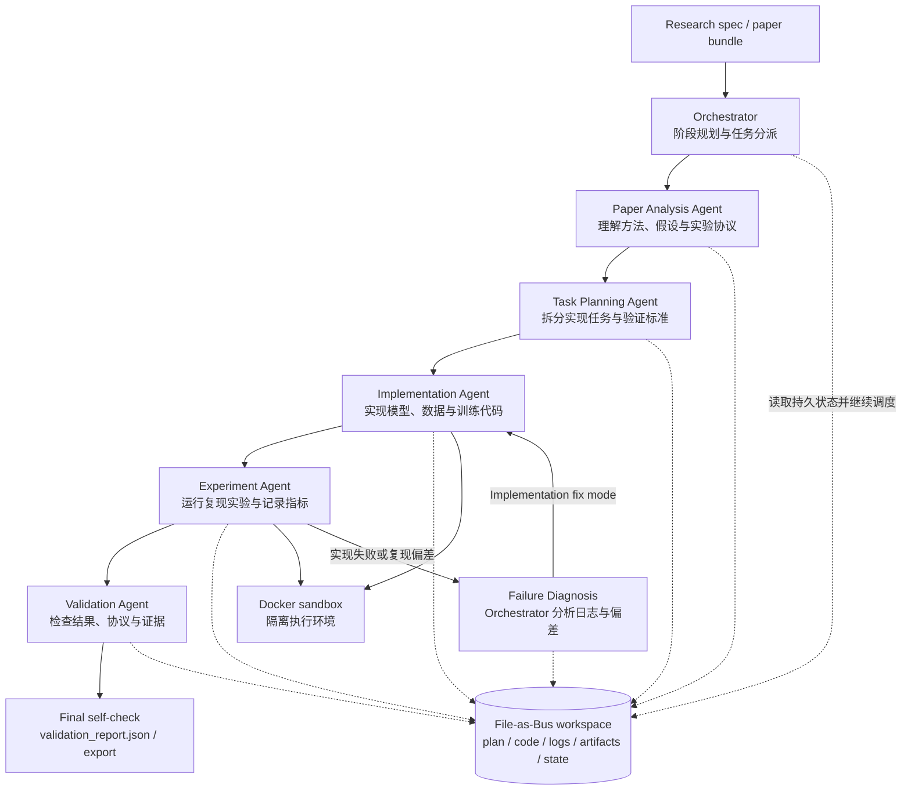
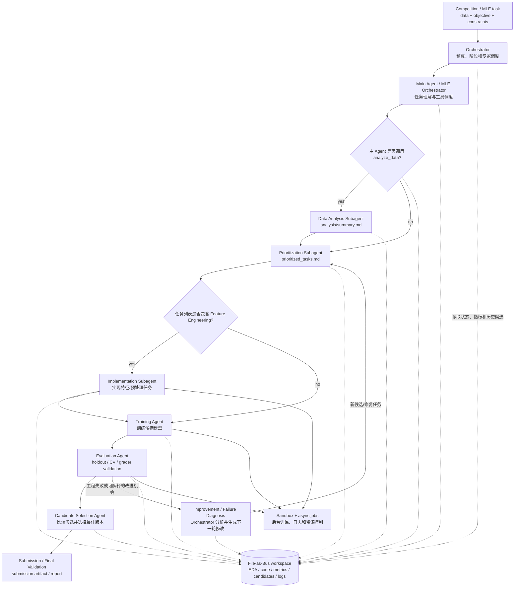
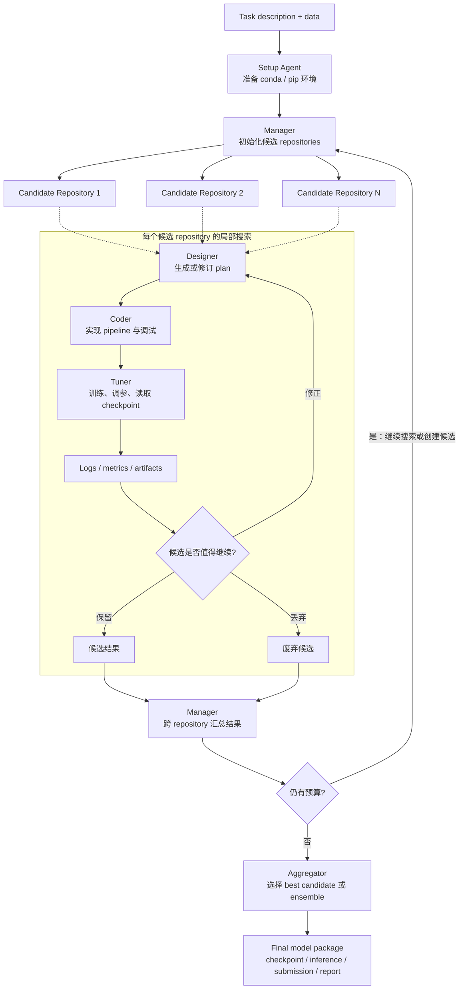
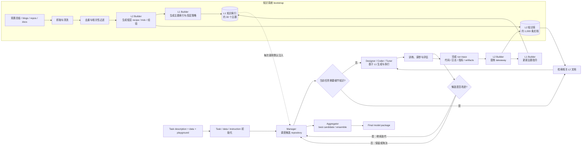

# AutoML / AI Research Agent 架构对比

> 更新时间：2026-08-13。
> 范围：Cobra Agent、AiScientist、orze、AIBuildAI、Argus。
> 目的：整理这些系统的架构，而不是只记录 benchmark 分数。

这四个系统都在做“让 Agent 自动完成 ML / AI 研究工程”，但层次不同：

- **Cobra Agent**：面向 MLE-Bench / Kaggle 式任务的端到端 ML engineering agent。
- **AiScientist**：面向长程 ML research engineering 的多智能体研究实验室。
- **orze**：GPU 实验编排和自动研究调度底座。
- **AIBuildAI**：产品化自动建模 Agent，覆盖从任务描述到模型、推理脚本和报告的完整交付。

## 1. 总览

| 系统 | 核心定位 | 主要闭环 | 状态管理 | 执行环境 | 最像什么 |
|---|---|---|---|---|---|
| **Cobra Agent** | 自动 ML 工程 / MLE-Bench agent | dataset + problem -> EDA / pipeline / train / validate / refine / submit | workspace 文件 + 内部验证记录 + 任务管理模块 | Docker / Conda sandbox；`/data` 只读，`/workspace` 可写 | 竞赛型 AutoML Agent |
| **AiScientist** | 长程 ML research engineering | research spec / paper / MLE task -> planning -> implementation -> experiments -> debugging -> validation | **File-as-Bus**；workspace 是 system of record | Docker sandbox + job workspace + logs/artifacts/export/state | 文件总线式虚拟研究团队 |
| **orze** | GPU 实验编排器 / research autopilot 底座 | ideas -> train -> evaluate -> report -> repeat | `ideas.md` + SQLite + `.orze/` runtime state + `orze_results/` | 多机共享目录 + GPU filesystem locks + daemon/watchdog | 实验调度 OS |
| **AIBuildAI** | 自动构建 AI 模型的产品化 Agent | analyze -> design model -> code -> train -> tune -> evaluate -> improve -> package | run directory + candidates + cross-run memory / replay | Linux x86_64；版本化 CLI；playground/data root | 自动建模产品 |

## 2. Cobra Agent

### 2.1 架构定位

Cobra Agent 是一个面向 ML 工程任务的 autonomous agent。输入是 competition description 和 dataset；输出是可提交模型 / pipeline。它强调 human-out-of-loop：不依赖人工干预，也不使用 leaderboard 或 hidden test feedback 来挑模型，而是用 holdout split、cross-validation 等内部验证信号选择候选。

### 2.2 主要模块

| 层 | 模块 | 作用 |
|---|---|---|
| 控制层 | Persistent Iterative Loop | 持续执行 hypothesize -> implement -> evaluate，直到时间预算耗尽或达到强结果 |
| Agent 层 | Autonomous Agent / composable modules | 负责分析、规划和任务拆分；公开页面提到 sub-agent orchestration，但尚不足以确认 EDA、特征工程、训练分别由独立 LLM 子 Agent 执行 |
| 执行层 | Sandboxed Execution | 在隔离 Docker / Conda 环境运行代码；数据目录只读，工作目录可写 |
| 并行层 | Async execution tools | `run_code_async`、`wait`、`check_log`、`stop_process` 支持后台训练、增量看日志和中止任务 |
| 工程模块 | Composable Modules | context summarization、prompt caching、file I/O、task management、sub-agent orchestration |
| 选择层 | Internal validation | 用训练集切分、holdout、CV 等内部信号选择最终提交 |

### 2.3 执行链路

```text
competition description + dataset
  -> sandbox 初始化
  -> EDA / data understanding
  -> 多个 pipeline 候选生成
  -> 后台训练与日志监控
  -> 内部验证 / CV / holdout 对比
  -> 失败修正或新候选探索
  -> 选择最佳 submission
```

### 2.4 三层关系：Agent、控制层和并行执行层

对 Cobra 的架构进行分层时，最好区分三个 plane，而不要把所有自动化都称为 Agent：

```text
Agent / decision plane
  主 Agent：理解任务、制定 pipeline、生成代码、分析结果、决定下一轮
              |
              | tool calls / task requests
              v
Control / workflow plane
  任务状态、依赖、进程生命周期、资源约束、日志和结果索引、停止/重启策略
              |
              | launch / monitor / stop
              v
Parallel / execution plane
  EDA、特征处理、训练、交叉验证、推理等后台进程及其 CPU/GPU 资源
```

因此，控制层和并行层都属于 infra，更准确地说分别是 workflow/control plane 和
execution/data plane；Agent 层是 intelligence/decision plane。控制层并非只有资源调度，
它还要维护任务依赖、进程状态、artifact 和结果协议，因此决定了 Agent 是否可恢复、
可审计和可并发。

### 2.5 并行进程不等于动态子 Agent

官方公开页面明确提到的工具包括 `run_python`、`execute_bash`、`check_log` 和
`stop_process`。主 Agent 可以把长时间训练放到后台，增量查看日志，并根据实时指标
停止或重启进程，以提高 GPU 利用率和整体吞吐量。

公开资料能够确认的链路是：

```text
主 Agent
  -> 生成 EDA / 特征工程 / 训练代码
  -> 启动多个后台 Python 或 shell 进程
  -> check_log 增量查看日志和指标
  -> stop_process 停止异常、低收益或不再需要的进程
  -> 根据内部验证结果修改 pipeline
```

这些并行任务通常是 subprocess、训练 worker 或交叉验证进程，**不等同于动态派生多个
独立 LLM 子 Agent**。截至当前调研，Cobra 的公开页面没有足够证据证明它已经实现了
“EDA Agent、特征工程 Agent、训练 Agent”这样的独立模型会话体系。因此应将“后台并行
执行”和“动态 Agent 派生”分开描述。

如果实现真正的专门子 Agent，所需的不是简单地再打开一个聊天会话，而是：

```text
角色模板 + 任务契约 + 隔离 workspace + 输入/输出 artifact
  + 生命周期管理 + 结果回传协议
```

例如控制层可以把一个特征工程任务表示为：

```json
{
  "task": "feature_engineering",
  "objective": "处理类别变量和缺失值",
  "input_artifacts": ["eda_report.json"],
  "allowed_paths": ["workspace/features/**"],
  "resource": {"cpu": 4, "gpu": 0},
  "success_criteria": ["生成 feature_schema.json", "通过数据校验"]
}
```

控制层负责创建 task record、选择角色和 tool policy、分配 branch/workspace、管理资源和
依赖、收集 patch/metrics/artifact，并在成功后触发下游 Agent。这样派生出来的 Agent 才
不会互相覆盖文件、重复训练或在 resume 时丢失上下文。

### 2.6 Cobra 的完整链路

Cobra 的端到端工作流可以抽象为：

```text
competition description + dataset
  -> sandbox 初始化（/data 只读，/workspace 可写）
  -> problem analysis
  -> model / pipeline design
  -> code generation
  -> EDA、特征工程、训练和验证任务
  -> 后台并行执行、日志监控、进程控制
  -> holdout / cross-validation 等内部验证
  -> 结果分析与失败诊断
  -> pipeline refinement
  -> candidate selection
  -> submission package
```

展开为控制时序：

1. 主 Agent 读取竞赛描述和数据，理解目标、字段、指标及约束。
2. 主 Agent 设计数据处理、特征、模型和验证方案，并生成可执行代码。
3. 控制/执行层启动 EDA、特征处理、训练、CV 或 ensemble 等后台进程。
4. 主 Agent 通过日志和内部指标观察运行状态；控制层负责资源、停止、重启和失败处理。
5. 主 Agent 根据 holdout/CV 结果修改 pipeline，重复实验迭代。
6. 控制层保存代码、日志、指标和候选产物，最终选择并打包 submission。

Cobra 的公开描述强调内部 holdout 或 cross-validation，而不是依赖隐藏测试集或线上
leaderboard feedback 指导搜索。因此它更接近竞赛型自动建模闭环，而不是带外部评审池的
长程科研工作流。

### 2.7 与 Famou Loop 的映射

| Cobra | Famou Loop |
|---|---|
| 主 Agent | IdeaAgent + ImplementAgent / Actor |
| 工具调用 | Agent adapter / tool runtime |
| 后台训练进程 | Experiment worker |
| `check_log` | worker heartbeat、日志和状态读取 |
| `stop_process` | cancellation、deadline 和 stop protocol |
| 内部验证 | trusted evaluator / Evaluation Pool |
| workspace 文件 | branch、artifact、trajectory、ExpBank |
| 任务管理模块 | AsyncOrchestrator、queue、lease、resume |
| candidate 迭代 | Ideaspark -> Implement -> Evaluation -> leaderboard |

Cobra 更接近 **agent-centric orchestration**：主 Agent 通过工具驱动后台任务；Famou
则显式建模了 **queue-centric / durable workflow orchestration**：Ideaspark、Implement
Queue、Benchmark Attempt Queue、Evaluation Queue 和 ExpBank 都是可恢复状态。Famou 可以
吸收 Cobra 的后台并行和日志驱动控制，同时保留队列 lease、trusted evaluation、审计和
任务级 resume。

### 2.8 借鉴点

Cobra 的关键不是“有很多 Agent”，而是把长时间训练任务做成异步可控资源：后台训练、日志观察、早停、重启和 GPU 利用率都进入 Agent loop。这对 Famou 的 benchmark-managed 模式很有参考价值。

## 3. AiScientist

来源：论文 [Toward Autonomous Long-Horizon Engineering for ML Research](https://arxiv.org/abs/2604.13018)；官方代码仓库 [AweAI-Team/AiScientist](https://github.com/AweAI-Team/AiScientist)。

### 3.1 架构定位

AiScientist 来自论文 **Toward Autonomous Long-Horizon Engineering for ML Research**。它把任务定义为 long-horizon ML research engineering：把不完整的研究目标转成可运行、可实验验证的 ML 系统。论文的核心架构主张是 **thin control over thick state**：控制层保持轻，状态层保持厚。

### 3.2 核心设计

| 层 | 模块 | 作用 |
|---|---|---|
| 控制层 | Orchestrator | 做阶段级决策，避免把所有细节塞进单一上下文 |
| Agent 层 | Hierarchical Research Team | 顶层 Orchestrator 调用 specialists / focused subagents，形成层级研究团队 |
| 协调层 | File-as-Bus | 不靠对话消息交接，而是通过 workspace 文件传递计划、代码、实验和验证信息 |
| 状态层 | Workspace as System of Record | workspace 是 durable source of truth，后续 Agent 按需读取 |
| 执行层 | Docker sandbox | 将 workspace 挂到容器标准路径，隔离运行代码 |
| 审计层 | logs / artifacts / export / state | 保留可检查、可恢复、可验证、可导出的完整运行记录 |

### 3.3 两条 Track

| Track | 输入 | 优化目标 | 验证出口 |
|---|---|---|---|
| `paper` | paper markdown 或 bundle | 论文理解、复现计划、实现、实验、debug、self-check | `validation_report.json` 和 final self-check |
| `mle` | competition zip / data dir / prepared workspace | 多轮实现和实验，提升目标指标 | submission-format 或 grader validation |

下面两张图是根据 AiScientist 论文和公开仓库抽象出的 **职责 DAG**，用于表达 Agent 如何分工和交接产物；它们不是项目内部未公开的精确调用图。两条 Track 共享 Orchestrator、File-as-Bus workspace 和 Docker sandbox，但研究目标、专家 Agent 和最终验证出口不同。

#### `paper` Track：论文复现与验证 DAG



`paper` Track 的核心链路是“理解论文 -> 形成可执行计划 -> 实现 -> 复现实验 -> 验证”。
这里的 `Failure Diagnosis` 不是 AiScientist 公开代码中单独注册的固定 Agent 类型，而是
Orchestrator 根据实验结果进行诊断后，重新调用 `Implementation Agent` 的 `fix` 模式。因此图中的主路径是 DAG，实际运行会在该 DAG 上按失败结果重复某些阶段。

#### Debug 触发、输入与修改边界

Debug 不是定时器无条件触发，也不是 evaluator 发现任意低分后就启动一个新 Agent。典型触发链路是：

```text
Experiment Agent / run_experiment
  -> 读取 stdout、stderr、退出码、产物和 metrics
  -> Orchestrator 判断是否存在可修复的工程错误或复现偏差
  -> 整理诊断 context
  -> Implementation Agent(mode="fix", context=diagnosis)
  -> 修改 workspace 中的实现并重新实验
```

常见触发条件包括：

- 代码异常退出、traceback、命令超时或资源/依赖配置错误；
- 产物缺失、格式不正确、`reproduce.sh` 无法从干净环境运行；
- 指标计算失败、结果为 NaN，或实现与论文描述的算法/实验协议明显不一致；
- 实验已经完成但暴露出可以定位的实现缺陷，需要修复后重新验证。

Implementation Agent 在 `fix` 模式中主要修改：

- `workspace/code/` 下的模型、数据处理、训练和推理代码；
- `workspace/submission/reproduce.sh` 及必要的依赖/环境配置；
- 必要时更新 `workspace/agent/plan.md`、`impl_log.md`，记录修复原因和验证计划。

它不会把失败的实验日志或官方评测结果改写成成功，也不应修改论文原文、rubric、
官方 evaluator 或历史 artifact。修复后的代码必须重新运行实验；如果只是科学上确实得分较低、
但工程和协议都正确，这属于有效负结果，应该进入下一轮研究决策，而不是被当作 bug 强行修复。

#### `mle` Track：数据建模与提交 DAG



`mle` Track 的本地实现链路更准确地表示为“主 Agent -> 可选数据分析 -> 任务优先级 -> 实现 -> 实验 -> 选择并提交”。
这里的 `Data Analysis Subagent`、`Prioritization Subagent`、`Implementation Subagent` 和 `Experiment Subagent`
是代码中的职责；Feature Engineering 不是单独注册的 Agent，而是可能被 Prioritization Subagent 写入
`prioritized_tasks.md` 的一种任务，之后由 Implementation Subagent 实现。图中的 Agent 节点表示职责边界，
不能简单理解为每个节点都一定对应一个独立的 LLM 会话。

#### 数据分析与特征工程：AiScientist 代码中的真实边界

下面是对本地 AiScientist 代码的事实描述，不把额外的 Famou 设计建议冒充为 AiScientist 已有能力。

**数据分析。** 主 Agent 通过 `analyze_data` 工具显式 dispatch `DataAnalysisSubagent`；代码描述它
分析 competition data，并生成 `/home/agent/analysis/summary.md`，后续 subagent 会读取这个摘要。
它的工具是 shell、文件读取、文件搜索和文件编辑，代码没有 `eda_quality` 这个独立质量判定器，
也没有看到自动把分析结论标为 `pass` / `reject` 的验证状态。因此，分析报告主要是 LLM 生成的
File-as-Bus 上下文，后续 Agent 会使用，但不是经过独立可信校验的事实层。

**特征工程。** 代码中没有 `FeatureEngineeringSubagent`。`prioritized_tasks.md` 的模板把
“Feature Engineering”列为 P1 任务示例，Implementation Subagent 根据任务列表和数据分析结果自行
修改 pipeline/代码；Experiment Subagent 再运行实验并记录结果。也就是说，它的产出不是一个由独立
特征 Agent 验收的标准 feature artifact，而是实现 Agent 修改后的代码、候选 `submission.csv`、实验日志
和指标。

**真实的使用和评测链路。**

- 数据清单、文件大小、样本数、字段/schema、数据类型和缺失值统计；
- 目标分布、类别不平衡、异常值、重复样本和 train/test 分布差异；
- 潜在标签泄漏、切分风险、时间/实体分组约束和数据质量问题；
- 面向任务的 EDA 报告、结构化摘要，以及对 baseline、资源和后续实验的建议。

对图像、文本、点云、科学模拟或已有数据管线的任务，EDA 可能被领域专用检查、代码库分析、
数据 loader smoke test 或直接的 baseline experiment 替代。最小产物可以只是一个 schema/quality
报告；不应为了形式上的 EDA 生成没有决策价值的图表。

代码中没有独立的 `FeatureEngineeringSubagent`。`prioritized_tasks.md` 模板把
“Feature Engineering”列为 P1 任务示例；如果任务列表包含它，Implementation Subagent 会根据任务
列表和数据分析结果修改 pipeline/代码，Experiment Subagent 再运行实验并记录结果。
因此 AiScientist 的实际产物是实现代码、候选 `submission.csv`、实验日志和指标，而不是由独立
Feature Engineering Agent 验收的标准 feature artifact。

如果 Famou 将 Feature Engineering 做成显式模块，常见产物才可以包括：

- 可复用的特征/预处理代码或配置，以及训练和推理一致的 transform；
- `feature_schema`、特征名称/类型、版本和来源 lineage；
- 变换后的数据索引或可重建缓存，而不是默认复制一份不可追踪的大数据集；
- 特征质量检查、缺失值/范围约束、train-inference consistency 测试和资源说明。

对端到端图像/文本模型、已经提供 representation 的 benchmark、kernel/system 优化或纯代码修复任务，
这个任务可以完全跳过，或者由 tokenizer、data loader、augmentation、embedding、simulation adapter 等
领域模块承担。无论是否经过数据分析或显式特征工程，最终都必须产出可执行 pipeline、候选 submission
和评测所需 artifact。

#### 产物如何评测与使用：AiScientist 事实与 Famou 建议分开

下面先说明本地 AiScientist 代码实际做了什么，再单独标出 Famou 可以新增的质量门禁。不能把后者
当成 AiScientist 已有能力。

```text
原始 benchmark 数据 / 任务契约（只读）
        |
        +--> Data Analysis Subagent（主 Agent 可选调用）
        |      -> /home/agent/analysis/summary.md
        |
        +--> Prioritization + Implementation Subagent
               -> prioritized_tasks.md 中的特征任务（如有）
               -> pipeline/代码 + submission.csv
                              |
                              v
                    Training Candidate
                              |
                              v
                    final validation / benchmark grader
                              |
                              v
                     score / validity / artifacts
```

**AiScientist 当前如何评测。** `analysis/summary.md` 本身没有 `eda_quality` 评分；本地代码没有
为数据分析报告提供独立 deterministic quality gate。报告是否有用，主要由后续 Prioritization、
Implementation 和 Experiment 阶段间接体现：能否生成有效 submission、实验是否成功，以及最终
validation/benchmark grader 的结果。

对应的本地源码证据是：`src/aisci_domain_mle/orchestrator.py` 注册并 dispatch
`analyze_data`、`prioritize_tasks`、`implement`、`run_experiment` 四类工具；
`src/aisci_domain_mle/subagents/analysis.py` 将数据分析结果写入
`/home/agent/analysis/summary.md`；`src/aisci_domain_mle/subagents/prioritization.py` 将任务写入
`/home/agent/prioritized_tasks.md`；`src/aisci_domain_mle/subagents/implementation.py` 和
`experiment.py` 分别负责代码修改和实验运行。`src/aisci_domain_mle/prompts/templates.py` 的优先级模板
把 Feature Engineering 列为 P1 示例任务，但这不等于存在独立 Feature Engineering Agent。

**Famou 可新增的 EDA 质量门禁（设计建议，不是 AiScientist 现状）。** 可以由非 LLM 的
deterministic checker 重新扫描原始数据并与报告交叉核对，至少检查：

- 文件、样本数、字段、dtype、缺失值、重复样本和目标列是否与实际数据一致；
- train/valid/test 的样本 ID 是否重叠，是否违反任务规定的时间、实体或 group split；
- 报告是否读取了禁止路径、hidden label 或 evaluator 私有文件；
- 报告引用的统计结果是否带有输入文件 hash、扫描时间、代码版本和随机种子；
- 关键结论能否由可重跑的脚本或结构化检查复现。

检查结果可以是 `pass`、`pass_with_warnings` 或 `reject`。只有通过检查的摘要才进入
Pipeline 规划上下文；被拒绝的报告仍保留作审计证据，但不能驱动自动生成的特征或训练配置。

**Famou 可新增的 Feature Engineering 质量门禁（设计建议）。** 特征实现首先按代码和数据变换
评测，而不是只看它是否生成了一个文件：

- schema、dtype、行数、主键和缺失值约束保持一致；
- transform 的 `fit` 只能使用允许的训练数据，不能拟合 hidden test、future label 或验证集标签；
- train/inference 使用同一版本的 transform，重复运行能得到相同或有明确容差的结果；
- 对空值、异常范围、重复输入、未见类别和边界样本做单元/性质测试；
- 记录原始输入 hash、split policy、代码 commit、配置、输出 hash 和 feature lineage；
- 通过小规模 smoke test 后，再用统一 baseline 做 A/B 实验，最后由 trusted evaluator 评估冻结 Candidate。

Feature Engineering 不应直接覆盖原始数据。生成的缓存应是可删除、可重建、带 manifest 的派生
artifact；训练任务引用的是 transform 版本和 manifest，而不是一个没有来源的 `features.csv`。

**如何使用。** 在 AiScientist 中，数据分析摘要主要供主 Agent 和后续 subagent 选择模型、任务优先级
和实验方案；特征工程如果被列入任务，则由 Implementation Subagent 写入 pipeline，Experiment
Subagent 运行并记录结果。最终 validation/benchmark grader 才决定候选是否有效以及分数，不能来自
Data Analysis Subagent 或 Implementation Subagent 自报。

**会不会污染？AiScientist 当前确实存在这种风险。** 错误的数据分析可能影响任务排序和实现方向，
特征实现也可能引入未来信息、train/test 泄漏或脏缓存。当前代码能确认的边界主要是：

1. 提示词要求竞赛数据位于 `/home/data/` 且不要修改这些文件；
2. 主 Agent 通过 `analyze_data`、`prioritize_tasks`、`implement` 和 `run_experiment` 组织闭环；
3. 最终 validation/benchmark grader 负责候选有效性和正式评分。

如果 Famou 要达到更强的 fail-closed 语义，还需要显式实现 provenance、数据泄漏检查、派生 artifact
manifest 和 deterministic preflight；这些不能宣称是 AiScientist 当前已有能力。低质量分析不会直接写入
官方分数，但可能通过后续代码和 submission 间接影响最终结果。

### 3.4 File-as-Bus 目录模型

```text
jobs/<job_id>/
├── input/
├── workspace/                  # Agent 可见的 File-as-Bus
│   ├── paper/ or data/
│   ├── code/
│   ├── submission/
│   │   ├── submission.csv
│   │   ├── submission_registry.jsonl
│   │   └── candidates/
│   └── agent/
│       ├── paper_analysis/ or analysis/
│       ├── prioritized_tasks.md
│       ├── plan.md
│       ├── impl_log.md
│       ├── exp_log.md
│       └── final_self_check.{md,json}
├── logs/
├── artifacts/
├── export/
└── state/
```

### 3.5 借鉴点

AiScientist 最值得借鉴的是“文件就是总线”。长程科研 Agent 最大问题不是一次推理不够强，而是跨阶段状态丢失、结论不可审计、后续 Agent 不知道前面为什么这么做。File-as-Bus 把计划、实现、实验、日志、候选、验证报告都落盘，天然支持 resume、diff、audit 和多 Agent 协作。

## 4. orze

### 4.1 架构定位

orze 不是单个科研 Agent，而是 GPU experiment orchestrator。它的主循环是：

```text
schedule ideas -> train -> evaluate -> report -> repeat
```

它把 ML research 中最工程化、最容易失控的部分抽象出来：GPU 排队、多机锁、实验队列、metrics contract、leaderboard、失败分析、通知、dashboard 和 watchdog。

### 4.2 免费版核心架构

官方 README 将开源包称为 `orze (free)`：它采用 Apache 2.0 许可证，并明确说明核心 orze
持续免费开源。免费版不是演示版，已经包含完整的实验编排和运维能力。

| 层 | 模块 | 作用 |
|---|---|---|
| 配置层 | `orze.yaml` | 项目配置的 single source of truth |
| Idea 层 | `ideas.md` + SQLite | 实验队列；SQLite 支持大规模调度 |
| 执行契约 | `train.py` contract | 每个 idea 以标准参数调用训练脚本 |
| 结果契约 | `metrics.json` | 每个实验必须输出结构化指标 |
| 资源层 | GPU filesystem locks | 多机共享目录下协调 GPU 使用 |
| 运行态 | `.orze/` | logs、locks、receipts、heartbeats、triggers、feedback 等 |
| 输出层 | `orze_results/` | 每个 idea 的 metrics、generated methods、knowledge |
| 运维层 | dashboard / notifications / watchdog | 实时查看、Slack/Telegram 通知、自动重启 |

官方功能矩阵中，免费版已经包括 GPU scheduling、multi-node、SQLite idea queue、超参数网格展开、
leaderboard、plateau/回归/失败分析、Smart Suggestions、通知、Admin dashboard、MCP server、watchdog、
失败率保护、OOM 检测、stale job 恢复、sealed evaluation 和 immutable ideas。

Smart Suggestions 会在实验停滞时继续尝试参数变体，所以免费版也能持续保持 GPU 忙碌；
但它不会像 Pro 那样由 LLM 自主修改 `train.py`。

### 4.3 Pro 版 Agent 层

`orze-pro` 是私有、商业许可的附加产品，在免费版能力之上增加 autopilot。官方当前公开功能矩阵
能够确认以下增量：

| Pro 增量 | 官方描述 |
|---|---|
| FSM autonomous research agent | 自动维护长程研究阶段和决策循环 |
| Visual Reasoning | 自动分析 plot 和 chart |
| Code Evolution | LLM 根据实验结果修改训练脚本，而不只调整参数 |
| SOP Library | 面向系统化研究流程的可复用 SOP |

概念上的 Pro 循环是：

```text
inspect history -> decide next research action -> evolve code/config -> run -> analyze -> repeat
```

Pro 需要 Gemini/OpenAI/Anthropic API key，免费版不需要 LLM API key。官方开源 README 没有把 Pro
内部实现定义为固定的 `Research Agents / The Professor / Engineer / Meta-research` Agent 拓扑，因此
这里不再把这些角色写成已确认事实；更细的 Agent 结构需要以私有 Pro 代码或官方技术文档为准。

### 4.4 Free / Pro 区别

| 问题 | orze 免费版 | orze-pro |
|---|---|---|
| 核心定位 | GPU 实验编排器 | 自主研究 autopilot |
| GPU 调度与多机 | 包含 | 包含 |
| Idea queue、sweep、leaderboard | 包含 | 包含 |
| Dashboard、通知、watchdog | 包含 | 包含 |
| 停滞后的处理 | Smart Suggestions 尝试参数变体 | Code Evolution 由 LLM 修改训练脚本 |
| Visual Reasoning / SOP | 不包含 | 包含 |
| LLM API key | 不需要 | 需要 |
| 许可证 | Apache 2.0 | 商业许可 |

所以“免费版 vs Pro”主要不是实验数量或 GPU 数量限制，而是“可靠实验编排器 vs 自主研究
autopilot”的能力边界。

### 4.5 标准项目布局

```text
your-project/
├── orze.yaml
├── train.py
├── ideas.md
├── GOAL.md
├── RESEARCH_RULES.md
├── configs/base.yaml
├── ORZE-AGENT.md
├── ORZE-RULES.md
├── .orze/
│   ├── logs/
│   ├── locks/
│   ├── receipts/
│   ├── triggers/
│   ├── heartbeats/
│   └── feedback/
├── procedures/
├── fsm/runner.py
└── orze_results/
    ├── idea-0001/metrics.json
    ├── methods/
    └── knowledge/
```

### 4.6 借鉴点

orze 的价值在“Agent 不应该直接管理 GPU 细节”。科研循环需要一个稳定实验 OS：标准 metrics、失败保护、排行榜、资源锁、心跳、通知、自动重启、sealed eval protection。Famou 如果接 benchmark 长任务，可以把 Loop 和 resource scheduler 解耦，Agent 只提交 idea / patch / run request，调度器负责执行和证据。

## 5. AIBuildAI

来源：官方代码仓库 [aibuildai/AI-Build-AI](https://github.com/aibuildai/AI-Build-AI)；v1 论文 [arXiv:2604.14455](https://arxiv.org/abs/2604.14455)；v2 论文 [arXiv:2605.27873](https://arxiv.org/abs/2605.27873)。

### 5.1 架构定位

AIBuildAI 是产品化自动建模 Agent。输入是 task description、数据目录和 playground；系统自动分析问题、设计模型、写代码、训练、调参、评估并迭代提升模型，最后产出 checkpoint、推理脚本、submission 和进度报告。

### 5.2 v1 技术方案：多仓库并行搜索 + 四层代理分工

v1 的核心思想不是“单个 agent 反复试”，而是把一次建模任务拆成多个并行候选仓库，让 manager 在仓库之间做长程调度。它的关键结构是：

| 组件 | 职责 |
|---|---|
| `setup agent` | 在初始化阶段准备 conda / pip 环境，确保依赖可用 |
| `manager` | 顶层控制器，遍历多个候选仓库，决定何时调用哪个 sub-agent |
| `designer` | 产出或修订 `plan`，决定模型结构、数据处理和训练策略 |
| `coder` | 把 `plan` 写成可执行代码，并在仓库内调试 |
| `tuner` | 根据日志、指标和 checkpoint 做训练配置优化 |
| `aggregator` | 在终止阶段选择最强仓库或做 ensemble，输出最终提交 |

v1 的运行机制可以概括成：

```text
task description
  -> setup agent 配环境
  -> manager 初始化多个 repository
  -> designer 生成 plan
  -> coder 实现 pipeline
  -> tuner 运行训练并改配置
  -> manager 读取各 repo 的 logs / results
  -> 继续修正、保留或丢弃 candidate
  -> aggregator 选 best candidate 或 ensemble
```

#### v1 运行流程图



图中每个候选 repository 都有自己的代码、日志、模型和局部上下文；Manager 只在候选之间传递压缩后的状态和选择信号，Aggregator 在最终阶段统一收口。

v1 的设计重点有三个：

1. **把上下文切开**：manager 只保留压缩后的控制信息，细节放进各自 repository。
2. **把搜索并行化**：多个 repository 可以同时推进，不把所有希望压在单一路线。
3. **把最终收口独立出来**：aggregator 只负责最后合并，不回头改中间候选。

v1 仍然主要依赖基础 LLM 能力和一般 web search，知识更多是“临时检索 + prompt 里带进去”，还没有后来的显式知识系统。

### 5.3 v2 技术方案：在同一骨架上加知识系统

AIBuildAI-2 没有推翻 v1 的骨架，而是在相同的 `setup / manager / designer / coder / tuner / aggregator` 结构上，引入了一个可检索、可演化的知识系统。

| 层级 | 内容 | 作用 |
|---|---|---|
| L1 | 大约 30 个主题类别的高层知识索引 | 给每个任务提供全局导航和高层策略 |
| L2 | 大约 1,000 条低层知识文档 | 存具体 recipe、trick、模型选择和数据处理经验 |

这个知识系统的工作方式是：

1. **每次调用默认带 L1**。L1 像总目录，给 Agent 一个全局地图。
2. **按需加载 L2**。只有当当前任务需要更细的方案时，才检索对应的低层文档。
3. **由 builder 持续进化**。`L2 builder` 从执行轨迹、外部网页、竞赛 write-up、代码仓库里抽取新知识；`L1 builder` 再把这些低层知识压缩回对应主题的高层指令。

v2 的 bootstrap 和更新逻辑可以理解成两段：

```text
bootstrap:
  crawled docs / blogs / repos
    -> dedup + relevance filter
    -> L2 builder 生成低层知识
    -> L1 builder 生成高层索引

post-run / online update:
  completed run trace
    -> L2 builder 提炼 takeaway
    -> L1 builder 更新主题指令
```

更新来源不只包括自己的运行轨迹，还包括持续抓取的新竞赛总结、博客、库更新和代码仓库，所以它是一个**会积累经验的知识系统**，不是静态知识库。

#### v2 知识增强与运行流程图



与 v1 相比，v2 的新增部分不是改变候选搜索骨架，而是给每次调用提供 L1 导航、按需检索 L2 细节，并把 run trace 转换为后续可复用知识。

### 5.4 架构链路

```text
task.yaml / CLI flags
  -> task / data / instruction / playground 初始化
  -> problem analysis
  -> model design
  -> code generation
  -> training
  -> hyperparameter tuning
  -> evaluation
  -> candidate iteration
  -> final model package
```

### 5.5 v1 / v2 / 之后版本的差异

| 版本 | 架构侧重点 |
|---|---|
| V1 | 四层代理 + 多仓库并行搜索；依赖 web search 和局部上下文，没有显式知识系统 |
| V2 | 在同一代理骨架上加入 L1/L2 知识系统，支持动态检索和 post-run 自我增知 |
| V2 Pro | 账户登录、Pro 运行入口，仍以 CLI flags 为主 |
| V2.5 Max | YAML config、live build dashboard、run replay、cross-run memory、MCP research tools、DeepSeek 支持 |
| Science | 当前最强版本；面向 scientific work，支持从 description 生成任务、paper writing、per-run GPU selection、kernel resource ceilings、resume without editing、OpenAI models |

### 5.6 输出模型

```text
run-output/
├── candidate_1/
├── candidate_2/
├── candidate_3/
├── checkpoint.pth
├── inference.py
├── submission.csv
└── progress.pdf
```

### 5.7 借鉴点

AIBuildAI 更像“自动建模产品”而不是研究框架。它把交付物做得很清楚：最终 checkpoint、独立 inference 脚本、可提交预测、进度报告、run replay、memory。对 Famou 来说，这提醒我们 benchmark agent 的最终产物不应只有日志和分数，也要有可复用的 inference / reproduce / report 包。

## 6. Argus

来源：论文 [Argus: A General-Purpose Agentic Reasoning Runtime for Long-Horizon Tasks](https://arxiv.org/abs/2608.05144)。截至本文更新时间，未找到论文明确指向的官方 GitHub 仓库；搜索结果中的同名仓库不视为 Argus 官方实现。

### 6.1 架构定位

Argus 是一个 general-purpose agentic runtime，不是单点 benchmark agent。它的目标是让 long-horizon reasoning 在一个**固定权重**的 runtime 里持续演化：当证据支持当前路线时坚持，当测量揭示失败、约束或目标写错时 pivot，但所有 pivot 都要经过验证门控。

### 6.2 核心设计

| 组件 | 职责 |
|---|---|
| `Manager` | 锚定任务/战役状态，管理任务分解、阶段切换和高层目标 |
| `Planner` | 选择下一批工作单元，决定当前 mission 的推进方向 |
| `Engineer` | 实现、实验、测量、修复和局部探索 |
| `Reviewer` | 独立审查产物和运行输出，在需要独立审查时给 completion verdict |

Argus 把运行拆成三条平面：

| 平面 | 内容 | 作用 |
|---|---|---|
| Control | scheduling、objective、constraint、verification policy | 管理任务怎么切，不让执行细节污染控制层 |
| Execution | 实际任务执行、实验、代码、工具调用 | 承载 work itself |
| Records | knowledge、event log、artifacts、backlog、budget、daemon、memory | 让状态可持久、可审计、可回滚、可复用 |

### 6.3 关键抽象：bounded missions over durable state

Argus 的基本单位不是无限对话，而是 `bounded mission`。每个 mission 都在一个 durable project state 上运行，完成后把:

- attempted routes
- measurements
- verdicts
- accepted / rejected results
- reusable skills
- verifiers
- routing decisions

写回状态。

这意味着它不是“把 transcript 接着往下聊”，而是“在同一项目状态上分阶段推进”。

### 6.4 任务契约：意图、目标、约束、验证分离

Argus 用一个显式的工作契约区分四件事：

| 变量 | 含义 |
|---|---|
| `iota` | stable user intent，用户真正想保留的方向 |
| `o_t` | 当前 operational objective，本轮要完成的具体目标 |
| `c_t` | 已知 constraints |
| `v_t` | verification criteria |

它的设计重点是：**目标可以被修正，但意图不能被偷偷改写**。因此 pivot 是允许的，但必须有证据，而且要记录下来给后续 mission 继承。

### 6.5 Verification-gated fixed-model self-evolution

Argus 的 self-evolution 不靠微调模型权重，而靠 runtime state 和 control policy 的演化。它的门控逻辑是：

1. 先由 Engineer / Planner 跑出候选路线。
2. 再由 Reviewer 或 task-native verifier 检查证据。
3. 只有通过验证的 memories、skills、procedures、routing decisions 才能进入长期状态。
4. 被否定的路线也会保留，供后续追踪和回收。

这使它更像一个“会积累验证过的工作策略”的 harness，而不是一个简单执行器。

### 6.6 运行机制

```text
user intent + current objective + constraints + verification criteria
  -> Manager 定义 mission
  -> Planner 选下一步
  -> Engineer 执行 / 测量 / 修复
  -> Reviewer or verifier 审核
  -> 通过则写入 persistent state
  -> 失败则 pivot / rollback / rescue
  -> 下一 mission 从更新后的 state 继续
```

### 6.7 论文里的经验结论

论文给出的结论是：这类 runtime 的价值不只在“做成了多少任务”，还在于它能否：

- 维护持续可审计的过程数据
- 在验证失败时恢复或回收路线
- 在长时间任务中积累可复用技能
- 以固定模型权重实现策略层演化

它在多个 arena 上报告了 broad evidence，但作者也强调这些 bars 是 breadth evidence，不是单一归一化 leaderboard。

## 7. 架构差异总结

| 维度 | Cobra Agent | AiScientist | orze | AIBuildAI |
|---|---|---|---|---|
| 控制方式 | 持续迭代 loop + 子 Agent 并行 | Orchestrator + hierarchical research team | daemon / FSM / research agents | 产品化 Agent loop |
| 状态核心 | workspace + validation traces | File-as-Bus workspace | SQLite + ideas.md + `.orze/` + results | run directory + memory + replay |
| 资源管理 | async tools 控制训练进程 | Docker job sandbox | GPU locks、多机、watchdog | per-run GPU selection / resource ceilings |
| 主要反馈 | internal validation / CV | experiment logs + validation report | metrics.json + leaderboard + analysis | evaluation + candidates + progress report |
| 最强点 | MLE-Bench pipeline 搜索效率 | 长程状态保持和审计 | 实验调度、并发和运维 | 自动建模交付体验 |
| 风险 | 仍偏竞赛任务，科学创新较弱 | 架构较重，对文件规范要求高 | 免费版偏调度，Pro 自动研究闭源能力更多 | 产品黑箱较多，内部 Agent 策略不完全透明 |

## 8. 对 Famou 的启发

1. **把 Agent loop 和实验调度分层**：Cobra / orze 都说明训练和评测应由异步执行层管理，Agent 不应阻塞等待长任务。
2. **把状态写成文件协议**：AiScientist 的 File-as-Bus 比对话摘要更适合长程科研；Famou 可以将 candidate、plan、patch、eval、claim、report 都标准化落盘。
3. **用 metrics contract 约束实验**：orze 的 `metrics.json` 思路适合 Famou 的 EvaluationJob，避免每个任务自定义解析。
4. **保留可交付 artifact**：AIBuildAI 的 `inference.py`、checkpoint、submission、progress report 对最终用户更有价值。
5. **区分“刷分 Agent”和“科研 Agent”**：Cobra / AIBuildAI 更偏自动建模，AiScientist 更偏长程研究工程，orze 更偏基础设施；Famou 需要明确自己每条 workflow 属于哪一层。
6. **评测隔离必须前置**：这些系统都强调 sandbox / sealed eval / internal validation / hidden feedback 隔离。Famou benchmark-managed 主路径应默认保持 evaluator 与 Agent 隔离。

## 9. 参考来源

- Cobra Agent project page: https://dalphakr.github.io/CobraAgent/
- AiScientist paper: https://arxiv.org/abs/2604.13018
- AiScientist official repository: https://github.com/AweAI-Team/AiScientist
- orze PyPI: https://pypi.org/project/orze/#description
- orze docs / homepage: https://orze.ai/
- AIBuildAI official repository: https://github.com/aibuildai/AI-Build-AI
- AIBuildAI v1 paper: https://arxiv.org/abs/2604.14455
- AIBuildAI v2 paper: https://arxiv.org/abs/2605.27873
- Argus paper: https://arxiv.org/abs/2608.05144
