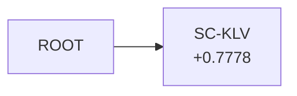

# 设计文档：方案演化图 v2（图结构 + 算子库 + 带海拔的节点）

> 状态：已评审通过，①–⑤′ 已落地；**⑤″（§5 索引换格式）待评审**，⑥ 未派发
> 前序证据：`.famou/naturebench-submit-batches/20260915-idea-graph-ab-10x2/README_CN.md`（A/B 实验）、
> `.famou/naturebench-submit-batches/20260919-deepseek-v4flash-nonmatch-20/README_CN.md` §九（v1 图的谱系审计，见 §1.4）
> 落地进度见 §11

---

## 0. 本次修订在改什么（2026-09-20）

①–⑤′ 已经把图建起来了：节点有分数、有多父、算子受校验、出分即收工。**剩下的问题不在图，在"给 agent 看的那张表"。**

已落地的 §5.0 三段式把分数搬上了图，但「前沿」段里的父节点是一个**十六进制 id 且不带分数**——而这一段的用途恰恰是"我下一步 exploit 谁"。agent 要回答它，必须拿 id 跨行去别的段查分。**这是 `IDEAS.md` / `INDEX.md` 两张半盲表的老毛病换了个尺度重演。**

所以 ⑤″ 改两件事，且**必须在 ⑥ 派发之前**（v8 跑过 run 就只能开 v9，§8）：

1. **§5.2 四段自足格式**——每一行不需要读另一行就能看懂；父节点用**标题 + 分数**称呼，hex id 只在行尾当 grep 把手；「最该接着挖的」**按父节点的最好分降序**，第 1 行就是答案。
2. **§5.1 明确不让 agent 读图**——mermaid 源码同样要跨块 join，退到文件末尾 `<details>` 里供人查看。图的遍历归宿主（确定性算术），判断归 agent。

**没有改的**：§3.1 的 `attempts[]` 与 §7.3 的分数回填保持原样。权衡过换成"渲染时 join、`record.json` 当唯一真相"，结论是⑥ 派发前不值得动——理由与代价完整写在 **§10.12**。

`IDEA_GRAPH_VERSION=v1` 一个字节不变，剪枝（§4.3）、存储去重（§10.13）、权重融合（⑦⑧）本轮都不做。

---

## 1. 背景与问题

### 1.1 上一轮做到哪了

`--idea-graph` 开关已经落地，Idea 图的读写链路在 benchmark 路径上全部接通（六跳贯通，20/20 作业跑完）。该批结论：

> **图接通了，agent 也确实在读，但读完没有改变它的行为，分数也没动。**
> Δ 中位数 +0.0061，符号检验 p=0.7539，10 题**无一走出噪声**（σ=0.2275，最大 0.55σ）。

机制侧是成立的：128 个图节点 vs 对照臂 0 个，23 条"只有看得见兄弟节点才提得出来"的硬证据 vs 0 条，编造引用 0 条 vs 3 条。**读到了，但没用起来。**

最能说明问题的是 `s41587-024-02428-4`：硬证据全批最多（7 条）、链最深（9 层），分数却是 −0.0192。

> 它沿着图挖了九层，**全程没有任何信号告诉它这个方向在变好还是变坏**。

### 1.2 三处结构性缺口

不是 bug，是 schema 本来就这样。

| # | 缺口                           | 证据                                                                                                                                                                                                                          |
| - | ------------------------------ | ----------------------------------------------------------------------------------------------------------------------------------------------------------------------------------------------------------------------------- |
| 1 | **图上没有分数**         | `IDEAS.md` 六列是 `Idea / 标题 / 状态 / 关系 / Parent / Gate摘要`（`storage/idea_graph.py:92`）；`idea_graph.py` 全文 grep `score` **零命中**                                                                 |
| 2 | **一个方案没有唯一身份** | `record.json` **没有 `idea_id` 字段**，只把整个 idea 按值内嵌（`storage/expbank.py:406-431`）。`s42256-025-01003-z`：16 个图节点 / 13 条 attempt / 实际只有 **7 个不同方案**，同一方案两套 id、两套父指针 |
| 3 | **多父在结构上不可能**   | `submit()` 存的是单字符串 `parent_idea_id`（`idea_graph.py:151`），索引也只渲染一个 Parent 列（`:123`）。于是 `combines` 这个值虽然在词表里，写进去也只记得住一个父——**图永远塌成树**                       |

于是 agent 拿到的两张表各缺一半：

|      | `IDEAS.md`（图层）                 | `INDEX.md`（attempt 层） |
| ---- | ------------------------------------ | -------------------------- |
| 结构 | ✅ 每行都有`relation` / `Parent` | ❌ `Parent` 空 **181/342 行（53%）**，且它的边是 attempt→attempt，**与图的 idea→idea 是两套边** |
| 分数 | ❌**一列都没有**               | ✅ 有真分数                         |

> **一处要说准的**：不能说"agent 看不到分数"——它在 `INDEX.md` 和 `benchmark_runtime.previous_best` 里都看得到。准确的说法是**两张半盲表，而且没有 id 级的 join key 能把它们拼起来**（`record.json.idea_id` 实测 20/20 全 null，见 §1.4）。这个区别决定了 v2 该做什么：不是"把分数弄出来"，而是"把结构和分数弄到同一行上"。

我们之所以能画出"节点带分数、带实现次数、带前沿"的全貌，**是因为审计脚本替 agent 拿标题做了字符串 join**。agent 自己拿到的从来不是这张图。

#### 1.2.1 根因：store 的边界是在"还没有分数"的时代划的

`idea_graph.py` 写出来时是个**尚未实现的 idea 的暂存区**——`submit()` 落盘那一刻方案还没实现，分数根本不存在。所以"节点上没有分数"在当时是**正确的**。

后来 attempt 有了分数，但没人回头重划这条边界：`idea_graph.py` 全文**从不 import expbank，也从不打开任何一个 `record.json`**（全文仅有的两处 `ExpBank` 命中是 :32 和 :261 的 docstring）。两个 store 在代码层面就是断开的，**渲染器物理上拿不到分数**。

记这一条是为了说清 v1 的毛病是"诚实地缺"而不是"写错"——它压根没有那条通路。v2 补的就是这条通路（§3.1 的 `attempts[]` + §7.3 的回填）。

### 1.3 两处口径问题

- **算子词表从未定义**。`relation` 的三个取值 `derived_from / alternative_to / combines`，在全部七个版本的提示词里只有一句 `idea_agent_v7.md:16`："明确新 Idea 与已有节点的关系"。词是什么意思、什么时候该用哪个，一个字没写。
- **字段从不校验**。`_valid_idea()`（`agents/workers.py:491-502`）硬要求只有 `title` + `mechanism`；`parent_idea_id` / `relation` **从不校验、从不必填、从不回填默认值**。而且没有任何代码读取或信任 agent 自报的 `relation`——三个值全部由代码路径写入（`runtime/implement_actor.py:325-342`、`orchestrator.py:4778-4779`，行号是 `20260915` 那批当时的代码）。

> 落地更正：`implement_actor.py` 那一处已经改掉了。它原来在 `switch` 时写 `relation="alternative_to"`、在 `fuse` 时写 `relation="combines"`——**这就是那个 44%/63% 分布的主要来源**。现在它只记 `switched_from_idea_id`（换之前在做哪个方案，别处确实查不到），不写任何父指针：`switch` 的语义是"放弃 previous 改做 offered"，offered 早就有自己的节点和 `operator`/`parents`，在这里给它安一个父就是凭空造一条假边。`fuse` 同理只留 `fused_ideas`。
>
> 留下的这两个字段都过了 §3.1 那条规矩：`switched_from_idea_id` 的值由宿主从自己的 `base_idea["id"]`（下一行就要被覆盖）派生，属于**可验证来源**；`fused_ideas` 随 `base_idea` 进 `actor_continuation` 载荷、真的递到 implement agent 眼前（`orchestrator.py:2659`），属于**有运行时消费者**。两条腿各占一条，所以留；`relation` 两条都不占，所以删。
>
> 两个分支都有回归测试卡住（`test_search_policy.py`）：`switch` 断言 `base_idea` 里没有 `parent_idea_id`/`relation`，`fuse` 断言来源累积且幂等、同样不写 `relation`。**这类改动靠 review 看不出来**——重新加回一行 `relation="combines"` 不会让任何东西报错，只会让下一批的算子分布再次变成自报噪声。

所以上一批实测的 `alternative_to` 占比 44%(处理臂) / 63%(对照臂) **不构成任何证据**——词没定义、字段可选，这个分布只是自报噪声。

### 1.4 20260919 批的谱系审计：v1 数据上实测"子不胜父"

脚本 `.famou/naturebench-submit-batches/20260919-deepseek-v4flash-nonmatch-20/audit_lineage.py`（可复跑），20 道题的 v1 图。这批本身测的是换模型（deepseek-v4-flash），图是 v1、**不是** v2 的实验——但它第一次在真实数据上把 §9.3 的主读数算了出来：

- **图内配对（子最好分 − 父最好分）：四棵代表性树合计 30 对，只有 13 对为正。** 基本是抛硬币。与 `20260915`"读了但没用起来"同结论，但这次是**图内配对**测的，不吃跨臂 σ=0.2275 —— **主读数选对了，v1 数据上就能算。**
- **形状与结果相关**：全批唯一的 Match（`s41587-025-02688-8`，+1.0035）来自一条深 3、**层层上升**的链（+0.7778 → +0.9053 → +1.0035）；全批最差（`s41587-025-02585-0`，−0.6397）是深度 1、出度 8 的**纯星形**——提了 9 个方向，一个都没往下走。
- **"提了没做"的节点很多**：每题 3–15 个，`s41592-025-02924-8` 是 31 个节点里 15 个从未实现。这是 §5.2 第 2 段要解决的东西，也说明那一段的排序值不值得较真——**它是全图最长的一段**。
- **图让作弊漂移变得可读**：最深那棵（`s43588-024-00757-7`，深 14）的节点标题按时间读过去，能看见它一路滑向答案重构——那道正是 gpt-5.5 判 invalid 的。**这是支持图的证据。**
- **`record.json.idea_id` 20/20 全为 null**，坐实缺口 #2；反向 join 只能靠 `lineage_id`，而**该字段存的其实是 idea_id，名字有误导性**。

⚠️ **一条实测事实，以及由它引出的一个口径决定**：同一 run 里不同标题的 idea 常常产出**逐字节相同的提交**——agent 写的是"一条基线管线 + 按 idea 开关的门控"，门没点亮就原样重发 anchor（`expbank/0023/code/run.py:1131`：`[proj] NOT lit -> anchor artefact kept byte-identical`）。全批 250 条出分 attempt 只有 207 个不同提交，**17% 逐字节重复**。

**口径决定（2026-09-20）：不按 sha256 去重，按提案计数——只要是新提出的就算新的。** 本批测的是 **agent 的决策行为**（看了图之后会不会沿着有分数的枝往下走），不是产物的多样性。agent 提了一个新方案，那就是一次独立的探索决策；它实现出来的代码碰巧和上一个一样，是**实现环节**的结果，不该倒扣到构思环节的账上。

这个口径的代价要一并登记：配对统计里会有一部分"改了没效果"实际上是"代码根本没变"，**不去重就分不出这两者**。这是**事前知道并接受**的限制，不是事后才发现的偏差——相同分数仍然只是线索，只是本批不再去追它到底是不是同一份字节。

一句话：**图的形状确实携带信息，但 agent 当时看不到能让它选对形状的那一列。** v2 补的就是那一列（§3.1）和读它的方式（§5）。

---

## 2. 设计目标

把"图"从一个**只有拓扑的旁路索引**，升级成一个**带海拔、带产物地址、算子受约束的方案演化 DAG**。

一句话判据：**agent 应该能只看一张表，就知道哪条路走通了、哪个节点还没人挖、以及每个方案的产物在哪。**

### 2.0 目标形态：一个回合从头到尾长什么样

下面这条链是本设计的**权威口径**，后面每一节都只是它的某一段的细节。先看全貌再看细节，否则很容易把某个局部实现当成设计本身。

```
  IdeaAgent 读 GRAPH.md（现在爬到哪了 / 最该接着挖的 / 试过没出分的 / 全部方案，§5.2）
        │
        ├─ 选 operator：innovate（开新方向）/ exploit（挖某个高分节点）/ cross（融合多个节点）
        ├─ 选 parents：与 operator 互相校验（§4）
        ▼
  idea 进 IdeaSpark 队列
        ▼
  ImplementAgent 消费 → 产出方案代码（+ ckpt 落到宿主指定目录，§6）
        ▼
  进评估池跑分
        │
        ├─ 代码有 bug ──► resume **同一个** ImplementAgent 来 debug（上限 3 次，§7.7）
        │                   └─► 修好再进评估池；修不好就是这条路没通
        │
        └─ 出分 ──► **收工**。不 refine、不就地再改一版。（§7.7）
        ▼
  结果记进 ExpBank（按图结构组织：节点 = 方案，attempts[] = 这个方案的多次实现）
        ▼
  回到第一步：想改进就作为一个**新的 exploit 节点**挂到那个已评分的父节点下
```

四条边界，每一条都有一节在守：

| 边界                                           | 为什么                                                                     | 哪一节守                                      |
| ---------------------------------------------- | -------------------------------------------------------------------------- | --------------------------------------------- |
| **agent 选下一步，不是队列层替它选**     | 这是 v2 的全部立论；有第二个决策者就说不清是谁的功劳                       | §7.6（关 search-policy）、§7.7（关 refine） |
| **改进必须外化成一条边**                 | 就地改只在节点内多一条 attempt，图上看不出"往哪走了"，主读数就没有配对可算 | §7.7                                         |
| **debug ≠ 改进**                        | 代码跑不起来和方案不够好是两回事，混在一起会把工程波折读成探索步数         | §7.7、§3.1                                  |
| **宿主给位置和引用，agent 自己产出结果** | 宿主一旦写融合代码或碰分数，产出就不再是 agent 的能力读数                  | §6.1、§6.3                                  |

**`cross` 的融合能力是这条链的终点，不是附属品**：它要能拿多个父节点的提交产物做预测级融合，也要能拿已有的 ckpt 做各种 fusion。这也是 §6 存权重的唯一理由——不存就只能做预测级，跨方向的模型级融合永远没得做。⑦/⑧ 做这一段，⑥ 先只验证图本身。

### 2.1 非目标

- 不替换 v1。v1 是上一批的对照臂配置，必须能一键回去。
- 不做宿主侧的融合逻辑。宿主永远不碰分数、不碰输出。
- 不动提示词里图那段的**位置**（现在在 51–100%）——那是另一个已批准但尚未执行的独立变量，混进来就没法归因。

---

## 3. 数据模型

### 3.1 节点 = 一个方案

写入方标注：**〔A〕**= Agent 写、**〔H〕**= 宿主写、**〔A→H〕**= Agent 声明、宿主校验/纠偏后才落盘、**〔E〕**= 可信 Evaluator（既不经 Agent，也不经宿主加工）。

```jsonc
{
  "schema_version": "evolution-graph-v2",   // 〔H〕
  "node_id": "...",                    // 〔H〕唯一身份；提示词不向 agent 要 id，宿主 setdefault 兜底
  "operator": "innovate|exploit|cross",// 〔A→H〕agent 必填，非法则重提一次、仍非法则 coerce
  "parents": ["..."],                  // 〔A→H〕同上；创新=["ROOT"] / 利用=1个 / 交叉=≥2个
  "root_branch": "...",                // 〔H〕所属方向 = 回溯到的第一层创新节点，宿主算
  "idea": { /* 动机、假设、预期、implementation_plan、risks ... */ },  // 〔A〕整块原样存
  "attempts": [                        // 〔H〕0..n 条：同一方案的多次实现，按 attempt_id upsert
    {
      "attempt_id": "0003",            // 〔H〕
      "status": "...",                 // 〔H〕由 promoted / validity_invalid 推出
      "score": 0.0653,                 // 〔E〕可信 evaluator 的 official_metrics 主指标，原样搬运
      "conclusion": "...",             // 〔H〕**不是 agent 的结论**，是宿主按状态三选一的固定文案
      "paths": { "code": "...", "run": "...", "evaluation": "...", "output": "..." },  // 〔H〕
      "evidence_refs": ["..."],        // 〔H〕宿主登记的 artifact id
      "weights": {                     // 〔A→H〕⑦ 才接线：agent 自己落盘并声明，宿主校验后登记
        "dir": "expbank/0003/weights",
        "files": [{"path": "...", "sha256": "...", "bytes": 123}]  // sha256/bytes 是〔H〕算的
      }
    }
  ],
  "best_score": 0.0653,                // 〔H〕attempts 里有限分的 max
  "status": "...", "actor_id": "...", "goal_contract_version": "...",  // 〔H〕
  "artifact_refs": [], "reviews": [], "admission": {},                 // 〔H〕
  "operator_coerced": false,           // 〔H〕纠偏记账，事前登记的合规读数
  "operator_violations": [], "operator_notes": [],                     // 〔H〕
  "created_at": 0, "updated_at": 0     // 〔H〕
}
```

**顶层不留 `idea_id` / `parent_idea_id` / `relation`。** 这三个曾经作为 v1 兼容镜像存在过，落地时删掉了：

- `submit()` 已经把**完整载荷**原样存进 `record["idea"]`，所以 `idea_id`(=`node_id`)、`parent_idea_id`(=`parents[0]`) 是纯副本，删掉**零信息损失**；agent 自报的 `relation` 仍然一字不动地留在 `record["idea"]["relation"]` 里，只是不再被提升到顶层。
- 代价是实打实的：`relation` 在 v1 里词表从未定义、字段从不校验、**没有任何代码读取**，上一批却拿它的分布（`alternative_to` 44%/63%）写进了结论——而那个分布里有多少其实是宿主代码自己 `setdefault` 填的，从没分开统计过。**自报又无人读的顶层字段会被后来者误当成证据。**
- 规矩：字段要么有明确的运行时消费者，要么值由宿主从可验证来源派生，两条都不满足就不写。不为兼容而兼容。
- 删除时机是"磁盘上还没有任何 v2 run"，迁移成本为零；⑥ 派发之后就不是了。

**回退不静默**：`read_parents()` 仍然兼容 v7 的单父字段（版本阶梯漂移过一次），但命中时 `submit()` 会把 `LEGACY_PARENT_FIELD_NOTE` 记进该节点的 `operator_notes`。v8 下出现即说明某处提示词或调用点没跟上——写在节点上而不是只打日志，是因为日志跑完散在容器 stdout 里，审计脚本没法按节点数出来。

**Agent 只写两样东西**：`idea` 整块，以及 `operator` + `parents` 这两个字段——也就是"方案是什么"和"它是怎么被造出来的"。其余全部由宿主或 evaluator 写。这条边界值得单独说三句：

1. **`attempts[]` 里没有一个字段出自 agent**（`weights` 是 ⑦ 之后的唯一例外）。特别是 `conclusion`：它不是 agent 对实验的结论，而是宿主按 `promoted` / `validity_invalid` 三选一生成的固定文案。看表的人很容易把它当成 agent 的判断。
2. **`score` 走 〔E〕**：从可信 evaluator 的 `official_metrics` 原样搬进来，agent 碰不到，宿主也不做任何换算——与"绝不 host 侧改分"同一条纪律。
3. **`operator`/`parents` 是唯一被校验的 agent 输入**。v1 时代 `relation`/`parent_idea_id` 从不校验、从不必填，字段就此变成自报噪声（§1.3）。所以 v2 里它们标的是〔A→H〕而不是〔A〕：落盘的值可能与 agent 自报的不一致，差异记在 `operator_coerced` / `operator_notes` 里。

**`attempts` 必须是列表。** 这把现在两张表都表达不了的两件事讲清楚了：

- `[]` = **提了没做** → 这是图上的前沿，最该接着挖
- `[失败, 失败, 0.0653]` = **这条路试了三次才通**，不是三个方案

⚠️ **v2 下这几条 attempt 的语义被收窄成"debug"**：从 §7.7 起 `refine_after_evaluation=0`，出分即收工，所以同一节点上的多条 attempt 只可能来自「代码有 bug → resume 同一个 actor 修」（上限 `max_debug_attempts=3`），**不再包含「分出来了、agent 觉得还能更好、就地又改了一版」**。这个区别直接决定主读数能不能读：改进若发生在节点内部，图上只多一条 attempt，看不出"往哪走了"；只有当改进作为一个新的 `exploit` 节点挂上去，Δ = 子 `best_score` − 父 `best_score` 才有配对可算。所以 `attempts` 的长度在 v2 里读作**工程波折**，不是**探索步数**。

### 3.2 虚拟 root

`ROOT` 写成**真实节点文件**（`operator: null, parents: []`），不是一个特判的保留字。

这样"每个节点都至少有一条入边"字面成立，"一个分支代表一个方向" = "root 的每条出边是一个方向"，`root_branch` 可计算，谱系代码也不必为创新节点开特例分支。

### 3.3 身份归一

- `ExpBank.create_attempt()`（`storage/expbank.py:389`）新增可选参数 `idea_id`，写进 `record.json` 顶层。**纯增量**，v1 读者不受影响。
- `expbank/INDEX.md` 在 v2 下增加一列 `Node`（v1 渲染保持原样）。
- 结果：attempt→node 是显式 id，node→attempt 是 `attempts[]`，**双向可 join，不再靠脚本替 agent 拼**。

---

## 4. 算子库

### 4.1 初始三个

| operator             | parents             | 语义                                               |
| -------------------- | ------------------- | -------------------------------------------------- |
| `innovate`（创新） | 恰好`["ROOT"]`    | 提出全新算法，开一个新方向，**不是局部微调** |
| `exploit`（利用）  | 恰好 1 个已存在节点 | 基于某节点（通常是高分节点）做调整                 |
| `cross`（交叉）    | ≥2 个已存在节点    | 参考多个节点、融合它们的优势                       |

算子挂在**节点**上，不挂在边上。有了多父之后，一个交叉节点的身份就是"它是怎么被造出来的"；入边只负责列出父节点。挂边上会出现"三条入边两条写交叉一条写利用"这种无意义状态。

### 4.2 校验：强制，但不丢 attempt

口径是"强制 + 拒绝非法值"。落地为两段，兼顾这一点和"4 小时的作业不能死在一个辅助索引上"：

1. **重提一次**。拿到 idea 后立即校验；非法则把违规原因塞进 `benchmark_runtime.operator_violation`，再调一次 Idea Agent。
2. **仍非法则纠偏并记账**。coerce 到最近的合法形态（父不存在 → `innovate`/`ROOT`；`cross` 只给了 1 个父 → `exploit`），写一条 `decision` artifact，**照常排程**。

> **被 coerce 的条数是必须事前登记的合规读数**——它直接决定"算子分布"那张表能不能当证据用。上一批 44%/63% 的教训就在这里。

**环路在写入时拒绝，不在事后剪枝。** v1 的 `lineage.py:147-161` 是事后剪掉闭环那条边——事后剪等于图里本来就存着脏数据。v2 在写入时就要求：父必须已存在、不得指向自己、不得成环。

校验函数**只有一份**，orchestrator 与 store 共用。`_idea_graph_active()` 的 docstring 已经把这条教训写在那里了（"三个关口靠手抄副本保持同步"）。

### 4.3 明确不做的第四个算子

**剪枝 / 终止**：一个方向跑死了没法标记，图会一直长。按"初始就这三个"本轮不做，但写在这里作为已知待补——不要等到图长到没法读才发现。

---

## 5. 索引：agent 真正读到的那张表

这是本轮改动的**主要目的**，不是附带产物。

> **修订状态：已落地的是下面 §5.0 那版三段式；§5.1–5.5 是 ⑥ 派发前要把它换掉的新版。**
> 改的理由不是"三段式不好看"，而是**⑥ 这一批要测的恰恰就是「agent 看得懂图之后会不会用」，而三段式要求 agent 跨行做 join**——带着它派发，测出来的"没效果"分不清是图没用还是格式没读懂。这是 ⑥ 派发前唯一还该改的东西。

### 5.0 已落地的三段式（将被替换）

```markdown
## 高分榜（最该被「利用」的节点）
| 节点 | 方向 | 最好分 | 试过 | 标题 |
## 前沿（提了没做，最该接着挖）
| 节点 | 方向 | 算子 | 父节点 | 标题 |
## 全图
| 节点 | 方向 | 算子 | 父节点 | 标题 | 试过几次 | 最好分 | 状态 |
```

它把分数搬上了图（缺口 #1 解决了），但留下两个问题：

1. **「前沿」段里的「父节点」是一个十六进制 id，没有分数。** 而这一段的用途就是"我下一步 exploit 谁"——要回答它，agent 必须拿这个 id 回「高分榜」或「全图」段去查分。**一次跨行 join。**
2. **「高分榜」和「前沿」用的是两个不同的排序键**（自己的分 vs 无序），agent 要自己在脑子里把两张表叉乘一遍，才能得出"挂在最高分节点下、还没人做的那个"。

这正是 `IDEAS.md` / `INDEX.md` 两张半盲表的毛病换了个尺度重演——只是这次两半都在同一个文件里。

### 5.1 一条被否掉的方案：不要让 agent 读图

顺着"那就把 DAG 直接画出来"往下走是错的。不是画不出来（原型画出来了，`/tmp/proto_dag.py`），而是 agent 拿到的是 **mermaid 源码**：

```
n945a6135["PROJ-Velo<br/>+1.0035"]     ← 节点声明在一个块
...
n53f36333 --> n945a6135                ← 边在另一个块
```

要知道"PROJ-Velo 的父亲考了多少分"，agent 得先在边表里找 `n945a6135` 的入边，拿到 `n53f36333`，再回声明块查它的标签。**同一个 join，第三次重演**，还额外附赠十六进制 id 和"这条链一共爬了多少"这种要做传递闭包才答得出的问题。

**分工应该反过来：图的遍历归宿主，判断归 agent。**

"哪条链在涨"、"父节点考了多少"、"每一跳涨了多少"、"兄弟之间谁高"——全是确定性算术，宿主几十行代码，而这恰恰是 LLM 最不擅长的活。留给 agent 的是"下一步往哪挖"，那才需要判断。

> 边界画在哪：算"最好的一条链"是**对 evaluator 产出的数字做算术**，宿主可以做（与 §3.1 里 `score` 走〔E〕同一条纪律——搬运和算术可以，换算和判断不行）；判断"这个分支死了该剪掉"是 judgment，宿主不做，也与 §4.3"本轮不做剪枝算子"一致。

### 5.2 新形态：**每一行自足**

两条硬规矩：

1. **任何一行都不需要读另一行才能看懂。** 父节点一律用标题 + 分数称呼，十六进制 id 只挂在行尾当 grep 把手。
2. **每个节点都要有一句话说清它是什么。** 只给标题等于没给——`PROJ-Velo`、`SC-KLV` 这种名字是 agent 自己起的缩写，三个回合之后它自己也认不出来。分数告诉它"这条路走通了"，**一句话描述才告诉它"走的是哪条路"**，缺了后者就没法判断值不值得接着挖。

下面是 8 节点时渲染出来的真实样子（逐字节复制，**列不对齐是有意的**——对齐要按全表最宽的标题补空格，标题一长整段就散了；末尾的 mermaid 块见 §5.4）：

```markdown
# 方案演化图 —— 8 个方案，3 个出过分，最好 +1.0035

每个方案一个节点，节点下面缩进那行是它的一句话说明（全文、实现计划、风险见 `graph/<节点>.json`）。算子：`innovate`（创新，父节点 恰好 ["ROOT"]）、`exploit`（利用，父节点 恰好 1 个已存在节点）、`cross`（交叉，父节点 ≥2 个已存在节点）。

## 现在爬到哪了

最好的一条链（每一跳都在涨，值得继续挖）：
  「SC-KLV」+0.7778  →  「ADV-Kin」+0.9053（+0.1275）  →  「PROJ-Velo」+1.0035（+0.0982）

当前最好：「PROJ-Velo」+1.0035，试过 2 次
  把速度场投影到空间图的切空间上，再用邻域一致性重新加权
  细节：graph/945a6135.json

## 最该接着挖的（提了还没实现，按父节点的最好分从高到低）

1. 「SPL-Adaptive」 父=「PROJ-Velo」(+1.0035)  exploit  —— 挂在全场最好的节点下
   按局部密度自适应选平滑核宽，替掉 PROJ-Velo 里固定的高斯核
2. 「GEO-Velo」 父=「ADV-Kin」(+0.9053)  exploit
   用测地距离代替欧氏距离构建邻域图
3. 「MSA-Velo」 父=ROOT（新方向）  innovate
   多尺度对齐：先在粗粒度聚类上估速度场，再逐层细化

## 试过但还没有分的（2 个；已经失败的别原样重试，还在跑的等结果）

- 「SFD-Velo」 父=「SC-KLV」(+0.7778)  实现 3 次：ENGINEERING_FAILED×3
  用随机微分方程拟合剪接动力学
- 「KLV-Dense」 父=ROOT（新方向）  实现 1 次，还在跑（未出分）
  稠密图上直接解 KL 散度最小化

## 全部方案

- 「PROJ-Velo」 +1.0035  试 2 次  父=「ADV-Kin」(+0.9053)  exploit  [945a6135]
  把速度场投影到空间图的切空间上，再用邻域一致性重新加权
- 「ADV-Kin」 +0.9053  试 4 次  父=「SC-KLV」(+0.7778)  exploit  [53f36333]
  在动力学方程里加平流项，用空间梯度估计输运方向
- 「SC-KLV」 +0.7778  试 3 次  父=ROOT（新方向）  innovate  [c61517ad]
  空间约束的 KL 速度估计，把 spatial_graph 当先验
- 「SFD-Velo」 未出分  试 3 次  父=「SC-KLV」(+0.7778)  exploit  [aa01]
  用随机微分方程拟合剪接动力学
- 「SPL-Adaptive」 未出分  试 0 次  父=「PROJ-Velo」(+1.0035)  exploit  [bb01]
  按局部密度自适应选平滑核宽，替掉 PROJ-Velo 里固定的高斯核
```

注意「没出分」写成 `未出分` 而不是 `0.0000`——**没有分和零分是两件事**，与 §5.5 同一条纪律。

四段各自回答一个具体决策，不是四种排序：

| 段                   | 回答的问题                       | 排序                                          |
| -------------------- | -------------------------------- | --------------------------------------------- |
| 现在爬到哪了         | 有没有一条在涨的链？涨了多少？   | 沿最好链                                      |
| 最该接着挖的         | **我下一步 exploit 谁**    | **按父的最好分降序**——所以第 1 行就是答案 |
| 试过但还没有分的     | 哪些坑别再踩                     | 按实现次数降序                                |
| 全部方案             | 全貌 / grep 落点                 | 按最好分降序                                  |

**「最该接着挖的」按父的分数排而不是按自己**（它自己还没分），是这一段唯一的设计要点，也正是 §5.0 那版缺的那一步：`exploit` 的定义就是"在一个高分节点上做调整"，那么排第一的就该是挂在最高分节点下、还没人做的那个。宿主把叉乘做完，agent 读第一行即可。

**「没跑过」进第 2 段、「跑了没出分」进第 3 段，物理分开**——保留 §5.0 那条纪律（原来是 `—` 与 `无分` 两个单元格值），只是从"两个符号"升级成"两个段落"，理由不变：混了就等于把"还没试"说成"试了不行"，与榜单口径里 `SR` / `CR` 必须分开同理。

⚠️ 第 3 段的「实现 3 次全部失败」在 v2 下读作**工程波折**，不是探索步数——见 §3.1 末尾那条 ⚠️ 与 §7.7。别让 agent 把它误读成"这个方向被试过三种改法了"。

#### 5.2.1 那一句话从哪来：`mechanism`，不加新字段

**用 `idea["mechanism"]` 的首句（或首 N 字符）。**

选它的理由是硬的：`_valid_idea()`（`agents/workers.py:494`）**只强制两个字段——`title` 和 `mechanism`**，缺一不可。所以：

- **保证非空**，不需要兜底分支，也不会出现"有的节点有描述有的没有"这种半残表；
- **不用改 idea schema、不用改提示词要一个新的 `summary` 字段**。新字段 `_valid_idea` 不认，就可能缺；缺了还是要回落到 `mechanism`，那不如一开始就用它。这也守着"不为兼容而兼容"：**能从已有的可验证来源派生，就不新增要 agent 填的字段。**

三条落地细节：

1. **截断是宿主做的〔H〕，必须显式标出来**（结尾 `…`）。一句被切掉一半的 `mechanism` 如果看起来像完整句子，agent 会把半句话当成方案全貌。上限建议 **100 字符**。
2. **每段都给 `graph/<node_id>.json` 的路径**，全文一个 Read 就能拿到。索引里的一句话是**索引**，不是替代品。
3. `mechanism` 是〔A〕——agent 自己写的。它写得烂，这一行就烂，宿主不加工也不改写（与 §3.1 里 `conclusion` 由宿主生成、`score` 走〔E〕原样搬运是同一套写入方标注）。

#### 5.2.2 预算：加了描述还装得下吗

装得下，但**原来这一节按造数据估的 `~10 K` 低了 5 倍**，已按 20260915 真实数据重算（`20260920-graph-v2-ab-10x2/replay_graph.py`，10 题把真实节点重放进 v2 渲染器实测）。

估错的原因很具体：估算里「指标行 ~60 字符」用的是造数据的短标题，而真实标题中位 **250 字符、最长 400+**，且一个父会被它的每个子节点各抄一遍。

实测（9–16 节点/题，`GRAPH.md` 全文字节）：

| | 每节点 | 整文件 |
| --- | --- | --- |
| 最小 | 1084 B | 13.8 KiB |
| 中位 | ~1400 B | **16.9 KiB** |
| 最大 | 1823 B | 26.1 KiB |

按每节点 ~1.4 K 外推到 31 节点约 **40 KiB**——对 200K 上下文仍无压力，所以结论（装得下）不变，只是量级从 10 K 改成 40 K。

已经做掉的两处削减，**收益也是实测的**（`replay_graph.py --budget`，10 题合计 187,503 B 起算）：

| 改动 | 效果 |
| --- | --- |
| mermaid 方框标题截到 60 字（`MERMAID_LABEL_LIMIT`） | 尾块原占正文 **26.6%**，截完中位 19.9 → 17.4 KiB（**−13%**） |
| 父标题截到 100 字（`PARENT_TITLE_LIMIT`）+ 行尾留父 id | 截断省 12,851 B（−6.9%），id 把手花 6,086 B，**净 −3.6%** |

⚠️ 后一条**在 10 题里有 4 题净变大**（`s41592-024-02523-z` +527 B、`s42256-023-00628-2` +664 B 等）：那几题的父标题本来就不到 100 字，一个字没截，行尾 id 成了纯成本。留着不改是有意的——只在真截断时才输出 id 会让格式变成「有时有方括号、有时没有」，agent 读不稳定的格式比多读 3.6% 字节代价大。**这一条是取舍，不是优化空间被漏掉了。**

**真正的失控风险不是描述，是节点数**——所以上限卡在"每节点一句话、100 字符"，而不是"每节点一段"。节点数若日后涨到几百，先动的应该是分段截断（比如「全部方案」只列前 N 个 + 一句"其余见 graph/"），不是砍掉描述。

### 5.3 渐进式披露：索引放一句话，全文留在 `node.json`

索引和详情不是二选一，是**两层**：

| 层 | 放什么 | 谁来写 |
| --- | --- | --- |
| `GRAPH.md` | 每节点一行指标 + 一行**宿主截断过**的 `mechanism`（≤100 字符，超了以 `…` 收尾） | 宿主〔H〕渲染，内容来自〔A〕 |
| `graph/<node_id>.json` | `idea` 整块原样存——`mechanism` **全文**、`implementation_plan`、`risks`、`expected_return`，外加每次 attempt 的细节 | `evolution_graph.py:666,701` 已经这么存了 |

agent 先按索引里那一句判断这个节点值不值得细看，要细节自己 Read 对应的 JSON。这样"每行自足"（§5.2 第 2 条硬规矩）和"索引不许膨胀"两个要求同时满足——**自足指的是"够做出下一步决策"，不是"信息完整"**。

量级：底层约 2.6 MB，索引实测中位 **16.9 KiB**（9–16 节点/题，§5.2.2 给了完整分布；外推 31 节点约 40 KiB），**压缩比约 150:1**。索引里每多一列，150 倍地摊薄真正有用的信息——这也是为什么四段都不做成 markdown 表格：表格逼着每行填满所有列，自足性就得靠宽度换。

### 5.4 mermaid 保留，但放在文件末尾、标明供人查看

```markdown
<details><summary>结构图（供人查看，agent 不必读）</summary>


</details>
```

它对**人**是有用的——`20260919` 那批审计正是靠画出来才一眼看到 `s41587-025-02585-0` 是个 9 节点纯星形（提了 9 个方向一个都没往下走）、`s43588-024-00757-7` 那条 14 层的链一路滑向答案重构。这个价值是真的，只是受众不是 agent。放末尾 `<details>` 里，人展开就看，agent 读到那儿已经拿到全部决策信息了。

⚠️ **原型里发现的 bug，落地时必须修**：节点 id 形如 `46377777` 是**纯数字**，mermaid 会解析失败。统一加 `n` 前缀（`n46377777`）。

### 5.5 渲染时读不出来怎么办

某个节点或 `record.json` 读不出来（写到一半、JSON 损坏）时，**跳过那一行并在该行写明"读不出"，不要整张表不渲染，更不要把它显示成"没跑过"**。这与 §5.2 坚持四段物理分开是同一条纪律：**不确定就说不确定，不许降级成一个看起来确定的状态。**

---

## 6. 权重与融合

### 6.1 链路：宿主给位置，agent 自己存，路径进 node

1. **宿主分配目录**：每个 attempt 一个 `expbank/<NNNN>/weights/`。落在 CFS（`/path/to/workspace`，7.9P 可用）；**不允许落 `/`**（2.0T，已用 77%）。
2. **位置随请求下发**：`benchmark_runtime.weights_dir`，与 `idea_runtime.idea_graph_dir` 同一范式。
   *不做成 `${weights_dir}` 模板变量*——`render_prompt` 是 strict `Template.substitute`，且把绝对路径写死进 md 会破坏"提示词版本化、不原地改"的规矩。
3. **instruction 层告诉 agent 怎么做**：训练产出的 checkpoint 写到 `benchmark_runtime.weights_dir`，并在 `famou_agent_result.json` 里按 `weights: [{path, notes}]` 声明。
   **不要 agent 声明 `framework`**：它自报、没人校验、也没有任何代码消费——正是 `relation` 那条老路（§3.1）。真需要区分格式时由宿主从扩展名/magic bytes 派生一个 `format` 字段，那才是可验证来源。
4. **宿主只登记，不搬运**：读声明 → 校验文件存在且在分配目录内（防路径穿越）→ 记 `sha256` + `bytes` → 写进 node 的 `attempts[i].weights`。

配套：`storage/artifacts.py` 的 `_KIND_DIR` 加 `model_weights` 类别；新增 `register_file(..., copy=False)` **按引用登记**——现有 `save_file` 是 `shutil.copyfile`，GB 级权重不能复制。

`freeze_code` 的 `_CODE_EXCLUDES`（`expbank.py:27-34`）已经排除 `output/`，**保持不动**：权重不该进代码快照，走独立登记。

### 6.2 保留与 GC（一开始就要有，不能先存了再说）

- 单 attempt 上限（默认 2 GiB）：超出则**跳过并记日志**，不静默截断
- run 结束时按 `best_score` 只保留前 k 个 attempt 的权重，其余删除
- 全程写 `weights_manifest.json`，记录保留与删除的决策

### 6.3 融合：宿主不写一行 ensemble 代码

`cross` 节点的 implement 请求里，宿主把父节点的 `paths.output`（提交产物）、`weights.dir`、`paths.code` 一并递过去，**融合代码由 agent 自己写**。

这条边界和"绝不 host 侧改分"是同一条纪律：宿主提供引用和门槛，不生产结果。

**可融合门槛**：该 attempt 有有限分，且状态不在 `{FAILED, ENGINEERING_FAILED}`。

**第一版做预测级融合，不做权重级。** 权重空间融合只在同架构下成立，也就是只在一条 `exploit` 链内部有效；而跨 `innovate` 分支恰恰是最想融合的地方。预测级架构无关、立刻能用，权重存着为后续留路。

---

## 7. 版本切换

**四个独立开关**（原计划两个，§7.6/§7.7 各追加一个），彼此风险与验证方式都不同，所以不合并成一个"v2 模式"总开关：

| 开关                                                 | 管什么                                    | 默认             | ⑥ 取值                               | 出处       |
| ---------------------------------------------------- | ----------------------------------------- | ---------------- | ------------------------------------- | ---------- |
| `IDEA_GRAPH_VERSION`                               | 图写成什么 schema                         | `v1`           | 两臂`v1`/`v2`（**自变量**） | §7.1–7.5 |
| `WEIGHT_STORE`                                     | 存不存 ckpt                               | `0`            | 两臂`0`（⑦ 才接线）                | §6        |
| `PAIRWISE_IMPROVE_SEARCH`                          | 队列层替不替 agent 选下一步               | `1`            | 两臂`0`                             | §7.6      |
| `REFINE_AFTER_EVALUATION` + `MAX_DEBUG_ATTEMPTS` | 出分后还让不让 actor 就地改；debug 给几次 | `1` / 不设上限 | 两臂`0` / `3`                     | §7.7      |

**为什么不合并成一个总开关**：前两个是"写什么"，后两个是"怎么搜"。合并之后，⑥ 一旦读出差异，就分不清是 schema 起了作用还是搜索行为变了——而后两者在 ⑥ 里是**两臂同值的固定项**，正是为了不让它们进自变量。

```
IDEA_GRAPH_VERSION=v1  WEIGHT_STORE=0    # 现状，逐字节不变
IDEA_GRAPH_VERSION=v2  WEIGHT_STORE=0    # 只测图（⑥ 的 arm1）
IDEA_GRAPH_VERSION=v2  WEIGHT_STORE=1    # 图 + 权重融合（⑦/⑧）
```

`_idea_graph_active()` 不动，仍是唯一判据。所以 v2 臂的完整配置是 `IDEA_GRAPH=1 IDEA_GRAPH_VERSION=v2`；`IDEA_GRAPH=0` 时两个版本都不写图。

此外 §7.8 的全量日志**不是开关**——它无条件生效，对 v1/v2 一视同仁。

### 7.1 v1 物理隔离

```
workspace/expbank/
├── IDEAS.md, ideas/*.json     ← v1，一个字节都不动
├── GRAPH.md                   ← v2 索引
└── graph/
    ├── ROOT.json
    ├── <node_id>.json
    └── .graph.lock            ← 沿用 idea_graph.py:46-58 的 fcntl.flock 范式
```

`idea_graph.py` **不被修改也不被 import**。工厂函数 `make_idea_graph(workspace, *, version)` 放在新模块 `storage/evolution_graph.py` 里。

### 7.2 v2 与 v1 同签名——这是低风险落地的关键

orchestrator 里 `idea_graph` 共 **20 个调用点**。只要 v2 把 v1 的八个公开方法签名逐字实现，这 20 处**一行都不用改**：

```
submit / begin_review / admit_without_review / record_review
read / latest_review / link_attempt / record_implementation
```

v2 额外新增（v1 facade 上提供同名 no-op，保证调用点无条件安全）：

```
record_attempt_result(...)   # 分数回填
register_weights(...)        # 权重登记
parents() / frontier() / top_scored(k)
```

### 7.3 分数回填的时序（上一轮留的"未决"）

`20260915` README §七.5 留了一个未决问题："`link_attempt` 回填分数的时序，得确认回填拿不拿得到"。**答案是拿不到**——分数是评测完才出的。

所以分工是：

- `link_attempt`（`orchestrator.py:2723`）建立 node↔attempt 的空壳关联，那时还没有分数
- `record_attempt_result` 挂在评测结果落盘处（`orchestrator.py:4598-4636`，`_primary_metric_spec()` 抽出标量写 `record["score"]` 的地方）补上海拔

重试的多条 attempt 按 `attempt_id` **upsert** 进同一个 `attempts[]`，不新建节点。

> ⚠️ **这一步把分数在磁盘上抄成了两份**（`record.json` 一份、节点 `attempts[]` 一份）。2026-09-20 复审时权衡过改成"渲染时 join、`record.json` 当唯一真相"，结论是 ⑥ 派发前不动——**理由、代价和缓解写在 §10.12**，要动的时机是 ⑦ 之前。

### 7.4 图写失败绝不能杀 run

所有新增写入点沿用 `orchestrator.py:3787` 那条既有纪律：`except Exception` → 只记日志，attempt 照常排程。图是上下文层，不是关键路径。

**渲染侧的对应规矩见 §5.5**：某一行读不出来就把那一行标成"读不出"，不要整张表不渲染，**更不要降级成一个看起来确定的状态**（比如把读不出的显示成"没跑过"）。这一条与 §7.3 那个 `try/except` 是配套的——正因为写入允许静默失败，渲染就必须能说出"我这儿缺了"。

### 7.5 开关贯通六跳

`fmjob` 实际路径是 `famou_scientist/loop/examples/naturebench/fmjob/`（不在仓库根）。

| 跳 | 文件                        | 内容                                                                                                                                             |
| -- | --------------------------- | ------------------------------------------------------------------------------------------------------------------------------------------------ |
| 1  | `submit_one_click.sh`     | `IDEA_GRAPH_VERSION="${IDEA_GRAPH_VERSION:-v1}"`、`WEIGHT_STORE="${WEIGHT_STORE:-0}"`                                                        |
| 2  | 同上                        | 导出`FAMOU_*`，并写进 run-config JSON（`:601-605`，臂标识的唯一可靠来源）                                                                    |
| 3  | `task_entrypoint.sh`      | 转成`--idea-graph-version`、`--weight-store`                                                                                                 |
| 4  | `harness/cli.py`          | `choices=["v1","v2"], default="v1"`（照 `--idea-debate-mode`）；`--weight-store` 用 `BooleanOptionalAction`                              |
| 5  | `harness/runtime.py`      | `HarnessConfig` 字段 + `validate()` 非法值**抛错**（落地更正：这个 dataclass 的既有风格是显式 `validate()`，不是 `__post_init__`） |
| 6  | `runtime/orchestrator.py` | `OrchestratorConfig` 字段 + `__post_init__` 非法值**钳到默认**（宿主层抛错、orchestrator 层钳默认，是这里的既有双重校验风格）          |

落地更正：`WEIGHT_STORE` 这一路**随 ⑦ 一起贯通**，不在 ⑤ 提前铺。提前铺会留下一个
接到底却什么都不做的开关——批次 ⑥ 本来就要求它关着，而一个「设了没反应」的 flag
是事后审计最容易误读的东西。

**默认必须是 v1 + 权重关**：`submit_one_click.sh` 是所有历史批次共用的提交脚本，默认开会静默改变后续一切 run 的行为。

`REFINE_AFTER_EVALUATION` / `MAX_DEBUG_ATTEMPTS`（§7.7）走的是**同一条六跳**，只是第 4 跳分别用 `BooleanOptionalAction`（默认 `True`）和 `type=int, default=None`，第 6 跳 `None` 表示不设独立上限、`0` 是合法值（一次 debug 都不给）——`0` 与 `None` 必须区分开，钳值时不能把 `0` 当成"没设"。默认同样必须是**历史行为**（refine 开、debug 不设独立上限）。

⚠️ 一个已知陷阱：`IdeaGraphStore` 在 `orchestrator.py:364` 是**无条件构造且有副作用**的（会 mkdir 并写空索引）。v2 同理。所以"`GRAPH.md` 是空的"**不能**用来区分两臂——臂标识必须落在 run-config JSON 里（`submit_one_click.sh:604-605` 已有这条警告注释）。

### 7.6 v2 图不与 search-policy 同场（决策）

**`PAIRWISE_IMPROVE_SEARCH` 与 v2 图互斥使用，从 ⑥ 起两臂都关。**

两者都在回答同一个问题——"下一步做什么"——但由不同的人回答：

|                                  | 谁决定                   | 依据                                                                 |
| -------------------------------- | ------------------------ | -------------------------------------------------------------------- |
| search-policy`switch`/`fuse` | **队列层（宿主）** | `_eligible_new_items` 取队首，agent 只在被递到眼前的两条之间二选一 |
| v2 图                            | **agent**          | 自己看`GRAPH.md` 的「最该接着挖的」，选 `operator` + `parents`（§5.2）      |

v2 的全部立论是后者。保留前者会让 agent 的一部分选择其实是被队列层替它做的，主读数（`exploit` 配对）虽不被直接污染，但被稀释。

还有一处**只伤 v2 的不对称副作用**：被 `switch`/`fuse` 消费掉的 idea 永远不会产生自己的 `record.json`，于是它的节点 `attempts` 恒为 `[]`，落进 §5 索引的「前沿（提了没做，最该接着挖）」——**把 agent 指回一条内容已经被吸收掉的方案**。20260915 处理臂实测 128 个节点里 13 个是这么来的，占前沿段 59 行的 22%（`s42256-025-01003-z` 一题 4/9 = 44%）。v1 的 `IDEAS.md` 根本没有前沿段，所以这份伤害是 v2 自己引进的。

关断是干净的：`search/policy.py:140` 一进 `prepare_dispatch` 就 `if not self.enabled: return item`，永不 `lease`；`settle` 拿不到 `search_opportunity`，`normalize_decision` 返回 `None` 直接 ignored。lease / `replay_tail` / `finish_lease` 整条路不会走到。

**因此 `frontier()` 的那个 bug 本轮不修**，记在 §10。代价也写明：Improve 回合的 refine/switch/fuse 三选一整个没了，只剩 refine——这是功能上的减法，不只是去掉一个 bug。

> **更正（§7.7 落地后）**：上面这句"只剩 refine"已经不成立了。关掉 `PAIRWISE_IMPROVE_SEARCH` 只去掉了 switch/fuse，剩下的 refine 是**另一条独立的路**（不走 search_policy），必须另外关。两个开关都关掉，Improve 回合才真正没有。

⚠️ **它必须留档在 run-config JSON 里**。`lease` 不发生时队列里不留任何痕迹，事后看产物无法区分"关了"和"开着但 agent 每次都选 refine"。为此在 `submit_one_click.sh` 的回执里新增了 `pairwise_improve_search` 字段（与 `idea_graph_version` 同一范式：只有调用方显式设过才留档）。

### 7.7 出分即收工：`REFINE_AFTER_EVALUATION=0`（决策）

§7.6 关掉的是"队列层替 agent 决定下一步"。但还剩一条路没关，而且它不归 search_policy 管：

**评测出分之后，`_schedule_actor_continuation(reason="evaluated")` 会让同一个 `ImplementActor` 就地再改一版。** 这是基础版的搜索策略，硬编码在调度器里，`self.search_policy` 一次都没被碰过——所以它不受 `PAIRWISE_IMPROVE_SEARCH` 影响，`search_policy.type` 那个 config 槽位也管不着它（`goal.py:132-135` 至今只接受 `pairwise_improve` 一个值）。

**为什么必须关掉**：主读数是「对每个有已评分父节点的 `exploit` 节点，算 Δ = 子 `best_score` − 父 `best_score`」。就地 refine 产生的是**同一个节点上的第二条 attempt**，不是新节点、没有边、进不了配对。于是"agent 看着分数决定往哪走"这件事在图上根本不留痕迹——而那正是本轮唯一要测的东西。不关的话，agent 越是勤快地就地改，主读数的样本越少。

**但 debug 必须活着。** 用户口径：代码有 bug 要 resume implement agent 来 debug，其余不再 refine。所以这是两个轴：

|                                 | 触发                   | v2 取值                       |
| ------------------------------- | ---------------------- | ----------------------------- |
| refine（出分后就地改进）        | `reason="evaluated"` | **关**                  |
| debug（实现/运行/评测失败后修） | 7 个`repair_reasons` | **开，每方案上限 3 次** |

⚠️ **一个差点踩进去的坑**：本来想靠 `MAX_IMPLEMENT_TURNS=1` 把 refine 压掉，这是错的——`_long_lived_actors_enabled()` 的老判据就是 `turns > 1`，turns=1 会让 actor 整个不存在，**resume debug 跟着一起没**，代码有 bug 的方案直接判死。所以判据改成"refine 关着且 debug 预算不为 0 时，actor 照样长命"；默认路径（`refine_after_evaluation=True`）与改动前逐字等价。

**`max_debug_attempts_per_actor` 是新的一轴，不是和 `max_repairs_per_revision` 重复**：后者每次 `register_candidate` 都会把 `repair_count` 清零（`implement_actor.py:210`），限的是"同一次提交里连修几回"，**从来不限制总次数**。"这个方案一共 debug 了几次"以前没有任何字段答得上来。扣费点在 `begin_turn(repair=True)` 而不是 `add_feedback`——一次失败反馈不等于一次 debug，真正被消耗的是 agent 被再唤醒一次。

**终止原因要分得开**：refine 关掉导致的收尾写 `status=COMPLETED` + `termination_reason="refine_after_evaluation_disabled"`，不写 `EXHAUSTED`。这是设计如此，不是预算耗尽；混在一起，事后审计会把前者读成后者。

⚠️ **同样必须留档在 run-config JSON 里**，理由与 §7.6 逐字相同：没 refine 时队列里不产生 `actor_continuation`，"没 refine"和"有预算但没触发"在产物上长得一样。回执新增 `refine_after_evaluation` / `max_debug_attempts` 两个字段。

⚠️ **它改变了 §3.1 里 `attempts` 的读法**：v2 下同一节点的多条 attempt 只能是 debug 波折，不再是探索步数。

### 7.8 canonical run 的 stdout/stderr 全量落盘

与 §7.7 同批落地，不是同一件事，但同一个动机：**产物里要留得下证据。**

改之前 `result.json` 里只有 `stdout[-3000:]` / `stderr[-1500:]`，**原件不落盘**。一次训练跑几小时，3000 字符大概就是最后二三十行；stderr 只留 1500 更要命——报错的 traceback 一长就被从头切掉，留下一截无头调用栈，事后谁也说不出它到底死在哪。

对照一下同类日志的既有标准：implement-agent 的 CLI stdout/stderr 早就是全量保留的（`agent_runtime.py:407-416`，注释原话"无论成功失败都保留完整 CLI stdout/stderr"），evaluator 侧也是全量（`integrations/evaluator_logs.py:24`）。**只有 canonical run 这一环是截断的**，而那恰恰是唯一真正跑方案代码的地方。

落地：每次 run 在 `run_dir` 下写 `stdout.log` / `stderr.log`。

- 单流上限 `RUN_LOG_MAX_BYTES = 64 MiB`。设上限只为防死循环刷屏写满 CFS，不是为了省空间。
- **切尾不切头**：报错的 traceback 在尾部，日志爆量时最该留下的也是尾部。截断时在文件头写明丢了多少字节。
- `result.json` 新增 `stdout_path` / `stderr_path` / `*_bytes` / `*_truncated` / `run_log_error` —— **"被截断了"本身是读数**，不能靠文件大小去猜。
- 摘要那两截 `[-3000:]`/`[-1500:]` 原样保留（agent 和索引还在用），只是不再是唯一证据。
- **日志写不进去绝不把 run 判死**：`_persist_stream` 吞掉 `OSError`，只把错误记进 `run_log_error`。日志是证据层，不是关键路径——与 §7.4 同一条纪律。

⚠️ **一处必须知道的交互**：`run()` 里有一条产物回退发现分支（命令模板不向 stdout 返回 JSON 时，就在 `run_dir` / `output_dir` 里找"恰好一个文件"当产物）。日志写进 `run_dir` 会让这条判据从"找到唯一产物"变成"找到三个，放弃"。已用 `RUN_DIR_HOST_FILES`（`runner.log` / `result.json` / `stdout.log` / `stderr.log`）排除，并有单测卡住。**这类"加一个文件就把另一个功能弄坏"的改动，靠 review 看不出来，只能靠测试。**

这直接服务一笔旧欠账：历史上有 5 个 run `completed` 但 `effective_score=null`，一直没查出原因——**当时的日志里根本不存在能回答这个问题的信息**。⑥ 之后才第一次有。

代价写在 §10.11：没有 GC。

---

## 8. 提示词

新增 **v8**，不原地改（`prompts/PROMPT_VERSIONS_CN.md:5` 的规矩）：

- `prompts/cli_agents/idea_agent_v8.md`（wrapper 层）
- `prompts/benchmark_managed/idea_agent_v8.md`（instruction 层）
- `prompts/cli_agents/implement_agent_v5.md` + `benchmark_managed/implement_agent_v5.md`（权重落盘契约）

v8 相对 v7 的改动：

1. schema：`parent_idea_id`(str) + `relation`(可选) → **`operator`(必填枚举) + `parents`(数组)**
2. **把三个算子逐条定义清楚**——这是上一批分布噪声唯一合理的解释
3. ~~说明 `GRAPH.md` 的三段结构，以及"最好分"/"前沿"分别该拿来做什么决策~~
   **已改为**：说明 §5.2 的**四段**结构，逐段说明该拿来做什么决策；写明**每一行都是自足的**（父节点直接写成「标题」(分数)，不必跨行 join）、**每个节点下面缩进那行是它的一句话说明**（光看 `PROJ-Velo` 这种自编缩写判断不了方向）；写明**「最该接着挖的」第 1 行就是默认答案**（宿主已按父的分数排好）；写明**节点 id 只在「全部方案」段行尾的方括号里**——`parents` 要填 id 就到那一段取；写明详情在 `graph/<node_id>.json` 里、要看自己 Read；末尾 mermaid 是给人看的、不必读。
   另加两条读图纪律：**「还没试」≠「试了不行」**（两段物理分开），**「实现 3 次全部失败」说的是工程波折、不是探索步数**。
4. **位置不动**（图那段仍在 51–100%），保持与"移到最前"那个独立实验的可分离性

> **③ 的落地方式是原地改写 v8，不再开 v9。** `prompts/PROMPT_VERSIONS_CN.md` "不原地改"那条规矩保护的是**已产出过 run 的版本**，而 v8 **0 个 run 用过**（⑥ 尚未派发）。开 v9 反而要再同步两处版本阶梯，多一次漂移机会——而那两处**现在就是漂的**（见下）。
> **已改**：两个文件里「方案演化图与算子」那一节的索引说明段与 `exploit` 表格行，`cli_agents/idea_agent_v8.md` 另加第 16 行的硬性边界。
> **这条时限很硬**：⑥ 一旦派发，v8 就有 run 了，之后只能开 v9。

⚠️ **版本阶梯在两个文件里各有一份，必须同时改**：`agents/workers.py:1045-1056` 和 `execution/cli_agent_wrapper.py:655-669`。两处现有的别名集合**已经漂移**（workers 的 implement 有 v5/v6/v7，wrapper 只到 v4；同一版本一个叫 `rules-v7` 一个叫 `rules-v4`）。`PROMPT_VERSIONS_CN.md:36-39` 也警告过。**加测试卡死。**

`_valid_idea()` 保持不动——算子校验走 §4.2 的两段式，不塞进那个只认 `title`+`mechanism` 的函数。

---

## 9. 怎么验证它有用

### 9.1 单测（`famou_scientist/loop/tests/test_evolution_graph.py`）

沿用 `test_idea_graph_benchmark.py` 的 `Orchestrator.__new__` 轻装配 + `inspect.getsource` 范式。

**保护对照臂（最重要）**——缺省时返回 `IdeaGraphStore`、`expbank/graph/` 不被创建、`INDEX.md` 不出现 `Node` 列。

**防 20 个调用点静默断链**——用 `inspect.signature` 逐一比对 v1/v2 八个方法签名完全一致。

**算子**——三种合法组合通过；创新带父 / 利用 0 父 / 利用 2 父 / 交叉 1 父 / 父不存在 / 指向自己 / 成环 全判非法；重提仍违规 → coerce + 记 decision + **attempt 仍排程成功**。

**分数与前沿**——`best_score` 更新、同 `attempt_id` 是 upsert 不是追加、`attempts==[]` 进"提了没做"、跑了没出分与没跑过**落在不同段**。

**权重**——关时 `register_file` 一次都不调；逃出分配目录的声明被拒；超上限跳过并记日志。

**贯通与版本阶梯**——六跳全断言（python 三跳用 `inspect.getsource`，shell 两跳用 grep）；v8 在两处阶梯都已更新。

#### 9.1.1 §5 换段带来的断言改动（已落地）

原来卡 §5.0 三段式的三处断言按下表改掉了。**改的是断言文本，不是放松断言**：

| 原断言                                                                             | 现在                                                                                          |
| ---------------------------------------------------------------------------------- | --------------------------------------------------------------------------------------------- |
| `"## 高分榜（最该被「利用」的节点）"` / `"## 前沿（提了没做，最该接着挖）"` / `"## 全图"` | `test_index_has_four_sections_with_real_scores`——四段标题齐全                            |
| `_score_cell()` 返回 `"在跑"` / `"无分"`                                       | `_score_cell` 随三张表一起删；`test_three_run_states_land_in_different_sections` 推着一个节点走完 没跑过 → 还在跑 → failed → 出分，逐步断言它落在哪一段 |
| `"无分" in text and "从没跑过" in text`                                          | 同上——两者必须在**不同段**                                                             |

**必须保留、一个字都不改的守卫**：`DEFAULT_GRAPH_VERSION == "v1"`、v1 不创建 `GRAPH.md`、`IDEAS.md`↔`GRAPH.md` 的链接切换、六跳贯通、`__post_init__` 校验。

**新增的断言**（都是 §5.2 的硬规矩，不测就等于没改）：

- `test_every_line_is_self_sufficient`——「全部方案」段每行同时出现父节点的**标题**和**分数**；`node_id` 只在行尾方括号里出现（解析出方括号里的 id 后断言它不在正文中，避免「A」这种单字符标题造成的假匹配）。
- `test_every_node_line_carries_a_brief`——每个节点行下面都跟着那一句话。
- `test_brief_is_truncated_by_the_host_and_says_so`——喂 5000 字的 `mechanism`，断言渲染出来正好 `BRIEF_LIMIT`（100）字符且以 `…` 收尾，**同时断言 `node.json` 里那 5000 字原样还在**。这一条测的正是 §5.3 的两层结构：截断只发生在索引层。
- `test_frontier_ranks_by_parent_score`——构造「父 +0.9」与「父 +0.1」两个前沿节点，断言前者排第 1。这是 §5.2 唯一的设计要点。
- `test_mermaid_is_last_and_prefixes_numeric_ids`——纯数字 `node_id` 带 `n` 前缀；mermaid 块在 `<details>` 里且位于文件**末尾**。
- `test_index_collapses_newlines_in_titles`——标题里的换行被压成单行，否则「一节点一行」的格式会被撑断。
- `test_v8_describes_the_four_self_sufficient_sections`——**防提示词与渲染器漂移**：提示词里提到的每个段名都必须出现在 `inspect.getsource(EvolutionGraphStore)` 里，且旧段名（「高分榜」「## 全图」）已彻底消失。没有这条守卫，提示词可以描述一个渲染器根本不产出的段，agent 会去找它、找不到就自己脑补一个。

测试里有两个解析辅助：`_section()` 取某段正文，`_entries()` 只取该段的**条目行**。后者是必要的——一个节点的标题也会作为**别人的父节点**出现在同一段里，用子串判断会把「它被谁引用」误当成「它自己被列在这一段」。

### 9.2 端到端

1. **v1 零改动证明**：`--idea-graph-version v1` 短 run，`expbank/graph/` 不存在，`IDEAS.md`/`ideas/*.json` 与改动前逐字节一致。
2. **v2 链路证明**：`ROOT.json` 存在、每方案一节点、`GRAPH.md` **四段齐全**且分数是**真实数字、与 `record.json` 对得上**、**每个节点行下面都有那一句话描述**、`record.json` 有 `idea_id` 且能对上。
3. **闭环证明（真正判据）**：第 2 回合起至少一条 `operator=exploit` 节点，其父指向第 1 回合真实存在、**且已有分数**的节点。
   > 仅"`GRAPH.md` 有内容"不算数——那只证明写通了。仅"agent 读了图"也不算数——上一批已经证明读了不用。要看的是**它有没有沿着有分数的枝走**。
   >
4. **多父证明**：构造一次 `cross`，`parents` 长度 ≥2，最长路径按 DAG 算且不塌成树。
5. **权重证明**：`weights_manifest.json` 有 sha256 与保留/删除决策；`df -h /` 前后无新增大文件；伪造越界声明被拒。
6. **出分即收工的正面证据**（§7.7）：抽一个已收尾的 actor，`termination_reason` 是 `refine_after_evaluation_disabled` 而**不是** `EXHAUSTED`。
   > "没看到 refine"不算数——没 refine 时队列里不产生 `actor_continuation`，"关了"和"开着但没触发"在产物上长得一样。只有 `termination_reason` 能正面区分。
   >
7. **日志证明**（§7.8）：某个 canonical run 的 `run_dir` 下有 `stdout.log` / `stderr.log`，且**不是** 3000/1500 字符的摘要；顺带记下 `stdout_truncated` 有没有为 true——64 MiB 上限是拍的，⑥ 是第一次有数据说话。

### 9.3 批次实验 `20260920-graph-v2-ab-10x2`

**v2 臂把两件事捆在一起：图上有分数（§3.1）+ 给 agent 看的格式（§5.2）。先合起来看有没有效果，有效果再拆。** 这是有意为之：两个变量分开测要两批 20 个 4h 作业，而 `20260915` 已经证明"读了不用"，先确认合起来能不能动分数更划算。**赢了的话归因需要第二批**（比如 v2 索引但只给标题不给分数）；没赢就不必拆。这条写进 `submit.sh` 头部。

- 两臂：`IDEA_GRAPH_VERSION=v1 + IDEA_PROMPT_VERSION=v7` vs `v2 + v8`
- **`WEIGHT_STORE=0` 两臂都关**。权重线单独一批，不与图改造混跑。
- **`PAIRWISE_IMPROVE_SEARCH=0` 两臂都关**（§7.6）。
- **`REFINE_AFTER_EVALUATION=0` + `MAX_DEBUG_ATTEMPTS=3` + `MAX_IMPLEMENT_TURNS=1` 两臂都关/同值**（§7.7）。出分即收工，debug 仍可 resume 三次。
  > 上面这两条与 `WEIGHT_STORE` 一样都是**固定项**，两臂同值所以不构成第二个自变量；但它们合起来使 arm0 **不再逐字等于** `20260915` 的处理臂——`README_CN.md` §四那张基线回算表要按这条差异打折读。
  >
- 除此之外每一项与 `20260915` 逐字相同（10 题、`claude-opus-5`、4h、`CROSS_TASK_EXPBANK=0`）
- 两臂同题必须同并发，**派发后实测核对**（上一批有两题跑在降并发上）；20 个 4h 作业一波内派完

**事前登记的读数**（写进 `submit.sh` 头部，事后不改）：

- **主读数：图内配对**——对每个有已评分父节点的 `exploit` 节点，算 Δ = 子最好分 − 父最好分，做符号检验。
  > 这是**图内比较**，天然配对，不受上一批 σ=0.2275 那个跨臂噪声的拖累（该批 10 对无一走出噪声）。这比继续加跨臂 A/B 更容易拿到可信信号。`20260919` 已在 v1 数据上验证它算得出来（§1.4）。
  >
  > ⚠️ **按提案计数，不做 sha256 去重**（§1.4）。`20260919` 实测 17% 的提交逐字节重复，但本批测的是 agent 的决策行为，新提出的方案就算一次新探索——代价是一部分"改了没效果"其实是"代码没变"，这条限制事前登记在此。
  >
- 算子分布 + **被 coerce 的条数**
- 次要读数：分数，σ 用 **0.2275**（两臂各自产方案的口径，不是 0.0798）
- 链深度（按 DAG 最长路）与 `dup_split`——上一批这两项是事后翻出来的，所以不算数

**同时写明功效上限**：仍是每题 1v1，本批**只能排除"图带来大增益"**，不能区分"小增益"和"零增益"。

#### 9.3.1 容量闸门与作业名撞秒（两件事，已分别修好）

该批的 `dispatch_parallel.sh` 原来带着**已被实测推翻**的推理，并据此 `exit 3` **硬拒派发**：

```
# fm-job 不排队——`list` 里只有 Running/Succeeded/Failed，没有 Pending。容量不够时
# 作业不是排在那里等，而是压根落不下去。
```

`20260919` 实测（该批 README §五）三条更正：

1. **作业会被创建，Pod 停在 Pending 等资源，有资源自己起来。**
2. **`fm-job list` 的 STATUS 按 Job 对象报，不按 Pod 相位报**——Pending 会被显示成 `Running`。**`POD_IP` 为空（或 `fm-job pod-ip` 无输出）才是"还没起来"的判据。**
3. **排队不吃 4 小时预算**——`timeout ${HARD_TIMEOUT_SEC}` 与 `MAX_WALL_TIME_HOURS` 都在 `task_entrypoint.sh` 里，容器起来才计时。

那条错误结论的来路是 **`20260915` 的作业名撞秒**，被误归因成容量。**两件事被并到了一起，现在拆开各修各的。**

**① 容量闸门 → 只告警（已改）**。仍按节点装箱打印"有多少个能立刻开跑"（8 CPU + 64 GiB + 1 GPU 必须落在**同一个**节点上，不能把全集群空闲量相加），但不再 `exit 3`，`FORCE_DISPATCH` 一并删掉。**配对实验仍必须一波派完两臂**——而排队恰恰保证了这一点：两臂都建出 Job，只是开跑时间不同，且不吃各自的 4 小时。原来那句"吃不下就减题数保两臂"的前提没了，删掉。告警文案里直接写明"查状态要看 POD_IP 不要看 STATUS"，免得下一个人重犯同一个误判。

**② 作业名撞秒 → 从结构上消掉（已改，且比预想的严重）**。核实结果是：`submit_one_click.sh` 给 fm-job 传的是 `--prefix "famou-nb-${TASK_ID}"`，fm-job 在后面补**时间戳到秒**，**`RUN_ID` 根本不参与作业名**。所以 `submit.sh:212` 那个含 `gv0`/`gv1` 的 `run_id` 对防撞名毫无作用——作业名和 run_id 是两套命名，我先前把前者当成缓解措施是想错了。改法：

- `submit_one_click.sh` 新增可选的 `JOB_NAME_TAG`，拼成 `famou-nb-<task>[-<tag>]`，并校验 DNS-1123 字符集与长度（前缀 ≤46，给 fm-job 追加的 `-YYYYmmdd-HHMMSS` 留 16 字符，总长不破 63）。**默认空 ⇒ 作业名与历史逐字节一致，老批次零改动。**
- `submit.sh` 传 `JOB_NAME_TAG="gv${arm}<规范化后的 RUN_SUFFIX>"`，把臂和重复位写进名字。
- 解析回执作业名的正则同步改成按 `JOB_NAME_PREFIX` 匹配，否则带 tag 的作业名解析不出来、`fmjob.json` 的 `job_name` 会变 null。

`dispatch_parallel.sh` 里「同题两臂串行提交」那层**保留**：它是时序上的规避，`JOB_NAME_TAG` 是结构上的消除，两层都留着不冲突。

> 回执（`controller/fmjob.json`）解决的是**事后对账**，`JOB_NAME_TAG` 解决的是**提交时撞名**——两件不同的事，都要做。

### 9.4 审计脚本

`20260915` 那批的 `lineage.py` 假设单父（`forest()` / `max_depth()` / `print_tree()` 都是一对一父字典），多父会直接给出错误答案。**但那批脚本是已发布的证据，不改**——新批次目录下另写 `dag.py`（已写好，`20260920-graph-v2-ab-10x2/dag.py`），并沿用 `dup_split` 口径（不用 `analyze_trace.dup`，后者已知答反，见该批 §七.2）。

两件曾经挂在这里的待办，现在的状态：

1. ~~**提交 sha256 去重**~~ —— **不做**（口径决定见 §1.4）。按提案计数，新提出的就算新的。`dag.py` 里没有也不要加 `submission_sha()`。
2. **两个 schema 都要吃** —— **已做**，`dag.py:119` 的 `parents_of()`：

```python
def parents_of(n):
    """多父安全：v2 读 parents 数组；v1 只有 parent_idea_id 单字符串。

    这是本脚本存在的全部理由——lineage.py 在这里会把 cross 节点的 2~3 个父
    压成 1 个，然后一路正常地算出错误的深度和错误的配对。
    """
    raw = n.get("parents")
    if isinstance(raw, list):
        out = [str(x).strip() for x in raw if str(x or "").strip()]
    else:
        one = str(n.get("parent_idea_id") or "").strip()
        out = [one] if one else []
    return [p for p in out if p != ROOT_ID]
```

注意它**不报错、只给错答案**是最坏的情况：单父假设遇到 `cross` 会把 2~3 个父静默压成 1 个，然后一路正常地算出错的深度和错的配对。

另外 `depth_of()` **碰到环要返回 -1，不许静默剪边**（`audit_lineage.py:82-96` 的做法）——事后剪等于把脏数据说成干净数据，与 §4.2"写入时拒环、不事后剪枝"是同一条纪律的审计侧对应。

---

## 10. 已知会留下的欠账

一开始就写明，不等事后解释。

1. benchmark 路径**没有 Judge**（`record_review` 从不被调用），run 内拿不到 Judge 有效性，融合门槛只能用数值有效性代替。**融合输入里可能混进事后被判 invalid 的方案。**
2. `cross` 的融合质量完全取决于 agent 自己写的融合代码，宿主不介入也不兜底。
3. 不动提示词里图那段的位置，所以"读了不用"的第二种解释（位置太靠后）仍未被排除。
4. 权重级（参数空间）融合不做。
5. 没有剪枝/终止算子，图会一直长。
6. 融合产物要重新过一次评测，**4 小时 wall 预算必须预留这一段**。
7. **`frontier()` 会把被 `switch`/`fuse` 消费掉的节点算成"提了没做"**（`evolution_graph.py:889`，唯一判据是 `attempts == 0`，图不读队列）。本轮靠 §7.6 关掉 search-policy 绕开，**没有修**。日后要重新启用 search-policy，必须先在 `finish_lease` 处给节点打一个"已被消费"的标记，并把它排除出前沿段（仍保留在全图段）。
8. 关掉 search-policy 之后，原本被 `switch`/`fuse` 吃掉的 idea 会照常排到自己的 attempt，implement 预算被摊薄——"墙钟未执行"的节点数预期变多。不影响主读数（没出分的节点本来就不进配对），但会改变节点总数与链深度的量级，跨批对比这两项时要记得。
9. **关掉 refine 之后，每个方案只评测一次**（§7.7）。上一批那种"同一方案改三版取最好"的隐性增益没有了，`best_score` 基本等于首次出分。这是主读数要的（改进必须外化成 `exploit` 边），但**分数这个次要读数会因此系统性偏低**，与 `20260915` 直接比分时必须记住这条差异——它不是 v2 图造成的。
10. **`max_debug_attempts` 的三次是拍的，没有实测依据。** 现有产物里没有任何字段记录过"一个方案一共 debug 了几次"（`max_repairs_per_revision` 每次提交清零，从不累计），所以 3 这个数既没有分布支撑也没有成功率支撑。⑥ 跑完后 `used_debug_attempts` 第一次会有真实分布，届时再定。
11. **canonical run 的全量日志会占盘。** 单流上限 64 MiB，20 个 run × 若干 attempt，最坏几 GiB 落在 CFS（7.9P 可用，量级无碍），但**没有 GC**——与权重那条线（§6.2 一开始就有 GC）标准不一致，是有意的取舍：日志正是用来查"跑完了却没分"那 5 个 run 的，删早了就白留。
12. **分数在图上是一份副本，不是唯一真相。** `record_attempt_result` 把 `score` 从 `record.json` 抄进 `attempts[]`（§7.3），于是同一个数字有两份。**权衡过要不要改成渲染时 join、让 `record.json` 当唯一真相，结论是本轮不改**：
    - 不改的理由：①–⑤ 已落地且有回归测试卡住（"分数回填与 upsert"）；`score` 走〔E〕原样搬运、有明确消费者（渲染器），过得了 §3.1 那条规矩；run 内分数只在评测落盘时写一次，发散窗口很窄。**⑥ 派发前做一次没有读数收益的重构，风险大于收益。**
    - 但代价要写明：回填点按 §7.4 包在 `try/except` 里，**一次写失败就在图上留一个静默的旧分数或空分数**。v1 的毛病是"诚实地缺"，抄进来会变成"可能悄悄错"，后者更难发现。另外 run 后的变更（重判 invalid → `effective_score` 置 null）图上永远看不到。
    - 缓解（本轮就做，成本极低）：§9.2 的 e2e 第 2 条加一句"分数与 `record.json` 对得上"；`dag.py` 审计时**以 `record.json` 为准**，图上的分数只做交叉校验，两者不一致时**报出来，不静默取其一**。
    - 真要改的时机是 ⑦ 之前。先例现成：`ExpBank._records()` 每次重建索引都全量重读所有 `record.json`（理由写在 `expbank.py:344`），量级相当。
13. **存储里 idea 正文重复了 74%。** 实测 `record.json` 中 `idea` 字段占 **70.7% 的字节，其中 74% 是重复副本**（9450K → 去重后 2429K，浪费 7022K）——同一节点的每次 attempt 都整份抄一遍 idea 正文；对照之下 `evaluation.official_metrics` 只有 **45 字节**。"节点持有 attempts、attempt 不再复制 idea"能消掉这一块，但那是**存储重构**，与本轮要解的"agent 看什么"是两件事，混进来会让 v2 臂多扛一个变量。留作独立一项。
14. **v2 臂捆了两个自变量**（图上有分数 + §5.2 的新格式）。赢了的话归因要靠第二批，见 §9.3。这是"先合起来看有没有效果，有效果再拆"的明示代价。

---

## 11. 落地顺序

```
① storage/evolution_graph.py（节点 schema + ROOT + 多父 + 写入时拒环 + GRAPH.md 三段）   ✅ 已落地
② 身份归一（create_attempt(idea_id=...) + INDEX.md 的 Node 列）                          ✅ 已落地
③ 分数回填（record_attempt_result 挂到评测落盘处）                                        ✅ 已落地
④ 算子校验两段式 + 提示词 v8                                                              ✅ 已落地
⑤ 六跳开关贯通 + 单测                                                                      ✅ 已落地（权重那一路随 ⑦）
⑤′ 出分即收工 + debug 预算 + canonical 全量日志（§7.7）                                    ✅ 已落地
⑤″ GRAPH.md 三段 → 四段自足格式 + 每节点一句话描述（§5.2）+ v8 提示词第 3 条改写（§8）  ✅ 已落地
⑥ 批次 20260920-graph-v2-ab-10x2（WEIGHT_STORE=0）                                         ⏸ 脚本就绪，未派发
──────── 以上是「图」这条线，可独立验收 ────────
⑦ 权重落盘契约（implement_agent_v5 + register_file + GC）
⑧ cross 的融合请求载荷 + 单独一批实验
⑨ 存储去重（§10.13，独立项，不进 ⑥）
```

①–③ 是"给图装上海拔"，也就是上一轮结论指向的那件事；④ 之前做没有意义，因为算子分布在没有分数的图上依然是自报噪声。

### 11.1 ⑤″ 的清单（⑥ 派发前）

排在 ⑥ 之前是因为**它有硬时限**：v8 一旦跑过 run 就只能开 v9（§8），而 ⑥ 要测的正是"agent 看懂图之后会不会用"——带着一个要跨行 join 的格式去测，测出"没效果"也分不清是图没用还是格式没读懂。

| 文件                                                                | 改什么                                                                                                                  |
| ------------------------------------------------------------------- | ----------------------------------------------------------------------------------------------------------------------- |
| ✅ `famou_scientist/loop/storage/evolution_graph.py`                 | **主战场**。`_score_cell()` 与 `top_k_default` 删（后者唯一的用处是给已经不存在的「高分榜」封顶）；`_cell()` → `_oneline()`；新增 `BRIEF_LIMIT` / `_brief` / `_score_text` / `_mermaid_id` / `_mermaid_label`；`_summary()` 加 `brief` / `statuses` / `settled`；`_write_index()` 三张表 → §5.2 四段（`_section_chain` / `_section_frontier` / `_section_unscored` / `_section_all`）+ §5.4 的 mermaid 尾块（纯数字 id 加 `n` 前缀）；前沿按**父的 `best_score`** 排序；§5.5 的读不出来降级 |
| ✅ `famou_scientist/loop/prompts/{cli_agents,benchmark_managed}/idea_agent_v8.md` | 原地改写第 3 条（§8）。**0 run 用过，安全；⑥ 之后不再安全**                                                    |
| ✅ `famou_scientist/loop/tests/test_evolution_graph.py`              | 三处旧断言改掉，新增七条（§9.1.1），共 **88 条通过**。**v1 对照臂与六跳贯通那批守卫一个字不改** |
| ✅ `.../20260920-graph-v2-ab-10x2/dispatch_parallel.sh`              | 容量闸门硬拦 → 只告警（§9.3.1）；同题两臂串行提交保留                                                       |
| ✅ 同目录 `submit.sh` + `.../fmjob/submit_one_click.sh`            | 传 `JOB_NAME_TAG="gv<臂><重复位>"`，把臂写进 fm-job 作业名，结构上消掉撞秒（§9.3.1）                     |
| ✅ 同目录 `README_CN.md`                                          | §2.1 补"先合起来测"的三条理由（拆开要 160 机时 / 中间态 20260915 已测过且为 null / 归因只在赢了之后才值钱）；§3.1 补**按提案计数、不做 sha 去重**的口径与它未消掉的那部分噪声（§1.4 / §9.3）；顺带把 §2.1 的"三段结构"改成四段、§2.1.1 的"前沿段"改成「最该接着挖的」、§2.3 的单测数 78 → 85 |

### 11.1.1 ⑤‴：真数据体检查出来的三件事（⑤″ 之后追加）

⑤″ 的 85 条单测喂的全是手搓的最小节点——标题短、树形规整。派发前把 20260915 **十道题的真实节点**重放进渲染器（`.../20260920-graph-v2-ab-10x2/replay_graph.py`），立刻抓到两个单测全漏的 bug，外加一处按用户决定做的取舍。

| | 改什么 | 证据 |
| --- | --- | --- |
| ✅ `_section_chain()` 谎报事实 | 链长为 1 有两种成因：真的只有一个方案出了分，还是**出了分的有好几个、但最好的那个没有出过分的父**。原来共用一句「目前只有一个方案出了分」，后者被直接告知一个假事实——而它恰恰是条强信号（没有人在别人的分数上接着往上挖） | 10 题里 **2 题**命中这一支 |
| ✅ 新增 `MERMAID_LABEL_LIMIT = 60` | mermaid 方框塞原标题（真实中位 250 字符），尾块占掉 `GRAPH.md` 正文的 **26.6%**——比四段的描述加起来还多，而这一段明确写了「agent 不必读」 | 中位 19.9 → **17.4 KiB**（−13%） |
| ✅ 新增 `PARENT_TITLE_LIMIT = 100` + 行尾 `[自己的 id ← 父的 id…]` | 父标题被每个子节点各抄一遍。截断会让两个父撞前缀，所以**配套**在行尾留父 id 当唯一把手——两件事是一对，只做前一件就是把「每行自足」换成「每行看不清」 | 截断省 6.9%，id 把手花回 3.3%，**净 −3.6%**；见 §5.2.2 的取舍说明 |

**另外把 §5.2.2 / §5.3 的预算按实测重写了**：原来按造数据估的 `~10 K` / 压缩比 260:1 **低了 5 倍**，实测中位 16.9 KiB、压缩比约 150:1。结论（装得下）不变，量级改了。

**v1 对照臂的不变性也是在这里拿到端到端证据的**：`loop/` 整个没进版本库，`git diff` 证明不了任何事；把真实节点重放进 v1 store、与当初磁盘上那份 `IDEAS.md` **逐字节对拍，10/10 全等**（2481–7044 字节）。这比单测里的守卫强——那些守卫喂的是造数据。

**`idea_graph.py` 一个字节都不动**（v1 对照臂）。**`record_attempt_result` 与 §3.1 的 `attempts[]` 不动**——理由与代价写在 §10.12。

①–⑤‴ 的回归测试在 `famou_scientist/loop/tests/test_evolution_graph.py`（88 条），
覆盖：对照臂逐字节不变、v1/v2 八个方法签名一致、算子合法/非法矩阵、写入时拒环、
纠偏记账、分数回填与 upsert、四段自足索引（每行带描述、宿主截断可见、前沿按父分排序、
mermaid 尾块）、提示词与渲染器不漂移、六跳贯通、两处版本阶梯都认 v8、
节点顶层不再有 v1 镜像字段、v7 回退命中会留痕。

⑤′ 另有 7 条：`test_candidates_and_actors.py` 3 条（debug 预算是按 actor 不是按
revision、不设上限时与历史行为逐字等价、**refine 关掉后 actor 仍活着以便 debug**），
`test_run_logs.py` 4 条（全量原件落盘而摘要仍是 3000/1500、宿主日志不被产物回退
发现误当成方案产物、超上限切头留尾并记明丢了多少、日志写不进去不把 run 判死）。

⑥ 的四个文件已写好并自检通过（`submit.sh` / `dispatch_parallel.sh` / `README_CN.md`
/ `dag.py`），事前登记的读数写在 `README_CN.md` §三 与 `submit.sh` 头部。**尚未派发**
——20 × 4 小时作业要单独确认。
