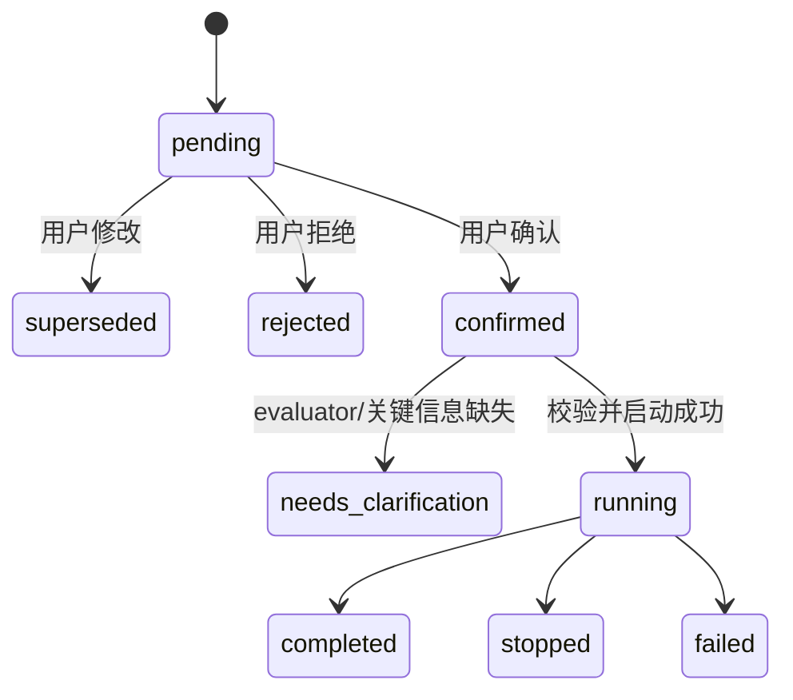

# Famou Scientist Loop Mode V1 实现方案

> 目标：把 `--mode loop` 做成一个可运行、可定位、可回溯的自主科研 loop。V1 先实现稳定骨架，不追求复杂科研操作系统。

关联设计文档：

- `docs/design/MULTI_AGENT_ALGORITHM_INNOVATION_DESIGN_CN.md`
- `docs/design/FAMOU_LOOP_BENCH_MODE_DESIGN_CN.md`

---

## 1. V1 实现原则

V1 只做必要能力：

```text
goal file
  → ResearchState
  → 三个队列
  → Artifact / Evidence Store
  → Shared Experience Pool
  → Benchmark Adapter
  → Orchestrator Tick
```

运行时明确区分两种工作流：

| `workflow.type` | 适用场景 | 循环内节点 |
|---|---|---|
| `research` | 目标需要和用户逐步澄清的开放式科研 | MasterBridge、idea、novelty gate、implement、experiment、result/deep analysis |
| `benchmark_managed` | task、数据、环境和 evaluator 均由 benchmark 明确提供 | benchmark attempt、implement、benchmark runtime、trusted evaluator、官方排行榜 |

`benchmark_managed` 是 human-out-of-loop 直通模式。它不实例化 MasterBridge，也不调用创新性、可解释性、速度或论文候选 judge；除非 benchmark 自己评测这些指标，否则它们不参与循环决策。

核心原则：

1. **先跑通两条最小闭环**：开放式科研走 idea/gate/analyze；完整 benchmark 直接走 attempt/implement/evaluator。
2. **先文件系统落盘**：JSON/YAML/JSONL 优先，不急着上数据库。
3. **所有产物留证据**：每一步必须写 artifact 和 decision record。
4. **V1 不做复杂调度**：不做多 orchestrator、分支合并、复杂 Pareto 权重学习。
5. **Master 只属于开放式科研**：Master 只处理用户沟通、goal patch 和状态摘要；完整 benchmark 不创建 Master。
6. **Evaluator 独立**：agent 不直接读 hidden data，只调用 Benchmark Adapter。

---

## 2. 用户入口

### 2.1 启动方式

支持命令行 goal file、聊天 GoalProposal 和 benchmark Harness 三类入口。本节先列前两类；
Harness-first 入口见配套 Agent CLI 文档。

用户友好入口：

```bash
famou-scientist --mode loop --goal-file goals/classification_algo_innovation.yaml
```

启用异步 producer-consumer pipeline：

```bash
famou-scientist loop run \
  --goal-file goals/classification_algo_innovation.yaml \
  --async-pipeline
```

调试 / 脚本入口：

```bash
famou-scientist loop run --goal-file goals/classification_algo_innovation.yaml
famou-scientist loop status --goal-id <goal_id>
famou-scientist loop stop --goal-id <goal_id>
famou-scientist loop pause --goal-id <goal_id>
famou-scientist loop resume --goal-id <goal_id>
famou-scientist loop message --goal-id <goal_id> --text "补充一个用户约束"
famou-scientist loop events --goal-id <goal_id> --json
```

`run` 的 workspace 语义：

```bash
# 默认：resume。workspace 存在则继续，不存在则新建。
famou-scientist loop run --goal-file goals/classification_algo_innovation.yaml

# 只重置 research_state.yaml；保留 queues/artifacts/branches/logs。
famou-scientist loop run --goal-file goals/classification_algo_innovation.yaml --reinit-state

# 干净重跑：删除该 goal workspace 后重建。
famou-scientist loop run --goal-file goals/classification_algo_innovation.yaml --fresh
```

兼容旧参数 `--reinit`，但它只是 `--reinit-state` 的 deprecated alias，不会清空
证据或队列；干净 smoke test 应使用 `--fresh`。

### 2.2 聊天 `/goal` 入口

OpenCode 从 `assets/opencode/commands/goal.md` 发现 `/goal`，Master 通过
`arc_loop_goal` 工具调用 Python 控制器：

```text
/goal 或普通对话
  → OpenCode Master 生成 GoalProposal
  → famou-scientist loop chat propose
  → 默认等待 Human confirm
  → Controller 校验 goal + benchmark/evaluator
  → 独立后台进程运行现有异步 Loop
```

聊天 CLI 是工具层的稳定后端，也可独立调试：

```bash
famou-scientist loop chat propose --conversation-id <sid> --proposal-file proposal.yaml
famou-scientist loop chat confirm --conversation-id <sid>
famou-scientist loop chat reject --conversation-id <sid>
famou-scientist loop chat status --conversation-id <sid>
famou-scientist loop chat policy --conversation-id <sid> --mode auto \
  --authorization-text "用户授权原文"
famou-scientist loop chat control --conversation-id <sid> --action pause
famou-scientist loop chat message --conversation-id <sid> --text "补充约束"
famou-scientist loop chat answer --conversation-id <sid> \
  --request-id <request_id> --text "用户回答"
famou-scientist loop chat goal-change --conversation-id <sid> \
  --decision continue_current --instruction "用户新指令"
```

默认策略是 `confirm`。持久 `auto` 策略必须保存用户明确授权的原始文本；
`/goal auto <目标>` 只授权当前目标，且一次性授权文本必须与 Proposal 的
`raw_user_message` 完全一致。普通对话中的 Master 可以输出
`enter_loop / stay_in_chat / needs_clarification`，但未授权 auto 时，`enter_loop`
也只能创建待确认 Proposal。

确认后控制器生成标准 goal 文件，并使用：

```bash
python -m famou_scientist loop run \
  --goal-file <generated-goal.yaml> \
  --async-pipeline \
  --max-ticks -1
```

`max_ticks=-1` 表示持续 admission，实际终止仍由 `max_wall_time_hours`、用户 stop
或工作流完成决定；不是取消预算。当前聊天入口只直接启动 `research`。已有完整 task、
环境和 evaluator 通道的 `benchmark_managed` 必须由 `famou-scientist agent run` 和外部
Harness 启动，Master 不伪造 benchmark 上下文。

### 2.3 CLI 改动点

在 `famou_scientist/cmdline.py` 中增加：

```python
if args and args[0] == "loop":
    from .loop import cli
    return cli.main(args[1:])

if "--mode" in args and mode in {"loop", "e2e"}:
    from .loop import cli
    return cli.run_from_mode_flags(args)
```

`loop` 是正式名称；旧 `e2e` 子命令和 `--mode e2e` 只作为兼容别名转发。

### 2.4 Human ↔ Master ↔ Loop 的 file-as-bus 控制面

开放式科研 Loop 使用追加式文件事件总线，不把新目标直接写入正在运行的目标：

```text
Master / CLI
  → control/commands.jsonl
  → Orchestrator 主线程消费
  → control/events.jsonl 回执
  → ResearchState / handoff / 证据
```

支持的命令包括 `message`、`pause`、`resume`、`stop`、`goal_change` 和
`clarification_response`。目标变更必须明确选择：

- `continue_current`：当前 Loop 继续原目标，新指令记录在 `pending_goal_change`，留给下一 Loop；
- `stop_current`：当前 Loop 停止接收新任务，queued 条目归档，在途任务自然收尾，写入
  `handoff.md/json`，之后通过新 `goal_id` fork。

创建新 Loop 时使用：

```bash
famou-scientist loop fork \
  --parent-goal-id <old_goal_id> \
  --new-goal-id <new_goal_id> \
  --goal-file <new_goal.yaml>
```

fork 不复制旧 `artifacts/`、branch 或代码；新目标通过 `lineage.prior_loop_dirs`
和 `lineage.experience_sources` 只读访问父 Loop 的 handoff、ExpBank、经验池和证据。
`control/commands.jsonl`、`control/events.jsonl`、`command_cursor.json` 和
`handoff` 都属于审计证据，不应删除或覆盖。

---

## 3. 新增模块结构

当前实现按**稳定职责**聚类，而不是按一次研究循环中的阶段拆目录：

```text
famou_scientist/loop/
  __init__.py
  cli.py                    # Loop CLI 入口
  utils.py                  # 通用 stdlib 工具
  agents/
    __init__.py
    llm.py
    workers.py
  domain/
    __init__.py
    goal.py
    schemas.py
  evaluation/
    __init__.py
    evaluator.py
    experiment.py
  execution/
    __init__.py
    workspace.py
    sandbox.py
    agent_runtime.py
  facilities/
    __init__.py
    agent.py
    benchmark.py
    contracts.py
    evaluation.py
  harness/
    __init__.py
    cli.py
    evaluator.py
    runtime.py
    trajectory.py
  integrations/
    naturebench/
      plugin.py
      benchmark.py
      evaluation.py
      evaluator_worker.py
      trajectory_adapter.py
      judge_adapter.py
  plugins/
    __init__.py
    builtins.py
    contracts.py
    registry.py
  prompts/
    benchmark_managed/
    cli_agents/
    research/
  runtime/
    __init__.py
    orchestrator.py
    async_orchestrator.py
    control.py
    implement_actor.py
    master_bridge.py
  storage/
    __init__.py
    artifacts.py
    candidates.py
    expbank.py
    experience.py
    queues.py
    report.py
    state.py
    workspace.py
  examples/
    naturebench/
      README.md
      goal.yaml
      run_task.py
      check_submission.py
      evaluate_task.py
  tests/
    test_loop.py
    test_control_and_fork.py
    test_loop_execution.py
    test_loop_web_api.py
    fixtures/
      agents/
      evaluators/
      experiments/
      goals/
      llm/

```

研究阶段不再单独建立 `idea/`、`implementation/`、`experiment/`、
`analysis/` 四组目录。原因是这些是 loop 的**业务阶段**，不是稳定的代码边界：

- idea 生成与 novelty gate 由 `agents/` 承担，由 `runtime/` 调度；
- implementation 与 experiment runner/evaluator 由 `evaluation/` 承担，由
  `runtime/` 调度；
- result/deep analysis 仍由 `agents/`、`storage/report.py` 和 `runtime/` 协作；
- Ideaspark、Experiment Queue、Analyze Spark 及其状态由 `storage/` 持久化。

这样既能表达阶段，又不会把一个阶段拆成多个互相依赖的小包，便于 V1 定位和
回溯。通用 helper 直接收敛到 `loop/utils.py`，报告导出与持久化对象放在
`storage/report.py`，主控桥接与调度器放在同一个 `runtime/` 包中。

一级目录不再放业务 facade 文件，避免看起来像“平铺架构”。除 `__init__.py`
外，只保留 `loop/cli.py` 作为直接命令入口，因为 `famou_scientist/cmdline.py`
通过 `from .loop import cli` 分发到 Loop CLI。其他代码应直接从
`domain`、`runtime`、`storage`、`evaluation`、`execution`、`agents`、
`plugins`、`facilities`、`harness` 和 `integrations` 导入。

职责：

| 文件 | 职责 |
|---|---|
| `cli.py` | loop 子命令入口：run/chat/status/control/message/goal-change/fork/report |
| `agents/` | idea/novelty/result/deep worker 与 LLM backend |
| `runtime/chat_goal.py` | GoalProposal、会话授权、确认和后台启动控制器 |
| `runtime/master_bridge.py` | Master bridge、澄清、handoff 和控制事件入口 |
| `runtime/control.py` | `commands.jsonl`、`events.jsonl` 和消费游标 |
| `domain/` | goal 读取/校验/规范化与运行时 schema 常量 |
| `evaluation/` | Benchmark evaluator 与 Experiment runner |
| `execution/` | Agent branch workspace、subprocess sandbox 与 implement-agent 接口 |
| `utils.py` | 无业务含义的 JSONL、原子写入、ID、hash 等 stdlib helper |
| `storage/report.py` | evidence bundle、claim map、final report |
| `plugins/` | Agent/Benchmark/Evaluator Adapter 契约和注册表 |
| `facilities/` | 三类设施的稳定运行协议与兼容包装 |
| `harness/` | 外部 benchmark 托管入口和 evaluator transport |
| `integrations/` | NatureBench 等具体 benchmark 插件 |
| `prompts/` | Idea/Implement/分析 Agent instruction |
| `runtime/` | 同步/异步 orchestrator runtime，以及 loop 阶段调度 |
| `storage/` | queues、state、artifacts、experience、workspace 持久化 |
| 一级 facade | 兼容旧 import；不放新业务逻辑 |

---

## 4. Workspace 目录

每次 loop run 创建独立工作目录：

```text
.famou/loop/<goal_id>/
  goal.yaml
  research_state.yaml
  handoff.md              # 停止或目标替换后的交接摘要
  handoff.json            # 机器可读交接记录

  control/
    commands.jsonl        # Master / Human 入站命令
    events.jsonl          # Loop 出站回执
    command_cursor.json   # 已消费命令游标
    orchestrator.lock

  queues/
    ideaspark.jsonl
    evaluation_queue.jsonl
    analyze_spark.jsonl
    queue_events.jsonl

  artifacts/
    artifact_index.jsonl
    decision_log.jsonl
    ideas/
    reviews/
    method_specs/
    code_patches/
    runs/
    evaluator_scores/
    analysis_reports/
    evidence_bundle/

  shared_experience_pool/
    external_baselines.jsonl
    literature_methods.jsonl
    attempted_ideas.jsonl
    failure_cases.jsonl
    reusable_artifacts.jsonl

  actors/<actor_id>/
    state.json
    mailbox.jsonl

  candidates/<candidate_id>/
    manifest.json
    code/
    output/
    evidence/

  expbank/
    INDEX.md
    <attempt_id>/
      SUMMARY.md
      record.json
      code/
      evidence/

  logs/
    orchestrator.log
    workers.log
```

V1 先把共享经验池放在 goal workspace 内；后续可以升级成用户级长期目录：

```text
~/.famou/loop/shared_experience_pool/
```

### 4.1 CORAL-inspired Agent Workspace / Sandbox

Implement Agent 需要一个比“直接把代码写到 goal workspace”更明确的边界。
这一版参考本地 CORAL 代码库中的以下职责划分：

```text
/path/to/workspace/opensource/CORAL/coral/workspace/project.py
/path/to/workspace/opensource/CORAL/coral/workspace/worktree.py
/path/to/workspace/opensource/CORAL/coral/agent/runtime.py
/path/to/workspace/opensource/CORAL/coral/agent/manager.py
```

CORAL 的可复用思想是：**run 级状态、agent 级工作区、public/private
状态、agent runtime 生命周期分开**。Famou V1 不直接复制 CORAL 的 manager
或 Docker wrapper，而是先抽出最小稳定接口：

```text
.famou/loop/<goal_id>/
  branches/
    <branch_id>/
      manifest.json
      worktree/       # implement agent 可读写的代码区
      public/         # 允许读取的共享上下文
      outputs/        # submission / 中间输出
      logs/           # agent / sandbox 日志
  evaluator_private/  # 预留；不放入 AgentWorkspace
```

对应代码：

| 组件 | 当前职责 | V1 边界 |
|---|---|---|
| `AgentWorkspace` | 创建 branch 目录、校验相对路径、写 manifest、提供 `worktree/public/outputs/logs` | 目录级隔离；不使用 symlink 共享代码 |
| `LocalSandbox` | 在指定 workspace root 内运行 argv 命令、限制 cwd、隔离进程组、约束单进程地址空间、处理 timeout 和输出截断 | 是带本地资源边界的 host subprocess，不是强安全容器 |
| `SingleCallImplementer` | 明确当前 `method_designer` 是一次调用式实现节点 | 保留现有 PromptWorker 行为，便于回归 |
| `ToolUsingImplementAgent` | 多步 OpenCode/Codex/Claude implement agent 的协议 | 通过 CLI preset/wrapper 接入，loop 只依赖稳定 result JSON |
| `BenchmarkAdapter` | 独立执行 public/official evaluator | evaluator 不进入 AgentWorkspace，agent 只拿脱敏视图 |

当前实现路径如下：

```text
idea accepted
  → PromptWorkerSet / SingleCallImplementer
  → AgentWorkspace.create(branch_id)
  → worktree 中生成 method.py 与 method_manifest.json
  → ArtifactStore 复制 method spec / code patch 留证
  → Experiment Queue
  → ExperimentRunner
  → BenchmarkAdapter
```

这里的 `directory` 隔离解决的是**并发 branch 互相覆盖、产物归属不清、
路径穿越和证据回溯**问题；它不能阻止恶意代码通过绝对路径读取宿主机文件。
因此：

1. V1 默认使用 `LocalSandbox`，方便本地调试和定位；每条 canonical run 使用独立
   process group，超时会清理完整进程组。CPU Candidate 使用 `prlimit` 约束地址空间；
   GPU Candidate 为避免 `RLIMIT_AS` 把 CUDA 显存映射误算成主存，改用进程组 RSS
   监控实际主存；GPU 显存声明只用于派发前 admission，不做进程级硬限制；
2. 不把 `local` 描述成 evaluator 级安全边界；
3. 后续新增 `DockerSandbox` / 集群执行后，只替换
   `ExecutionSandbox` 实现，不修改 Queue、ResearchState、Evaluator 和
   Evidence 协议；
4. Docker 版本必须只挂载 branch `worktree/public/outputs` 及必要的运行时
   目录，不能挂载 `evaluator_private`；
5. evaluator 仍然由 loop 单独调用，不能让 Implement Agent 直接启动官方
   evaluator。
6. `method_designer` 只收到去掉 adapter command 的 implementation goal view；
   public/official evaluator 的可执行命令不进入 implement agent 上下文。

Harness 在 benchmark 声明任务总内存时，把 75% 作为整个 Evaluation Pool 的动态装箱
容量，剩余 25% 留给 Controller、Agent 和运行时；不会按最大并发静态均分。Idea 声明
Candidate 的 CPU、主存、GPU 数量和每卡显存，Resource Broker 在租约可满足且未超过
`max_parallel_evaluations` 时，再读取当前实际空闲显存；逻辑租约余量和物理余量都满足
声明后才启动 EvaluationJob。资源暂时不足进入
`waiting_resources`，释放租约后自动调度；请求永远超过任务资源时回传确定性工程诊断。
候选主存超限时只失败当前进程；CUDA OOM 作为独立工程诊断返回。stdout、stderr、退出码、
资源请求、admission 时的实际空闲显存、租约和终止原因进入 ExpBank，并恢复原
ImplementActor 修复，不调用正式 evaluator。

与 CORAL 的差异需要明确记录：

- CORAL 当前有 run 级 repo clone 和 git worktree；Famou V1 先使用普通目录
  branch workspace，避免在研究 goal 目录内引入 git 状态和 worktree 回收问题；
- CORAL 的 `run.session=docker` 主要包裹整轮 manager/runtime，不等价于每个
  agent 一个容器；Famou 后续如果需要强隔离，应单独实现 branch/experiment
  sandbox；
- CORAL 的 public/private 分层在 Famou 中对应 `public/` 与 goal 级
  `evaluator_private/`，private 目录不应被复制或暴露给 Agent。

---

## 5. Goal File 结构

V1 不使用权重系数，而使用 `objective_brief`。

```yaml
goal:
  name: interpretable_fast_classifier

workers:
  implement:
    type: agent
    runtime: codex
    model: gpt-5.6-sol
    max_turns: 400
    timeout_sec: 14400

benchmarks:
  - name: dataset_1
    adapter:
      type: command
      public_eval_cmd: "python eval_public.py --submission {artifact}"
      official_eval_cmd: "python eval_official.py --submission {artifact}"
    official_metric:
      name: accuracy
      direction: higher_is_better
    hidden_test_access: forbidden

baselines:
  - name: baseline_A
    repo: baselines/A
  - name: baseline_B
    repo: baselines/B

objective_brief:
  primary_goal: >
    官方 accuracy 达到或接近 baseline，同时形成有论文价值的新机制。
  official_metric:
    name: accuracy
    source: benchmark_adapter
    direction: higher_is_better
  preference_description: >
    用户更偏好机制清晰、可解释、可复现的方法；不希望只做 HPO、ensemble 或 benchmark trick。
  allow_examples:
    - accuracy 基本持平，但模型更快、更简单，并有清晰可解释机制。
    - 对 baseline 做结构性改造，并用消融证明贡献。
  reject_examples:
    - 只通过 HPO 获得小幅提升。
    - 直接 ensemble 多个 baseline，但没有新算法贡献。
    - 泄漏 hidden test 或违反 benchmark 规则。
  tie_breakers:
    - 分数相近时，优先选择新颖性、可解释性、证据链更强的方案。
    - 论文故事更清晰的方案优先于纯工程 trick。

constraints:
  max_wall_time_hours: 72
  max_evaluator_submissions: 20
  max_experiment_retries: 1
  external_data_policy: declare_and_approve

infra:
  pipeline: async
  concurrency:
    implementations: 4
    experiments: 4
```

### 5.1 Goal 文件校验与 Workspace 路径安全（V1 已实现）

`loop run` 会先读取并校验 goal 文件，校验失败时直接返回错误码，不创建或
启动研究 loop。V1 的校验包括：

- 顶层必须是 object；`goal` 必须是 object；
- `goal.id`（或兼容的顶层 `goal_id`）不能为空，且必须是单层安全名称；
  只允许字母、数字、点、下划线和连字符，拒绝 `/`、`\`、`..` 等路径片段；
- `benchmarks` 必须是 list，每个 benchmark 必须是 object；
- `official_metric` 如果存在，必须包含 `name`，`direction` 只能是
  `higher_is_better` 或 `lower_is_better`；
- `adapter` 如果存在必须是 object；
- `constraints` 必须是 object，以下数值约束会做类型和下界校验：
  `max_evaluator_submissions >= 0`、`max_parallel_evaluations >= 1`、
  `max_experiment_retries >= 0`、`max_wall_time_hours >= 0`。
- `infra.pipeline` 只能是 `sync` 或 `async`；`infra.concurrency` 中的
  `ideas`、`implementations`、`experiments` 必须是正整数。

未提供的可选顶层字段会补齐为空结构；未提供 `goal.id` 时会从 goal 名称
生成安全 ID。这里的校验是 fail-closed：非法配置不会被“自动修正”后继续
运行，避免用户以为使用了某个目标而实际运行了另一个目标。

Workspace 层还会再次校验 `goal_id`，然后才拼接：

```text
.famou/loop/<goal_id>/
```

因此 CLI 的 `run`、`status`、`stop`、`pause`、`resume`、`patch`、`export`
和 `report` 都不能通过 `goal_id` 访问 workspace 外部路径。goal 文件在
校验通过后才会复制为 workspace 内的 `goal.yaml`。对应回归测试位于
`famou_scientist/loop/tests/test_loop.py` 的
`test_loop_goal_validation_rejects_unsafe_id_and_bad_constraints`。

Master 的运行中修改也使用同一套 fail-closed 原则。V1 的 goal patch 只允许
修改 `objective_brief` 和 `constraints`，不允许修改 `goal_id`、benchmark
adapter 或任意未知运行时字段。两种写法都会被规范化为：

```json
{
  "reason": "user clarified objective",
  "changes": {
    "objective_brief": {
      "primary_goal": "prefer interpretable mechanisms"
    }
  }
}
```

CLI 写入时校验一次，orchestrator 消费 control 文件时再校验一次。非法 patch
不会被静默裁剪：会写入
`control/rejected_goal_patches.jsonl` 和 `research_state.audit`，随后移走待处理
文件，不改变当前研究目标或运行参数。合法 patch 应用后，同时更新持久化
`ResearchState` 和当前进程中的 goal，使后续 idea generator、novelty gate 和
result analyst 立即看到用户的新偏好。对应回归测试为
`test_loop_goal_patch_is_validated_and_research_goal_is_synced`。

这里的 `patch` 是保留给旧调用方的兼容接口，适用于同一目标内的小范围约束同步；
用户提出一个新的研究方向时，不应通过它原地改写当前 Loop，而应使用
`goal-change --decision ...` 决定 `continue_current` 或 `stop_current`，再通过
`loop fork` 创建新的目标工作空间。

---

## 6. ResearchState V1

`ResearchState` 是当前 goal 的实时状态机和台账。

```yaml
research_state:
  goal_id:
  status: running | paused | stopped | completed | failed
  lifecycle: active | stopped_by_user | superseded_by_user | ...
  goal_revision:
  created_at:
  updated_at:
  lineage:
    parent_loop_id:
    parent_workspace:
    prior_loop_dirs: []
    experience_sources: []
  pending_goal_change:
    decision:
    instruction:

  goal:
    name:
    type:
    domain:
    objective_brief:
    constraints:

  benchmark_contract:
    adapters:
    official_metrics:
    public_validation:
    hidden_eval_policy:
    prohibited_actions:

  queues:
    ideaspark:
      queued:
      running:
      finished:
    evaluation_queue:
      queued:
      running:
      finished:
    analyze_spark:
      queued:
      running:
      finished:

  branches:
    - branch_id:
      idea_id:
      status:
      code_ref:
      config_ref:
      evidence_refs:

  evaluator_budget:
    max_submissions:
    used_submissions:

  artifact_index_ref:
  decision_log_ref:

  audit:
    evaluator_calls:
    hidden_test_access_attempts:
    artifact_writes:
    missing_evidence_warnings:
```

V1 不需要复杂嵌套，核心是能回答：

```text
当前有哪些 idea？
哪些 branch 在跑？
用了几次 evaluator？
每个结论证据在哪里？
```

---

## 7. 三个队列

V1 只保留三个长期队列。

### 7.1 Queue Item

```yaml
queue_item:
  id:
  type: idea | branch | analysis_task
  status: queued | running | finished | failed | archived
  priority:
  created_at:
  updated_at:
  input_refs:
  output_refs:
  evidence_refs:
  retry_count:
```

### 7.2 Ideaspark

```text
queues/ideaspark.jsonl
```

只保存通过 novelty / feasibility gate 的 idea。

### 7.3 Experiment Queue

```text
queues/evaluation_queue.jsonl
```

保存已实现、等待 public eval / optional official eval 的 branch。

### 7.4 Analyze_spark

```text
queues/analyze_spark.jsonl
```

保存有潜力、等待消融 / 鲁棒性 / paper claim 检查的 branch。

---

## 8. Artifact / Evidence Store

所有产物都通过 `ArtifactStore` 写入：

```python
class ArtifactStore:
    def save_json(self, kind: str, obj: dict, *, refs: list[str] | None = None) -> str:
        ...

    def save_text(self, kind: str, text: str, *, refs: list[str] | None = None) -> str:
        ...

    def save_file(self, kind: str, path: str, *, refs: list[str] | None = None) -> str:
        ...

    def record_decision(self, decision: dict) -> str:
        ...
```

每个 artifact 写入 `artifacts/artifact_index.jsonl`：

```yaml
artifact_record:
  id:
  type: idea | novelty_review | method_spec | code_patch | run_log | public_eval | official_eval | analysis_report | decision
  path:
  checksum:
  created_at:
  created_by:
  branch_id:
  idea_id:
  provenance:
  input_refs:
```

决策写入 `artifacts/decision_log.jsonl`：

```yaml
decision_record:
  id:
  decision: promote_to_analyze_spark | archive | retry | reject_idea
  reasons:
  evidence_refs:
  alternatives:
  created_at:
```

---

## 9. Shared Experience Pool

V1 先实现简单 JSONL 检索。

```python
class ExperienceStore:
    def search(self, query: str, filters: dict | None = None, top_k: int = 10) -> list[dict]:
        ...

    def upsert(self, record: dict) -> str:
        ...
```

V1 检索可以先做关键词 / 简单 BM25，不急着接向量库。

经验记录：

```yaml
experience_record:
  id:
  type: external_baseline | attempted_idea | failure_case | reusable_artifact | literature_method
  domain:
  benchmark:
  summary:
  outcome:
    status: useful | failed | rejected_low_novelty | inconclusive
    reason:
  artifact_refs:
  created_at:
```

注意：不能写入 hidden labels、hidden examples、hidden 逐样本错误。

---

## 10. Benchmark Adapter / Evaluator

### 10.1 接口

```python
class BenchmarkAdapter:
    def validate_artifact(self, artifact_path: str) -> dict:
        ...

    def run_public_eval(self, artifact_path: str) -> dict:
        ...

    def run_official_eval(self, artifact_path: str) -> dict:
        ...

    def score_schema(self) -> dict:
        ...
```

### 10.2 CommandEvaluatorAdapter

V1 先支持 command 类型：

```yaml
adapter:
  type: command
  public_eval_cmd: "python eval_public.py --submission {artifact}"
  official_eval_cmd: "python eval_official.py --submission {artifact}"
```

返回统一格式：

```json
{
  "benchmark": "dataset_1",
  "source": "official_evaluator",
  "valid": true,
  "official_metrics": {
    "accuracy": 0.873
  },
  "diagnostics_public": {
    "format_check": "passed"
  },
  "extra": {
    "num_samples": 12000,
    "num_batches": 24
  },
  "stdout": "evaluator progress ...",
  "stderr": ""
}
```

其中：

- `metrics` / `official_metrics`：用于排行榜和目标判断的指标；
- `diagnostics_public`：允许暴露给智能体的公开诊断信息；
- `extra`：评测器提供的额外结构化信息，完整结果会作为 evidence 保存；
- `stdout` / `stderr`：评测进程输出，用于排障和审计；
- `stdout` / `stderr` 受 `output_limit_bytes`、`stdout_limit_bytes`、
  `stderr_limit_bytes` 控制，结果中同时记录是否发生截断以及原始字节数。

评测脚本必须在标准输出最后一行打印 JSON 对象。评测器退出码为零且 JSON
中的 `valid` 不是 `false` 时，结果才会被视为有效。

### 10.3 防泄漏要求

- adapter 只能返回 benchmark_contract 允许的字段；
- hidden split 不挂载到 agent workspace；
- official score 与 public score 分开存储；
- evaluator call 计入 budget；
- 保存原始 `score.json`。

实现层面，V1 将 evaluator 返回值分成两种视图：

1. **Evidence result**：完整结果只由 orchestrator 接收并写入
   `public_eval` / `official_eval` artifact，用于审计与复现；其中包含
   `stdout`、`stderr`、`extra`、解析结果和错误信息；
2. **Agent view**：传给 `result analyst` 的受限结果，只保留 benchmark、valid、
   flat scalar metrics、显式的 `diagnostics_public` 和经过过滤的 `extra`，
   并去除 `parsed`、原始 stdout/stderr、逐样本错误、label、prediction 等字段。
   如果需要向智能体暴露额外字段，评测器可以将其放入 `extra_public`，运行时
   会优先使用该字段生成 agent view。

Agent view 还会作为 `evaluator_agent_view` artifact 留证据。这样 agent 不会
因为 evaluator 工具返回了额外调试字段，就把这些字段继续带入 idea/analysis
决策。对应回归测试为
`test_loop_evaluator_agent_view_redacts_raw_and_hidden_fields`。需要注意，这属于
这一层是 Agent view 的 runtime contract。NatureBench 的 fm-job 参考实现已经把
evaluator 作为同一 Task Job 内的 root 可信进程，并将原始 response、stdout、stderr 和
extra 写入 root-only `trusted/raw_evaluator_artifacts/<request_id>/`；公共 `responses/`
和 `artifacts/evaluator_scores/` 不再保存这些原始字段。未来接入其他需要更强边界的
benchmark 时，可以在其 Evaluator Adapter 内采用同样的 trusted evidence store 或
容器隔离，Core 不读取 hidden evaluator 文件。

Command evaluator 超时不会直接抛出未记录的异常，而是生成
`valid=false`、`timed_out=true` 的 evaluator artifact。只要 official evaluator
进程已经被启动，该次调用就会计入 `max_evaluator_submissions`，即使最终没有
得到分数；invalid official result 不会传给 result analyst。对应回归测试为
`test_loop_official_evaluator_timeout_is_recorded_and_charged`。

---

## 11. Workers V1

V1 worker 先抽象接口，先用 dummy worker 跑通，再接 LLM。

```python
class WorkerSet:
    def generate_ideas(self, goal: dict, experience: list[dict]) -> list[dict]:
        ...

    def novelty_gate(self, idea: dict, experience: list[dict]) -> dict:
        ...

    def implement(self, idea: dict, workspace: str) -> dict:
        ...

    def analyze_result(self, branch: dict, results: dict) -> dict:
        ...

    def analyze_deep(self, branch: dict) -> dict:
        ...
```

### 11.1 Dummy Worker

Phase 1 先实现 dummy worker：

- 生成固定 idea；
- gate 固定 accept；
- implement 生成一个 dummy artifact；
- evaluator 用 fake command；
- analyzer 根据分数决定 promote/archive。

目的是先验证 runtime、队列、状态和证据链。

### 11.2 LLM Worker

当前已接入 prompt worker，prompt 放在：

```text
famou_scientist/loop/prompts/research/
  idea_generator.md
  novelty_gate.md
  method_designer.md
  result_analyst.md
  deep_analyzer.md
```

LLM worker 必须输出 JSON，不能只输出自然语言。当前
`PromptWorkerSet.implement()` 支持两种实现后端：

```json
{
  "workers": {
    "type": "prompt",
    "llm": {"type": "command", "cmd": "..."},
    "implement": {
      "type": "single_call"
    }
  }
}
```

`single_call` 是默认值：一次调用 `method_designer`，返回 entrypoint 和代码
文件内容。适合小 smoke test、低成本方法草稿和确定性测试。

`agent` 是命令型多步实现后端。它会在 branch workspace 中创建请求 JSON、
`IMPLEMENT_INSTRUCTIONS.md` 和 result JSON 路径，然后用 `LocalSandbox` 执行
指定 runtime。V1 支持两种配置：

1. **显式 command**：接我们自己的 agent driver，最适合测试和内部定制；
2. **CLI preset**：用 `runtime: opencode|codex|claude` 选择 OpenCode/Codex/
   Claude Code wrapper。

显式 command 示例：

```json
{
  "workers": {
    "type": "prompt",
    "implement": {
      "type": "agent",
      "cmd": "python {config_dir}/../agents/my_implement_agent.py --input {input} --output {output}",
      "timeout_sec": 3600,
      "sandbox": {"type": "local"}
    }
  }
}
```

显式 command 支持占位符：

```text
{input}       # agent request JSON
{output}      # agent result JSON
{instruction} # instruction file
{workspace}   # branch root
{worktree}    # branch/worktree
{public_dir}
{outputs_dir}
{logs_dir}
{branch_id}
{idea_id}
{config_dir}  # goal file 所在目录
```

CLI preset 示例：

```json
{
  "workers": {
    "type": "prompt",
    "implement": {
      "type": "agent",
      "runtime": "codex",
      "max_turns": 20,
      "timeout_sec": 180,
      "sandbox": {"type": "local"}
    }
  }
}
```

对应测试配置见：

```text
famou_scientist/loop/tests/fixtures/goals/codex_agent_algorithm_innovation.yaml
famou_scientist/loop/tests/fixtures/goals/opencode_agent_algorithm_innovation.yaml
famou_scientist/loop/tests/fixtures/goals/claude_agent_algorithm_innovation.yaml
```

默认示例不指定 `model`，优先使用用户本机 CLI 的默认模型/配置；如果要固定模型，
可显式增加 `model` 字段。常用字段：

| 字段 | 含义 |
|---|---|
| `runtime` | `opencode` / `codex` / `claude` |
| `binary` | CLI 可执行文件路径；默认等于 runtime 名称 |
| `model` | 传给 CLI 的模型名 |
| `agent` | 传给 CLI 的 agent/profile 名称，OpenCode/Claude 可用 |
| `profile` | Codex profile |
| `max_turns` | 写入 implement prompt，作为自主回合预算提示 |
| `auto_approve` | 是否启用非交互自主执行；默认 `true`，生产环境应配合容器隔离 |
| `compact_on_context_overflow` | Claude 请求发生上下文超限时，恢复同一 Session 前先执行一次 `/compact`；默认 `true` |
| `extra_args` | 追加传给底层 CLI 的参数列表 |

实现上 preset 不直接把复杂 prompt 塞进 orchestrator，而是调用：

```text
famou_scientist/loop/execution/cli_agent_wrapper.py
```

该 wrapper 会：

- 读取脱敏 request JSON 和 `IMPLEMENT_INSTRUCTIONS.md`；
- 生成 `logs/<runtime>_implement_prompt.md`；
- 调用对应 CLI 的非交互模式；
- 要求 agent 在 `worktree/famou_agent_result.json` 写 result JSON，并同步到
  manager 侧 `{output}`；这样 Codex 等 CLI 即使只允许写当前 worktree，也能工作；
- 实时保存 CLI stdout/stderr 到 `outputs/<runtime>_stdout.txt` 和
  `outputs/<runtime>_stderr.txt`，便于长时间运行时观察；
- Claude 上下文超限时先执行独立的 `/compact` 恢复回合，再发送“继续当前任务”；
  该内部回合及其结果写入 wrapper meta，失败时仍保留一次普通 Session 恢复机会；
- 保存 last message、wrapper meta；
- 若 result JSON 缺失或非法，则 fail closed。

Codex preset 的真实 smoke 注意事项：

- 当前 Codex CLI 某些版本要求 `--ask-for-approval` / `--sandbox` 放在 `exec`
  子命令之前，wrapper 已按这个顺序生成 argv；
- Codex 会写 app-server/session/log 状态；当默认 `CODEX_HOME` 不可写时，wrapper
  会创建 branch-local `logs/codex_home`，不复制用户凭据；
- 在受限 sandbox 下可能出现 `Operation not permitted` 或 request timeout，这
  属于外部网络/账号/模型可用性问题，不代表 evaluator 泄漏或 branch 隔离失效；
- 真实调试优先查看：
  `branches/<branch_id>/outputs/codex_stderr.txt`、
  `branches/<branch_id>/logs/codex_wrapper_meta.json`。

Agent result JSON 至少需要包含：

```json
{
  "status": "implemented",
  "entrypoint": "method.py",
  "files": [{"path": "method.py"}],
  "method_summary": "...",
  "experiment_plan": ["..."],
  "limitations": ["..."]
}
```

`entrypoint` 和 `files[].path` 必须是相对 `worktree/` 的路径。runtime 会回读
这些文件，做路径/大小/数量校验，计算 checksum，再写入 evidence。

通用流程：

1. runtime 在当前 goal workspace 下创建独立 branch workspace；
2. `single_call` 模式由 method designer 返回 entrypoint 和相对路径代码文件；
3. `agent` 模式由 command/CLI agent 直接编辑 worktree，并写 result JSON；
4. 对路径穿越、保留目录、文件数量和文件大小做 fail-closed 校验；
5. 写入 `method_manifest.json`，并将 method spec、每个 code patch 写入
   `ArtifactStore`；
6. branch 暴露 `method_dir`、`entrypoint`、`workdir`，供 Experiment Runner
   执行。

当前 branch 的实际落盘位置为：

```text
.famou/loop/<goal_id>/branches/<branch_id>/
  manifest.json
  worktree/
    method.py
    method_manifest.json
  public/
  outputs/
  logs/
```

因此 `method_dir` 指向该 branch 的 `worktree/`，而不是共享的
`artifacts/code_patches/`；后者只保存供证据链使用的 code patch 副本。

Experiment Runner 的 command template 额外支持：

```text
{method_dir}   # 生成的方法 workspace
{entrypoint}   # 生成方法的绝对入口文件
{branch_dir}   # method_dir 别名
```

因此最小可执行方法可以使用：

```bash
python {entrypoint} --output {run_dir}/submission.json
```

Evaluator 仍然只接收 runner 产出的 submission artifact；method designer
不会获得 hidden evaluator 的原始数据或标签。

如果 implement 返回 `implementation_failed`，runtime 不会把该 branch 推入
Experiment Queue，而是直接归档为 failure case，避免空 entrypoint 进入
runner 后制造噪声。

---

## 12. Orchestrator Tick

V1 不做复杂调度器，只做循环 tick。

```python
def tick(ctx):
    state = load_state()

    if state.status in {"paused", "stopped", "completed"}:
        return

    # 1. Ideaspark 不够则生成 idea
    if queues.ideaspark.size(status="queued") < ctx.min_ideas:
        exp = experience.search(goal_query(state))
        raw_ideas = workers.generate_ideas(state.goal, exp)
        for idea in raw_ideas:
            idea_ref = artifacts.save_json("idea", idea)
            review = workers.novelty_gate(idea, exp)
            review_ref = artifacts.save_json("novelty_review", review, refs=[idea_ref])
            if review.get("accept"):
                queues.ideaspark.push(idea, evidence_refs=[idea_ref, review_ref])
            else:
                experience.upsert({"type": "attempted_idea", "outcome": "rejected_low_novelty"})

    # 2. 从 Ideaspark 取 idea 实现
    if ctx.can_implement() and queues.ideaspark.has_queued():
        item = queues.ideaspark.pop()
        branch = workers.implement(item.payload, ctx.workspace)
        branch_ref = artifacts.save_json("branch", branch, refs=item.evidence_refs)
        queues.evaluation.push(branch, evidence_refs=[branch_ref])

    # 3. 单个 EvaluationJob 顺序完成运行、产物检查和评分
    if ctx.can_evaluate() and queues.evaluation.has_queued():
        item = queues.evaluation.pop()
        run_result = runner.run(item.payload)
        public_result = evaluator.run_public_eval(run_result["artifact"])
        refs = [artifacts.save_json("public_eval", public_result, refs=item.evidence_refs)]

        official_result = None
        if has_official_evaluator_budget(state):
            official_result = evaluator.run_official_eval(item.payload["artifact"])
            refs.append(artifacts.save_json("official_eval", official_result, refs=refs))

        analysis = workers.analyze_result(item.payload, {
            "public": public_result,
            "official": official_result,
        })
        analysis_ref = artifacts.save_json("analysis_report", analysis, refs=refs)

        if analysis.get("promote"):
            queues.analyze.push(item.payload, evidence_refs=[analysis_ref])
        elif analysis.get("retry"):
            queues.ideaspark.push(analysis["revised_idea"], evidence_refs=[analysis_ref])
        else:
            archive_branch(item.payload, analysis_ref)

    # 4. Analyze_spark
    if ctx.can_analyze() and queues.analyze.has_queued():
        item = queues.analyze.pop()
        report = workers.analyze_deep(item.payload)
        report_ref = artifacts.save_json("deep_analysis", report, refs=item.evidence_refs)
        if report.get("paper_candidate"):
            mark_paper_candidate(item.payload, report_ref)
        else:
            archive_or_retry(item.payload, report_ref)

    save_state(state)
```

### 12.1 Loop 阶段的有界并发（V1 已实现）

V1 当前支持三类有界并发参数：

| 参数 | CLI 覆盖 | 控制范围 |
|---|---|---|
| `constraints.max_parallel_ideas` | `--max-parallel-ideas` | idea 生产预算记录；V1 的单次 generator 仍是一次 worker 调用，不把一个 prompt 强拆并发 |
| `constraints.max_parallel_implementations` | `--max-parallel-implementations` | Ideaspark → Implement Agent 的并发实现数 |
| `constraints.max_parallel_evaluations` | `--max-parallel-evaluations` | Evaluation Queue → EvaluationJob 的并发数 |

同步 `Orchestrator.tick()` 中，implementation 默认继承
`max_parallel_evaluations`，用于一次 tick 内填满评测消费者容量；也可以显式
设置 `max_parallel_implementations` 限制真实 coding agent 的并发数。

Evaluation 阶段的 `max_parallel_evaluations` 控制 **Evaluation Queue → EvaluationJob**：

1. 每个 tick 最多从 `evaluation_queue` 取出 `N` 个 queued item，并先标记为
   `running`，避免同一批被重复领取；
2. 异步模式用有界 `ThreadPoolExecutor` 并发执行 EvaluationJob，`N` 是硬上限；默认值
   为 `1`，因此默认行为仍然是串行；
3. 每个 EvaluationJob 内部严格执行 runner、artifact validation、public evaluator
   和 official evaluator，不在 Runner Pool 与 Evaluator Pool 之间转交；
4. Job 返回后，主线程按完成顺序串行提交预算、Leaderboard、ExpBank 和 result analyst；
5. 某个 runner 抛异常或返回无效结果时，只把该 branch 归档为 `failed`，其余
   branch 继续完成评测和分析；
6. runner 返回的 artifact 先调用统一 adapter 的 `validate_artifact`，并保存
   `artifact_validation` 证据；校验失败不会进入 public/official evaluator。
7. public evaluator 返回 `valid=false` 或非 object 时，保存原始失败结果并直接
   归档 branch，不进入 result analyst，避免无效分数驱动后续决策。
8. official evaluator 返回无效结果时，仍保存该次调用和预算消耗，但把
   `official` 结果置空后再交给分析器；有效的 public 结果可以继续使用。

每个有效 evaluator 结果还会更新 `research_state.leaderboard`。V1 只维护
benchmark contract 中声明的 primary/official metric：优先使用有效 official
结果，否则使用有效 public 结果；新纪录会写入 `new_best` decision，并在
status summary / final report 中展示 branch、metric、value 和来源。

Result Analyst 如果返回 `retry=true` 和合法的 `revised_idea`，Orchestrator
会把它重新经过 novelty gate；通过后回流 Ideaspark，并保留
`analysis_report → idea → novelty_review → retry_idea` 的完整证据链。缺少
合法 revised idea 或未通过 novelty gate 时不会回流。

成功进入 Analyze_spark 的 branch 会额外写入
`shared_experience_pool/reusable_artifacts.jsonl`，记录 domain、benchmark、
public/official metrics、leaderboard 快照和 artifact refs；被归档的 branch
也会把已有 evaluator metrics 写入 `failure_cases.jsonl`。后续 idea generator
可以检索这些历史尝试，而不需要重新扫描所有 artifact 文件。

因此这里是“实现/实验执行可并发、评测与决策串行”，不是把整个研究 loop
粗暴地并行化。已有 queued/running branch 会占用槽位，不会无限制地产生新
实验。

### 12.1.1 异步 producer-consumer runtime（V1 已实现）

`--async-pipeline` 启用 `loop/runtime/async_orchestrator.py`。它与同步
`Orchestrator.tick()` 共用 JSONL 队列、ResearchState、ArtifactStore 和恢复
协议，但 coordinator 不会等待整批 runner 返回：

```text
coordinator
  ├─ producer：生成 idea、novelty gate、补充 Ideaspark
  ├─ implement pool：并发执行 K 个 Implement Agent
  ├─ Evaluation Queue：领取 queued Candidate
  ├─ evaluation pool：run.py → artifact → evaluator
  └─ coordinator：逐个提交预算、排行榜、ExpBank、analysis
```

其中 implement pool 的并发上限由 `max_parallel_implementations` 控制，evaluation
pool 的并发上限由 `max_parallel_evaluations` 控制；official budget、状态和决策
保持主线程串行提交，避免竞态和隐藏评测泄漏。pause/stop 会阻止新任务
提交，但允许已经提交的 implement / evaluation 安全收尾；进程中断后仍通过
`running → queued` recovery 恢复。`max_ticks` 限制新的 coordinator admission
cycle，已提交的 implement / evaluation 会继续 drain 完成。

同步 `Orchestrator` 仍保留，便于单步调试和最小 smoke test。当前异步 runtime
是同一进程内的线程池，不是分布式任务系统；后续可以在不改变队列协议的前提
下，将 producer、evaluation 和 deep-analysis 拆成独立 worker。

### 12.2 实验 runner 失败重试（V1 已实现）

`constraints.max_experiment_retries`（也可以通过
`--max-experiment-retries` 覆盖）只针对 **runner 失败**：

- runner 抛异常、超时或返回 `valid=false`：先保存 `experiment_run` 证据；
- 如果 `retry_count < max_experiment_retries`，队列项重新回到 `queued`，并记录
  `retry_experiment` 决策；
- 如果重试次数耗尽，才把该 branch 标记为 `failed` 并写入经验池；
- public/official evaluator 和 result analyst 失败不走 runner retry，避免重复
  消耗官方提交预算或混淆评测证据。

默认 `max_experiment_retries=0`，因此不改变最小串行 smoke run 的行为。

实验分支还会同步写入 `research_state.branches`：`evaluation_queued` →
`evaluation_running` → `analysis_queued` / `archived` / `failed` →
`paper_candidate`。这样 Web 面板和 `final_report.md` 看到的是 branch 的实际
生命周期，而不是只看到队列计数。

Master 通过 `goal_patch` 修改 `max_evaluator_submissions`、
`max_parallel_evaluations` 或 `max_experiment_retries` 后，下一次 tick 即会
更新当前 runtime 配置；已经消耗的 evaluator submission 不会被重置，若新
预算低于已使用次数，后续 official eval 会直接跳过。

### 12.3 墙钟预算与安全停止（V1 已实现）

`constraints.max_wall_time_hours` 是 Idea/Implement 研究阶段的墙钟预算，也可以通过
`--max-wall-time-hours` 覆盖。每个 tick 开始前检查从
`research_state.created_at` 起算的连续 elapsed time。Evaluator 与 Idea/Implement 异步
并行，Evaluator 活跃时 Agent 仍在工作，因此不能暂停研究时钟；否则会把同一段并发时间
重复赠送给 Agent。只有研究截止后对既有 Evaluation Queue 的排空属于预算外收尾时间。

达到预算时按以下规则处理：

- 未超时：正常推进 loop；
- 超时：将状态置为 `stopped`，写入
  `termination_reason: wall_time_budget_exhausted`；
- 同时记录 `audit.termination_events`，并刷新 `status_summary.md`；
- 异步流水线停止 Idea/Implement admission，通过截止文件终止尚未提交 Candidate 的
  Agent，并把对应队列项标记为 `not_executed`；
- 截止时已经进入 Evaluation Queue 的 `queued`、`waiting_resources` 和 `running`
  Candidate 继续完成 canonical run 与正式评分，全部落盘后才退出 orchestrator；
  未进入该队列的 Idea/Implement 不再执行；最终 Judge 属于额外收尾阶段，也不消耗研究
  墙钟预算；
- `max_wall_time_hours <= 0` 表示不启用墙钟限制。

这样后台无人运行不会因为 `max_ticks` 设置过大而无限占用资源，Master 和
evidence report 也能看到明确的终止原因。墙钟正常耗尽是正常完成语义；只有设施异常
才应让外层进程返回非零状态。

### 12.4 中断恢复与 workspace 运行锁（V1 已实现）

`famou-scientist loop run` 进入 workspace 时会持有
`control/orchestrator.lock`：

- 同一个 goal 同时启动两个 orchestrator 时，后启动者直接返回冲突错误；
- `--fresh` 删除 workspace 前也会先获取同一个 lock；如果已有 orchestrator
  正在运行，则 fail closed，不会删除运行中的证据；
- 进程异常退出后，锁由操作系统释放，不需要手工删除 lock 文件；
- 下次 `run` 启动时，会把上次遗留的 `running` queue item 恢复为 `queued`；
- 恢复事件写入 `audit.recovery_events`，并同步 branch 状态；
- `queue_events.jsonl` 中保留 `recover` 事件，便于判断是否发生过中断恢复。

这样 `run` 可以安全地作为后台任务重复启动，而不会因为一次进程崩溃永久
卡住队列。

启动/恢复模式的边界：

| 参数 | 行为 | 适用场景 |
|---|---|---|
| 默认无重置参数 | resume：保留 state、queue、artifact、branch 和 budget | 长时间后台 loop 继续跑 |
| `--reinit-state` | 只重建 `research_state.yaml`，保留其他文件，并打印 warning | 修复损坏 state 或调试 |
| `--reinit` | deprecated alias for `--reinit-state` | 兼容旧脚本 |
| `--fresh` | 删除并重建整个 goal workspace；busy 时拒绝 | 本地 smoke / 干净重跑 |

pause/stop 是 tick 边界控制：如果请求在一个长 runner 执行期间到达，当前
实验允许完成，但 tick 末尾会重新读取 control/state，并保留 `paused` 或
`stopped`，不会用旧的 running state 覆盖 Master 的控制结果。

ResearchState 还维护 `current_phase` 和 `last_heartbeat_at`。长 runner 启动前
会先 checkpoint 为 `experiment_runner`，随后依次进入 `evaluator`、
`deep_analysis`，空闲时为 `idle`；Web/CLI 因此可以区分“没有推进”和“正在
执行长实验”。

### 12.5 Status / Report 观察面（V1 已实现）

CLI 现在提供两层观察：

```bash
famou-scientist loop status --goal-id <goal_id>
famou-scientist loop status --goal-id <goal_id> --json
famou-scientist loop summary --goal-id <goal_id>
famou-scientist loop report --goal-id <goal_id> --output final_report.md
famou-scientist loop export --goal-id <goal_id>
```

`status` 使用 `generate_status_overview()` 汇总：

- workspace / goal_id / status / current_phase / heartbeat；
- runtime limits：idea / implement / experiment 并发、retry、墙钟预算；
- evaluator submissions 使用量；
- leaderboard 当前最好 branch；
- Ideaspark / Experiment Queue / Analyze Spark 的 queued/running/finished/failed；
- branch 总数和各状态数量；
- artifact 总量和各类型数量；
- 最近 decision 摘要。

`summary` 仍生成给 Master bridge 使用的 `status_summary.md`；`report` 更偏
最终科研报告骨架；`export` 会把 state、queue、artifact index、decision log、
claim-evidence map 和 final report 打包成 evidence bundle。

---

## 13. 与 OpenCode / Master 的关系

### 13.1 进程边界

V1 可以先不把 loop runtime 做成 OpenCode 内部 agent，而是：

```text
famou-scientist loop run
  → Python orchestrator 后台运行
  → 需要 LLM 时调用 worker prompt / opencode session / 模型 API
```

OpenCode Master 只生成结构化 Proposal 和调用控制工具；Python
`ChatGoalController` 是授权校验、持久化和进程启动边界；后台 Orchestrator 才拥有
Ideaspark、ImplementActor、EvaluationJob 和 ExpBank。三者不能互相代替。

### 13.2 Proposal 与会话状态

聊天控制面的持久化目录不放在单个 goal workspace 内：

```text
.famou/goal-controller/
  proposals/<proposal_id>.json  # 原始指令、目标、偏好、假设和状态
  goals/<goal_id>.yaml          # 用户确认后生成的标准 goal
  sessions/<hash>.json          # conversation 到当前 proposal/loop 的映射
  policies/<hash>.json          # confirm/auto 及用户授权原文
  logs/<goal_id>.stdout.log
  logs/<goal_id>.stderr.log
  events.jsonl                  # 提议、确认、启动和控制审计
```

Proposal 的主要状态为 `pending`、`needs_clarification`、`confirmed`、`running`、
`completed`、`stopped`、`failed`、`rejected` 和 `superseded`。用户修改待确认目标时创建
新 Proposal，旧版本标记 `superseded`，不覆盖历史证据。

默认确认状态机：



`auto` 只是跳过 `pending -> confirmed` 的人工确认，不跳过 goal schema、evaluator、
活动 Loop 冲突和预算校验。会话级 auto 没有用户授权原文时，Controller fail closed。

### 13.3 运行中 file-as-bus

Master bridge 当前通过 file-as-bus 接入：

- `commands.jsonl`：Human / Master 的追加式入站命令；
- `events.jsonl`：Loop 对每条命令的 accepted/rejected 回执；
- `command_cursor.json`：消费位置；
- `status_summary.md`：给 Master 展示当前进展；
- `clarification_request.jsonl`：Loop 需要用户偏好时写入；
- `handoff.md/json`：停止当前 Loop 或目标替换后的交接证据。

`goal_patch.json` 和 `pause` / `stop` 标记仍保留给旧调用方兼容；新的人机
控制应使用 `message`、`goal_change`、`pause`、`resume`、`stop` 和
`clarification_response` 命令。当前目标不能被新研究方向原地覆盖：
`goal_change` 必须在 `continue_current` 与 `stop_current` 中选择，后者通过
`loop fork` 创建新的 workspace。

聊天工具把 `message`、`clarification_response` 和 `goal_change` 直接写入该总线，不把
它们拼进 Agent prompt，也不原地改 `goal.yaml`。Master 负责询问和转译用户选择，Loop
Orchestrator 负责消费命令以及所有内部科研判断。

当前文件级控制目录：

```text
control/
  pause
  stop
  goal_patch.json
  clarification_request.jsonl
  commands.jsonl
  events.jsonl
  command_cursor.json
```

---

## 14. Web / Trace 后续集成

V1 先命令行可用。后续 Web 可以展示：

- 当前 goal；
- 三个队列；
- branch 状态；
- evaluator budget；
- artifact index；
- decision log；
- evidence bundle；
- paper candidate。

这部分不阻塞 V1。

---

## 15. 实现阶段拆分

### Phase 1：Runtime Skeleton

交付：

- `famou-scientist loop run/status`
- goal parser
- workspace 创建
- ResearchState
- 三队列
- ArtifactStore
- dummy orchestrator tick

测试：

- 能创建 workspace；
- 能从 dummy idea 跑到 archive/promote；
- 每一步有 artifact；
- status 能读出队列状态。

### Phase 2：Evaluator Adapter

交付：

- `BenchmarkAdapter`
- `CommandEvaluatorAdapter`
- public / official eval command
- evaluator budget
- score schema

测试：

- fake evaluator 返回 score；
- official score 写入 artifacts；
- 超预算后拒绝提交。

### Phase 3：Experiment Runner

交付：

- Experiment Queue 接入已有 async runner 或 command runner；
- 保存 run log / status / result；
- 支持 timeout / retry。
- 支持 branch workspace 的 `{method_dir}`、`{entrypoint}` 和 `{workdir}`；
- 运行相对路径输出时，统一解析为 runner 的绝对 artifact 路径。

测试：

- 成功实验；
- 失败实验；
- timeout；
- 重试上限。

### Phase 4：LLM Worker

交付：

- idea generator prompt；
- novelty gate prompt；
- method designer / code writer prompt；
- 可配置 `workers.implement.type=single_call|agent`；
- 命令型 Implement Agent runtime；
- OpenCode/Codex/Claude CLI preset wrapper；
- result analyst prompt；
- 独立 branch workspace 和 method manifest；
- JSON 输出校验。

测试：

- 输出格式错误时重试 / fail closed；
- rejected idea 不进入 Ideaspark；
- accepted idea 进入 Ideaspark。
- method designer 生成的代码能被 runner 执行；
- command-backed implement agent 生成的代码能被 runner 执行；
- `../escape.py`、保留目录和超大文件被拒绝；
- method spec 与 code patch 出现在 evidence index。

### Phase 5：Master Bridge

交付：

- status summary；
- goal patch；
- pause/resume/stop；
- clarification request。
- file-as-bus command/event 回执；
- continue_current / stop_current 目标变更；
- handoff 与新 Loop fork。

测试：

- pause 后 tick 不推进；
- goal_patch 更新 objective_brief；
- stop 后安全退出。
- 多条控制命令按顺序消费且不覆盖；
- stop_current 归档 queued 条目并保留 handoff；
- fork 只读读取父 Loop 经验且不复制父 artifacts。

### Phase 6：Evidence Bundle / Report

交付：

- evidence bundle export；
- claim-evidence map；
- final report skeleton。

测试：

- paper claim 必须有 evidence refs；
- missing evidence 产生 warning。

---

## 16. V1 暂不实现

明确不做：

- 多 orchestrator；
- 分布式任务系统；
- 复杂数据库；
- 自动多 benchmark 迁移；
- 分支自动合并；
- 动态 Pareto 权重学习；
- hidden score 驱动的自适应提交策略；
- 完整 paper 自动生成。

---

## 17. 最小验收标准

V1 完成时，至少能跑通：

```bash
famou-scientist loop run --goal-file famou_scientist/loop/tests/fixtures/goals/dummy_algorithm_innovation.yaml
famou-scientist loop status --goal-id <goal_id>
```

并生成：

```text
.famou/loop/<goal_id>/
  research_state.yaml
  queues/*.jsonl
  artifacts/artifact_index.jsonl
  artifacts/decision_log.jsonl
  artifacts/ideas/*.json
  artifacts/evaluator_scores/*.json
  logs/orchestrator.log
```

验收条件：

- 有至少 1 个 idea 进入 Ideaspark；
- 有至少 1 个 branch 进入 Experiment Queue；
- 有至少 1 次 public eval；
- 有明确 archive 或 promote decision；
- 所有 decision 都有 evidence refs；
- status 命令能展示当前状态；
- stop/pause 不破坏状态文件。

---

## 18. 建议第一批代码 PR 切分

1. PR1：`loop` 包 + CLI + workspace + goal parser。
2. PR2：ResearchState + queues + ArtifactStore。
3. PR3：dummy orchestrator tick + status 命令。
4. PR4：CommandEvaluatorAdapter + fake evaluator example。
5. PR5：Experiment Queue 接 async runner / command runner。
6. PR6：LLM worker prompt 接入。
7. PR7：goal patch / pause / stop / status summary。

---

## 19. Web / Trace 只读集成（V1 已实现）

Loop runtime 的 Python 文件协议已经可以独立运行；为了让研究台能观察后台 loop，Web 端增加了一个**只读观察面**。它不重复实现 Master，也不提供控制按钮，避免出现两个控制平面。

### 19.1 数据边界

```text
.famou/loop/<goal_id>/
  research_state.yaml
  queues/
  artifacts/
  shared_experience_pool/
  control/
  status_summary.md
```

Node Web server 通过 `loop-api.mjs` 读取这些文件，React 面板通过 HTTP API 获取数据。API 不写入 Loop workspace；pause、stop、resume、goal patch 仍走 CLI / Master bridge。

### 19.2 只读接口

| 接口 | 返回内容 |
|---|---|
| `GET /loop/goals` | goal 列表、状态、队列摘要、产物数量 |
| `GET /loop/status?goal_id=...` | `ResearchState`、队列摘要、澄清统计 |
| `GET /loop/queues?goal_id=...` | 三个队列的计数与队列项 |
| `GET /loop/artifacts?goal_id=...` | artifact index，支持类型过滤和分页 |
| `GET /loop/artifact?goal_id=...&artifact_id=...` | 单个 JSON / 文本产物内容 |
| `GET /loop/decisions?goal_id=...` | decision log |
| `GET /loop/clarifications?goal_id=...` | Master bridge 澄清请求 |
| `GET /loop/experience?goal_id=...` | shared experience pool，支持文本查询 |
| `GET /loop/report?goal_id=...` | status summary、final report、claim-evidence map |
| `GET /loop/evidence-bundle?goal_id=...` | evidence manifest 与下载入口 |

### 19.3 Web 面板

左栏新增「Loop 任务」入口。打开后：

- 左侧选择 goal；
- 右侧显示运行状态、目标摘要、三个队列、官方 evaluator budget、分支、最近决策、最近产物；
- 如果已经导出 evidence bundle，则可以直接下载；
- 面板每 5 秒轮询当前 goal，入口数量每 10 秒刷新；
- 产物的「查看」链接复用已有 `/raw`，不重新复制文件。

### 19.4 安全与并发读取

- `goal_id` 只能是单层安全名称；
- workspace 和 artifact 路径必须在项目根 / goal workspace 内；
- 拒绝通过 symlink 越界；
- 只读 JSON API 统一返回 `cache-control: no-store`；
- JSONL 正被 orchestrator 追加时，跳过无法解析的尾行，并返回 `invalid_lines`；
- artifact 内容有大小上限，二进制或超大文件只返回元数据；
- 开启 Web 鉴权时，`/loop/*` 与其他 API 一样走 `authGate`。

### 19.5 验证

已增加：

```text
famou_scientist/loop/tests/test_loop_web_api.py
```

该测试在允许本地 TCP 的环境中启动真实 Node server，验证 `/loop/goals`、`status`、`artifacts`、`artifact` 和路径穿越拒绝；当前受限 sandbox 禁止 AF_INET 时会跳过 HTTP smoke test。另已用 Bun 对 `src/app.tsx` 做浏览器 bundle 语法检查。

---

## 20. 有界异步 Actor 循环（V1 已实现）

当前异步路径使用逻辑长生命周期 `ImplementActor`。Actor 不等于常驻 OS 进程：
Agent 每次获得 Implement 并发 lease 后运行，提交 Candidate 后 park 并释放 lease；
session、稳定 worktree、mailbox 和预算继续存在，收到反馈后恢复原 session。

```text
Idea Pool ───────────────→ Implement Pool
                              ↓
                    原 Actor Session + worktree
                              ↓
                    Agent smoke + Controller preflight
                         ┌────┴────┐
                       失败       通过
                         ↓          ↓
                    原地修复    冻结 Candidate
                                    ↓
                              Evaluation Pool
                                    ↓
                         run.py → 校验 → evaluator
                                    ↓
                     mailbox → park Actor 恢复队列
```

三个线程池只执行耗时外部工作。Evaluation worker 内部严格顺序调用 Runner 和
Evaluator。队列状态、正式 evaluator 预算、Leaderboard、ExpBank 和 decision log
仍由调度主线程串行提交。

### 20.1 Actor 与 Session 生命周期

```text
ready / repair_ready / refine_ready
                 ↓ 获得 Implement lease
              running
                 ↓ preflight 通过并提交不可变快照
        waiting_evaluation（释放 lease）
                 ↓
      ┌──────────┴──────────┐
  工程错误                有效 benchmark 结果
      ↓                         ↓
repair_ready              refine_ready / completed
      └──────── 等待 lease 后恢复原 Session ────────┘
```

- 同一 Actor 始终复用同一个 branch/worktree，不把其他 Idea 的 Agent 拉来修复；
- 同一 Actor 最多一个 queued/running/waiting Candidate；
- park 的 Actor 不占 Implement 并发槽，慢评测期间可运行其他 Idea；
- `repair_ready` 的调度优先级高于 `refine_ready` 和新 Idea，但不抢占在途 Agent；
- 如果反馈返回时没有空闲槽，Actor 保持持久状态，每个 tick 都会重新尝试派发；
- Codex 从 JSONL 保存真实 `thread_id`，后续通过 `exec resume <thread_id>` 精确恢复；
- Claude Code 通过首次分配的 UUID 和 `--resume` 恢复；
- OpenCode 通过稳定 worktree 和 `--continue` 恢复。

### 20.2 Candidate 准入与结果语义

Agent 提交前先使用公开数据执行轻量 smoke。Controller 随后执行不访问隐藏数据的
确定性 preflight，至少检查入口路径、入口存在性和 Python 语法。只有通过后才冻结
Candidate 并进入 Evaluation Pool。

工程错误包括实现协议错误、preflight 失败、canonical run 异常和提交格式错误。
这些尝试的代码、stdout、stderr 和诊断完整留在 ExpBank，但状态为
`engineering_failed`，结论明确写成“尚不能形成方法有效性结论”，也不会进入科研
failure experience。工程修复不扣研究/refine 回合，也不扣正式 evaluator 次数；
benchmark 返回的有效低分、`pass=false`、规则内 timeout/OOM 才是科研结果。

主要约束：

| 配置 | 含义 |
|---|---|
| `max_implement_lifetime_sec` | 单个 actor 的最长墙钟生命周期 |
| `max_implement_turns_per_actor` | actor 最多使用的研究/refine 回合数，纯工程修复不计入 |
| `max_run_attempts_per_actor` | canonical run 次数上限 |
| `max_official_evaluations_per_actor` | 单 actor 正式评测调用上限 |
| `max_repairs_per_revision` | 同类运行/格式失败的定向修复上限 |
| `idea_queue_high_watermark` | Idea/continuation 队列生产背压水位 |
| `evaluation_queue_capacity` | 全局 Evaluation 队列容量，包含 queued 和 running |
| `infra.concurrency.evaluations` | EvaluationJob 并发度 |

正式 evaluator 只有实际被调用才扣全局提交预算；Actor 的有效正式评测计数只在
evaluator 返回可信结果时递增。
