# 多智能体算法创新循环设计文档

> 目标：为 Famou Scientist 设计一个面向 **明确算法任务 + 明确 benchmark + 多目标科研价值** 的 multi-agent autonomous research loop。  
> 这个模式不是简单 AutoML，也不是只刷 leaderboard；它的目标是在给定子问题上自动提出、实现、评估、迭代一个具有 **性能、创新性、可解释性、速度、鲁棒性、可发表性** 的新算法。

> **架构状态（2026-08-06）**：本文同时描述长期目标蓝图与当前 V1 执行架构。
> 当前实现已经落地 `research` 和 `benchmark_managed` 两条工作流、三个调度通道（异步
> 实现为三个执行器）、
> 长生命周期逻辑 `ImplementActor`、显式 `submit_candidate`、不可变 Candidate 快照、
> 统一 `EvaluationJob`、Actor mailbox 恢复、ExpBank、可信评测隔离，以及聊天中的
> `GoalProposal -> confirm/auto -> background Loop` 控制面。文中标注为
> “研究模式目标蓝图”的模块不代表已经全部实现。

> **本次同步（2026-08-06）**：补充了 `research` 与 `benchmark_managed` 在 Idea 调度
> 路径上的差异，明确了三设施的兼容装配路径，并记录 NatureBench 最近完成的可信侧源码
> 快照排除、原始 evaluator 证据隔离和 Agent 结果脱敏强校验。

## 文档定位

本文是 Loop 的总体架构蓝图，负责说明稳定边界和演进方向：

- **当前执行事实**：以 `famou_scientist/loop/` 代码和本文标注“V1 已实现”的部分为准；
- **开放科研目标蓝图**：包括可选同步 Idea Gate、AnalyzeSpark、消融和论文候选链路；
- **完整 benchmark 主路径**：采用 human-out-of-loop 的 `benchmark_managed` 工作流；
- **Benchmark 集成方向**：支持 Harness-first，也保留无 Harness benchmark 的 adapter-first 回退路径。

配套文档：

- `docs/design/FAMOU_LOOP_IMPLEMENTATION_PLAN_CN.md`：代码结构、状态和实现细节；
- `docs/design/FAMOU_BENCHMARK_AGENT_CLI_DESIGN_CN.md`：Harness-first / Embedded Agent 设计；
- `docs/benchmarks/naturebench/INTEGRATION_AND_RUN_CN.md`：NatureBench 当前运行链路。

## 目录

1. 背景与目标
2. 核心原则
3. 总体架构图
4. 节点 / Agent / 工具的边界
5. Agent 角色设计
6. 共享经验池设计
7. 证据与产物留存设计
8. 研究状态设计
9. Pareto 板与多目标决策
10. 循环调度策略
11. 异步与并发：三个调度通道与有界队列
12. 与 Famou Loop / Goal / Benchmark Harness 的集成
13. 评测器接口设计
14. V1 实现状态与后续蓝图
15. 适合优先接入的基准类型
16. 主要风险
17. 结论

---

## 1. 背景与目标

### 1.1 典型使用场景

用户给定一个明确算法创新任务：

```text
任务：在某个分类子问题上设计一个更好的算法。
已知 baseline：A、B、C、...
已知 benchmark：Dataset-1、Dataset-2、Dataset-3
目标：
  - 指标达到 SOTA 或接近 SOTA；
  - 方法解释性强；
  - 推理速度快；
  - 训练成本可接受；
  - 鲁棒性好；
  - 有足够新颖性，可以写成论文。
```

这类任务属于 **benchmark-driven autonomous algorithm research**：

- 任务边界明确；
- 数据集 / benchmark 明确；
- baseline 明确；
- 评价目标多维；
- 研究过程需要循环迭代；
- 最终产物不仅是分数，还包括方法、代码、实验、消融、论文 claim。

### 1.2 与普通 AutoML 的区别

| 维度 | 普通 AutoML / HPO | Algorithm Innovation Loop |
|---|---|---|
| 目标 | 找到高分配置 | 提出有论文价值的新方法 |
| 输出 | model / config / submission | method + code + experiments + ablations + paper draft |
| 搜索空间 | 预定义 pipeline / hyperparameters | idea、算法结构、loss、训练流程、解释机制、系统优化 |
| 评价 | 单一 metric 为主 | 多目标：性能、速度、解释性、鲁棒性、新颖性、可发表性 |
| critic | 通常没有 | 必须有 novelty / reviewer / failure analysis |
| evaluator | public / hidden test | trusted evaluator，不暴露 hidden test |

### 1.3 与 `/goal` / loop mode 的关系

这个系统应作为 Famou Scientist 的一种 **goal loop graph**：

- 启动时可通过 `--mode loop` 进入完全托管模式；
- 正常对话中也可以由用户触发 goal；
- goal 一旦启动，后台 loop 自主执行；
- human 可以随时对话、暂停、改目标、注入约束；
- master agent 作为 human 与 goal system 的 bridge；
- trusted evaluator 独立于 agent，避免 hidden test 泄漏。

这里需要区分两种启动语义：

| 工作流 | 目标从哪里来 | Human / Master | 研究判断 |
|---|---|---|---|
| `research` | Human 与 Master 对话形成可演化目标 | Master 只做 Human 与 Loop 的桥接 | 创新性、机制、消融、论文价值由 Loop 内部节点按 Contract 判断 |
| `benchmark_managed` | Benchmark 已提供任务、数据、环境、提交协议和 evaluator | Human out of loop，不创建 Master | 只按官方 evaluator 结果迭代，不额外添加 LLM judge |

`research` 默认采用“先提议、后确认”：Master 可以判断一个普通对话是否适合进入 Loop，
但没有用户明确的全自动授权时只能生成 `GoalProposal`，不能自行启动后台进程。

---

## 2. 核心原则

### 2.1 目标不是预先写死的，而是通过对话逐步确认

系统不能假设用户一开始就能把目标说完整。算法创新任务里的“好”通常需要在对话中逐步澄清：

- 用户一开始可能只说“做一个更好的分类算法”；
- Master 需要追问或从上下文中抽取：任务、benchmark、baseline、硬约束、偏好的评价维度；
- loop 跑一段时间后可能产出中间结果，例如“分数提升但解释性差”“速度很好但创新性不足”；
- Master 把这些产物总结给用户，用户再给出更清晰的偏好，例如“宁愿少 1% accuracy，也要可解释”“不要 ensemble”；
- 这些新偏好会更新 goal / task card，再传递给后台 loop。

因此目标应被建模为 **可演化目标（evolving objective）**，而不是启动时一次性固定。V1 不建议让用户或 Master 生成精确权重系数；更合理的是生成一段 `objective_brief`，包含目标描述、允许/拒绝案例和冲突时的 tie-breaker。

```yaml
goal:
  status: clarifying | running | waiting_user_feedback | revised | completed
  user_intent:
    raw_dialogue:
    confirmed_requirements:
    open_questions:
  objective_brief:
    primary_goal: 在官方 benchmark 指标上达到或接近强 baseline，同时形成有论文价值的新方法。
    official_metric:
      name: accuracy
      source: benchmark_adapter
      direction: higher_is_better
    preference_description: >
      用户更重视“有清晰机制和可解释性的新算法”，不希望系统只通过 ensemble、堆模型、
      大规模调参来刷分。若 accuracy 小幅下降但方法更简单、更快、更可解释，可以接受。
    allow_examples:
      - 比 baseline A 略低 0.5% accuracy，但推理速度明显更快，且有清晰可解释机制。
      - 在 public validation 上先验证新机制，再少量调用官方 evaluator。
      - 对已有方法做有机制解释的结构性改造，并用消融证明贡献。
    reject_examples:
      - 只做 HPO / 换 backbone / 加 ensemble，没有新的方法机制。
      - 为了 hidden score 频繁 probe evaluator。
      - 牺牲可复现性或违反 benchmark 数据规则来提分。
    tie_breakers:
      - 若分数接近，优先选择机制更清晰、证据链更完整的方案。
      - 若创新性相近，优先选择实现更简单、实验成本更低的方案。
  constraints:
    hard:
      - no_hidden_test_access
      - max_training_hours
    soft:
      - prefer_simple_method
      - avoid_ensemble
```

注意：多目标里的很多维度不是 benchmark 官方 evaluator 能给出的，而是由系统内部通过公共实验、静态分析、文献评审或 human feedback 补充估计。

#### 2.1.1 Research Task Contract 与评估来源

Master 与 Human 完成澄清后，应把确认结果冻结成一份 **Research Task Contract**。
它在开放科研任务中的作用等价于 benchmark 提供的 `instruction.md`，同时补充 Human
偏好和对应的验证协议：

```text
Research Task Contract
  = task instruction
  + benchmark / dataset / baseline
  + hard requirements
  + preference description
  + allow / reject examples
  + tie-breakers
  + verifier plan
  + rubric plan
  + clarification evidence refs
```

Contract 不把创新性、可解释性和速度强行折算成综合权重。不同要求按证据来源分开判断：

| 评估来源 | 适用内容 | 性质 |
|---|---|---|
| Benchmark Evaluator | 官方 accuracy、loss、pass rate 等 | benchmark 定义的正式指标，Agent 不可访问隐藏数据 |
| Deterministic Verifier | 墙钟、显存、内存、模型大小、格式和资源上限 | 可重复执行的可信程序，不由 LLM 自由判断 |
| Rubric Judge | 创新性、机制清晰度、可解释性计划和实现后证据质量 | 冻结 Rubric 的 Agent 判断，必须返回逐项诊断、证据和置信度 |

Master 负责把 Human 要求写进 Contract，但不充当 Loop 内部 Judge。Idea Gate 和实现后的
Evidence Gate 读取同一个 Contract；前者判断“是否值得实现”，后者判断“实验是否支持
原始科研主张”。`benchmark_managed` 已有外部 instruction 和 evaluator，默认绕过这两类
额外研究 Judge，避免改变 benchmark 语义。

### 2.2 evaluator 只负责 benchmark 自身评测，不负责替 agent 做研究判断

agent 不能自己读取 hidden test，也不能自己决定官方成绩。评测器应是一个可信工具 / service，底层调用 **benchmark 自己的官方评估协议或适配器**。

正确结构：

```text
Agent 产出 artifact / submission
  ↓
Benchmark Adapter 按 bench 官方协议校验与评测
  ↓
Trusted Evaluator 返回有限 score.json
```

Evaluator 返回什么，取决于 benchmark 自身协议。很多刷分类 benchmark 只能返回很粗的聚合分数，例如：

```json
{
  "benchmark": "my_bench",
  "submission_id": "sub_001",
  "valid": true,
  "official_metrics": {
    "accuracy": 0.873
  },
  "budget": {
    "remaining_submissions": 14
  }
}
```

只有当 benchmark 官方就支持时，才返回 runtime、robustness、分项得分、错误类型等更细粒度信息。不能假设 evaluator 一定能返回解释性、新颖性、鲁棒性、失败样本等信息。

Evaluator 不应返回：hidden labels、hidden examples、逐样本预测对错、hidden split 细节、可反推隐藏集的信息。

### 2.3 多分支而不是单线程

算法创新通常不是一条线跑到底。系统应该支持：

- 多个 idea 并行；
- 多个 implementation branch；
- 多 seed / 多 dataset；
- public validation 与 trusted evaluation 分离；
- branch selection / pruning / merging。

当前 V1 通过逻辑长生命周期 `ImplementActor` 管理分支。每个 Actor 固定绑定一个
Idea lineage、branch、worktree 和 CLI Agent Session；不同 Actor 可以并行，但同一
Actor 同时最多只有一个在途 Candidate，避免评测反馈与代码版本错配。

### 2.4 critic 是核心，而不是附属

如果没有 critic，系统容易退化为：

- 调参；
- ensemble；
- prompt hacking；
- benchmark overfitting；
- 无新意的 baseline 拼接。

因此必须显式引入：

- novelty critic；
- method soundness critic；
- experiment critic；
- paper reviewer；
- leakage auditor。

### 2.5 共享经验池是长期记忆，不是单次上下文

单个 goal 的 `ResearchState` 只记录当前任务状态；但自主科研系统还需要一个跨任务、跨分支、跨时间的 **共享经验池（Shared Experience Pool）**：

- 外部检索到的 baseline / SOTA / leaderboard 方法；
- 当前任务中已复现 baseline 的结果；
- 过往尝试过的 idea、实现、指标、失败原因；
- 可复用的代码片段、训练技巧、调参经验；
- 哪些方法在相似 benchmark 上有效 / 无效；
- 哪些方向已被判定低创新、重复或不可发表。

所有生成、设计、实现、分析节点都可以检索这个经验池，避免重复试错，也能把“失败经验”变成下一轮 idea 的先验。

NatureBench 的 V1 跨任务经验库固定放在项目级 `.famou/cross_task_expbank/`，不增加
`_infra/` 或 `cross_domain/` 等额外分区：

```text
cross_task_expbank/
├── README.md
├── index.jsonl
├── cellular_omics/
├── protein_biology/
├── biomedical_modeling/
├── physical_modeling/
├── molecular_design/
└── relational_reasoning/
```

每个真正结束的 Loop 在 Evaluation Queue 排空后启动一次 `experience_summary` Agent。
该 Agent 复盘当前 Run 的公开 Goal、ResearchState 摘要和完整 ExpBank，区分算法结论、
实现失败、资源失败和评测失败，并把任务级 Markdown 写入对应官方领域；`index.jsonl`
保存结构化摘要、标签、可迁移经验和原 Run 证据路径。同一 Run 幂等更新，不复制代码、
模型或大文件。后续同领域 Idea Agent 会收到这些索引，并可按证据路径继续阅读。

总结属于收尾流程，不继承研究阶段的截止信号；默认复用 Idea 模型，限制为 30 轮和
600 秒。总结失败时写入确定性基础摘要并保留错误审计，不改变 benchmark 分数、Judge
结果和任务退出码。`paused` 不是总结终态，只有 `completed`、`stopped`、`failed`
触发写入。hidden test、GT、私有 evaluator、凭据和 endpoint 不进入总结上下文。

在 NatureBench 的 fm-job 集群运行中，任务通常只挂载自己的 Run 目录，不能假设容器
可以直接写项目级 `.famou/cross_task_expbank/`。因此 Harness 为每个 Run 准备公开的
`shared_experience_pool/cross_task_expbank/` 快照；收尾时先把结构化总结写入
`controller/cross_task_experience_record.json`（outbox），并在 Run-local 经验库中更新。
宿主侧提交下一任务前通过 `sync_cross_task_expbank.py` 将所有 outbox 幂等合并到项目级
经验库，再把最新快照注入新 Run。这样既能跨任务复用经验，也不会为了共享目录而把其他
Run、trusted evaluator 或隐藏数据暴露给任务容器。

### 2.6 所有产物和证据必须留存，可追溯

科研系统不能只给最终答案。每个结论都必须能追溯到证据：

- 一个 idea 为什么被接受 / 拒绝；
- 一个 branch 为什么晋级 / 归档；
- 一个分数来自 public validation 还是官方 evaluator；
- 一个 paper claim 对应哪些实验、消融、图表和日志；
- 一个失败结论来自哪次运行、什么错误、什么 config；
- 用户的哪条反馈改变了目标或约束。

因此所有 agent / worker 的关键产物都要进入 artifact store，并在 `ResearchState` 里保留引用。没有证据链的结论不能进入最终报告或论文草稿。

---

## 3. 总体架构图

### 3.1 分层高层图

整体架构分成四层。Master 只存在于开放科研工作流，不进入 benchmark-managed
的自主执行链路：

1. **交互与目标层**：Human / Master，负责澄清和修改开放科研目标；
2. **工作流层**：`research` 与 `benchmark_managed` 两条互不混淆的研究图；
3. **统一执行层**：Orchestrator、Idea / Implement / Evaluation 三个调度通道、Actor、
   Candidate 和持久化队列；异步模式下这三个通道分别对应三个执行器；
4. **可信资源层**：Evaluator、Sandbox、ExpBank、证据和共享经验池。

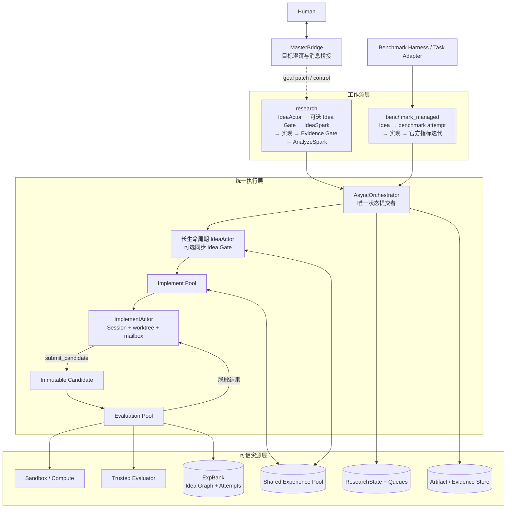

统一执行层不替工作流做研究判断。它只保证并发、预算、版本隔离、状态持久化、
失败路由和证据一致性；`research` 与 `benchmark_managed` 的准入和晋级语义由各自
工作流定义。

### 3.2 Master 不应该是 loop 内部裁判

Master 的定位是 **human 与自主 loop 的 bridge**，不负责 loop 内部的日常科研判断。

Master 负责：

- 和用户对话，澄清目标；
- 把用户约束、偏好、修改意见转成 goal patch；
- 把 loop 的阶段性状态总结给用户；
- 处理用户随时插话、暂停、恢复、改方向；
- 必要时请求用户选择，例如“继续冲 SOTA”还是“转向可解释论文主线”。

Master 不负责：

- 每轮接收 evaluator 结果并判断下一步；
- 处理分支冲突；
- 更新 Pareto 板；
- 决定某个 idea 是否实现；
- 判断消融是否通过；
- 直接调度实现或评测队列。

这些都应该由 **Loop Orchestrator** 和 loop 内部 worker 完成。只有当 loop 需要 human preference 或用户主动发来消息时，Master 才介入。

### 3.2.1 V1 的目标变更语义

Human、Master 和 Loop 之间使用 file-as-bus，不把用户新指令直接混入当前运行目标。
入站命令追加到当前 workspace 的 `control/commands.jsonl`，Loop 主线程消费后把
结果写入 `control/events.jsonl`；原始命令、回执和游标都保留为审计证据。

```text
Human / Master / CLI
        │
        ▼
control/commands.jsonl
        │ Loop tick 消费
        ▼
ResearchState + queues + handoff
        │
        ▼
control/events.jsonl
```

用户提出新目标时必须选择：

- `continue_current`：当前 Loop 继续原目标；新指令只写入
  `research_state.pending_goal_change`，留给下一 Loop；
- `stop_current`：停止派发新任务，未领取队列项归档，在途任务自然收尾，写出
  `handoff.md/json`，然后使用新的 `goal_id` fork。

新 Loop 不复制旧 Loop 的 artifacts、代码或队列，而是在 goal 中记录：

```yaml
lineage:
  parent_loop_id: old_goal
  parent_workspace: /abs/path/.famou/loop/old_goal
  prior_loop_dirs: [/abs/path/.famou/loop/old_goal]
  experience_sources: [/abs/path/.famou/loop/old_goal/shared_experience_pool]
```

Idea/Implement Agent 先读父 Loop 的 `handoff.md`，再按需读 ExpBank、代码快照、
评测证据和失败日志；这些目录对新 Loop 都是只读输入。

### 3.3 两种循环形态

开放科研循环：

```text
目标澄清 / task card
  → benchmark 协议解析 + baseline / 文献理解
  → 长生命周期 IdeaActor 复用调研上下文，逐条提交 raw hypothesis
  → 每条 raw Idea 立即进入 ExpBank 的 Idea Graph
  → 默认信任 IdeaAgent 指令并直接准入 Ideaspark
  → 可选同步 Idea Gate 按 Goal Contract / Rubric 返回 pass、revise、reject 或 needs_evidence
  → 开启 Gate 时，只有 pass 的 idea 进入 Ideaspark
  → 并发选择 idea 进行方法设计与实现
  → 公共实验 / 官方 evaluator 调用
  → 结果分析
  → 达标分支进入 Analyze_spark
  → 消融 / 鲁棒性 / 复杂度 / 论文 claim 检查
  → loop 内部决定继续、分叉、归档、论文化
  → 必要时由 Master 向用户请求更清晰偏好
```

完整 benchmark 循环：

```text
Benchmark Task / Harness
  → Idea Agent 读取任务与 ExpBank
  → benchmark_attempt_queue
  → ImplementActor 实现并 smoke test
  → submit_candidate 冻结代码快照，Actor park
  → EvaluationJob 顺序执行 run.py、产物校验和官方 evaluator
  → 分数与工程诊断写 ExpBank，脱敏反馈写 Actor mailbox
  → 原 Actor Session 恢复，修复或继续 refine
  → 更新最佳候选，直到墙钟或 benchmark 预算结束
```

`benchmark_managed` 不经过 Master、Idea Gate、Result Analyst、AnalyzeSpark 或论文
候选 judge。不是因为这些维度不重要，而是完整 benchmark 没有为它们提供可信评测
协议；Loop 不应自行增加会改变 benchmark 语义的 LLM 裁判。

---

## 4. 节点 / Agent / 工具的边界

文档里出现的“分析器”“评审器”“运行器”不一定都必须是独立常驻 agent。建议区分三类：

| 类型 | 含义 | 例子 | MVP 实现方式 |
|---|---|---|---|
| Agent node | 需要独立推理、规划、产出结构化结论的智能体节点 | 假设生成、方法设计、结果分析、论文审稿 | 可以是独立 agent，也可以是同一 LLM 的不同 role prompt |
| Tool / service | 不应由 LLM 自由发挥，必须确定性执行或受控执行 | Trusted Evaluator、训练脚本、单元测试、benchmark adapter | 独立工具 / CLI / service |
| Capability / subroutine | 一个明确阶段里的可复用能力，不一定单独成 agent | benchmark 协议解析、指标 schema 解析、baseline 摘要、日志解析 | 可由 Loop Orchestrator 调用模板化 prompt、脚本或短任务 worker 完成 |

这里的 **Capability / subroutine** 指的是：

- 它有明确输入和输出；
- 它服务于某个固定阶段；
- 它不一定需要长期维护独立记忆、目标和队列；
- 它可以由同一个 LLM role、一个脚本、一个函数或一个短生命周期 worker 完成；
- 当这个能力变复杂、需要并发、需要独立状态时，再升级成 agent node。

例如：

```text
benchmark 协议解析 capability:
  输入: benchmark README / evaluator 脚本 / submission spec
  输出: benchmark_contract.yaml
  是否必须独立 agent: 否，MVP 可作为 Loop Orchestrator 调用的子流程

文献与基线分析 capability:
  输入: baseline repo / papers / leaderboard 方法
  输出: baseline_map.md + novelty_gap.yaml
  是否必须独立 agent: 不一定；若任务强依赖文献创新，可升级为独立 agent
```

因此：

- **基准与指标分析器**：更像 `Capability + Tool adapter builder`。它负责把 benchmark 协议读清楚，产出 `benchmark_contract`，但不一定是独立 agent。
- **文献与基线分析器**：可以是一个 agent node，也可以先作为 `Research Context Builder` 的子能力；如果任务重度依赖文献创新，建议独立成 agent。
- **结果分析器 / 新颖性评审器 / 论文审稿器**：更适合作为 agent node，因为需要判断、归纳和研究性 critique。
- **Trusted Evaluator**：绝对不是 agent，而是隔离工具。


### 4.1 建议的明确阶段划分

为了避免“每个器都是一个 agent”以及 loop 语义混乱，阶段必须按工作流拆分。

完整 benchmark 的 V1 阶段已经固定为：

| 阶段 | 目标 | 执行主体 | 主要产物 |
|---|---|---|---|
| B0 任务装载 | 使用 benchmark 已给出的任务、数据和环境 | Harness / Task Adapter | public problem / task contract |
| B1 Idea 生产 | 读取任务和完整 ExpBank，持续提出可执行改进 | Idea Agent Pool | benchmark attempt |
| B2 实现回合 | 在稳定 worktree 中实现、修复或 refine | ImplementActor | code / smoke evidence |
| B3 显式提交 | 原子冻结当前代码，建立 Candidate | `submit_candidate` 工具 | immutable Candidate |
| B4 运行与评分 | 顺序运行代码、校验产物、调用官方评测 | Evaluation Pool + Trusted Evaluator | run evidence / official result |
| B5 反馈与记忆 | 写 ExpBank、排行榜和 Actor mailbox | Orchestrator 主线程 | attempt record / feedback / best branch |

开放科研的目标阶段如下；其中后半段仍属于持续演进的研究模式蓝图：

| 阶段 | 目标 | 典型节点 / 能力 | 主要产物 |
|---|---|---|---|
| P0 目标澄清 | 把用户模糊意图变成可执行目标 | Master + Task Formalizer | `goal_card` / `task_card` |
| P1 Benchmark 接入 | 明确官方评测协议和可返回指标 | Benchmark capability + Adapter tool | `benchmark_contract` |
| P2 上下文构建 | 理解 baseline、SOTA、文献空白，并检索共享经验池 | Literature/Baseline worker + Experience Retriever | `baseline_map` / `novelty_gap` / `retrieved_experience` |
| P3 Idea 生成 | 复用同一调研 Session，逐条提出并关联候选机制 | 长生命周期 IdeaActor | `raw_idea` / Idea Graph node |
| P4 Idea 准入 | 同步返回通过、修改、拒绝或补证据诊断 | Goal/Rubric Idea Gate | review / criterion diagnosis |
| P5 Ideaspark 排队 | 只保存通过准入的可实现 idea | Ideaspark queue | 待实现 idea 队列 |
| P6 方法设计与实现 | 把 idea 变成算法和代码 | Method Designer + Implementation Agent | branch code / config |
| P7 公共实验与官方评测 | 跑 public validation，必要时调用官方 evaluator | Experiment Runner + Trusted Evaluator | public results / official scores |
| P8 结果分析与分支决策 | 判断是否晋级、回退、归档，并写回经验池 | Result Analyst + Loop Orchestrator | branch decision / Pareto board / evidence links / experience records |
| P9 深度分析 | 对候选做消融、鲁棒性、复杂度、可解释性 | Analyze_spark workers | ablation tables / robustness report / evidence bundle |
| P10 论文化 | 形成 claim、论文草稿和审稿反馈 | Paper Writer + Reviewer | paper draft / review / claim-evidence map |

关键点：**Ideaspark 不是原始 idea 垃圾桶，而是“已通过 Goal/Rubric 准入的候选 idea 队列”。** 原始 Idea 在调用 P4 Gate 前就写入 `expbank/ideas/`；无论结果是通过、修改、拒绝还是补证据，都保留在 `expbank/IDEAS.md` 所索引的 Idea Graph 中。只有 `pass` 才进入 Ideaspark。

在 `benchmark_managed` 中，Idea 不做创新性准入，因此进入的是
`benchmark_attempt_queue`，不是开放科研语义下的 Ideaspark。

---

## 5. Agent 角色设计

### 5.1 主控智能体（Master Agent）

定位：**human 与后台 loop 的桥接层**，不是 loop 内部裁判。

职责：

- 与用户对话，澄清目标；
- 把模糊目标转成初始 `task_card` / `goal_card`；
- 在 loop 产出阶段性结果后，向用户汇报并请求更清晰偏好；
- 接收用户随时插入的指令，例如暂停、恢复、修改约束、改变目标权重；
- 将用户反馈转换成 `goal_patch`，发送给 Loop Orchestrator；
- 控制 human-facing 叙事：当前进展、风险、候选方案、下一步建议。

不负责：

- evaluator 结果的日常处理；
- 分支优先级排序；
- idea 是否实现的内部决策；
- 公共实验、消融实验、鲁棒性实验的调度；
- Pareto 板更新；
- loop 内部冲突处理。

输入：

- 用户消息；
- loop 给出的阶段性摘要；
- 需要用户确认的问题；
- 当前 goal / task card。

输出：

```yaml
goal_patch:
  reason: user_feedback | clarification | budget_change | direction_change
  changes:
    objective_brief:
      preference_description: 用户更关注可解释性，不希望只靠 ensemble 刷分。
      allow_examples:
        - accuracy 小幅下降但方法明显更简单、更可解释。
      reject_examples:
        - 多个强模型 ensemble 后只提升分数，但没有方法创新。
      tie_breakers:
        - 分数接近时优先选择可解释性和证据链更强的方案。
    constraints:
      ensemble_allowed: false
```

典型行为：

```text
如果用户目标模糊：
    追问 benchmark、baseline、主指标、硬约束
如果 loop 给出多个方向且需要价值判断：
    总结 trade-off，请用户选择偏好
如果用户随时插话修改目标：
    生成 goal_patch，交给 Loop Orchestrator
如果 loop 不需要用户输入：
    Master 不进入 loop 内部决策
```

---

### 5.2 循环编排器（Loop Orchestrator）

定位：loop 内部的调度与状态机，不是 human-facing master。

职责：

- 维护 `ResearchState`；
- 维护 Ideaspark / Benchmark Attempt / Evaluation / AnalyzeSpark 队列；
- 串行提交 queue、Actor、Candidate、ExpBank、预算和排行榜状态；
- 在 `research` 中根据公共实验、官方结果和 critic 更新分支决策；
- 在 `benchmark_managed` 中执行确定性失败路由，不增加额外研究 judge；
- 控制墙钟、并发、队列容量和 benchmark 可选提交预算；
- 在 `research` 中决定 idea 晋级、归档、回退和进入论文化；
- 在需要用户偏好时，向 Master 发出 `clarification_request`。

输出示例：

```yaml
loop_event:
  type: clarification_request
  reason: tradeoff_between_score_and_interpretability
  options:
    - pursue_sota_score
    - pursue_interpretable_method
  context:
    branch_a: 高分但接近 ensemble baseline，创新性不足
    branch_b: 分数略低但解释性和论文故事更强
```

典型内部决策规则：

```text
如果实现失败：
    回到实现智能体修复，超过重试次数则归档
如果公共验证远低于 baseline：
    归档或要求方法设计器简化
如果官方 evaluator 仅返回总分：
    只用官方总分更新 benchmark_score，其它维度来自内部公共实验和 critic
如果实现后的实验表明原创新 claim 不成立：
    不进入论文候选，回到结果分析 / 方法修订阶段
如果某个 idea 在准入阶段就被判定低创新：
    直接拒绝，不进入 Ideaspark
如果新颖性高但分数低：
    保留为探索分支，降低资源优先级或寻找混合方案
如果分数、稳定性、故事线都不错：
    推入 Analyze_spark 做消融和论文化
如果出现需要价值偏好的 trade-off：
    通过 Master 询问用户
```

---

### 5.3 任务形式化器（Task Formalizer）

职责：

- 把用户自然语言目标变成结构化 task card；
- 明确数据集、baseline、官方指标、用户偏好、约束、资源预算；
- 明确哪些是 hard constraints，哪些是 preference brief / examples；
- 标记哪些目标已经由用户确认，哪些只是系统暂定假设。

输出示例：

```yaml
task_card:
  task_id: classification_algo_innovation_001
  domain: classification
  problem: tabular / vision / graph / time_series / text
  datasets:
    - name: dataset_1
      split_policy: official
      public_val_available: true
    - name: dataset_2
      split_policy: official
  baselines:
    - A
    - B
    - C
  objective_brief:
    primary_goal: 设计一个具有新机制的分类算法，在官方 accuracy 上达到或接近强 baseline。
    official_metric:
      name: accuracy
      direction: 越大越好
      source: benchmark_adapter
    preference_description: >
      用户希望方法有解释性和论文价值；速度也重要，但不能为了速度牺牲核心指标过多。
      不希望系统只做调参、ensemble 或简单拼接 baseline。
    allow_examples:
      - 比最强 baseline accuracy 略低，但推理速度明显提升，且解释性更强。
      - 引入新的可解释路由/原型/符号结构，并用消融证明其作用。
      - 先在 public validation 上做充分验证，再有限调用官方 evaluator。
    reject_examples:
      - 只调 learning rate、batch size、tree depth 等超参数。
      - 直接 ensemble A/B/C 来刷分，没有新机制。
      - 使用 benchmark 禁止的数据或通过 evaluator 反推 hidden test。
    tie_breakers:
      - 分数接近时，优先机制清晰、证据链完整、实现简单的方案。
      - 如果速度和 accuracy 冲突，先向 Master 请求用户偏好。
  constraints:
    no_hidden_test_access: true
    max_training_hours: 24
    max_inference_latency_ms: 5
    max_model_size_mb: 200
```

---

### 5.4 基准与指标分析器（Benchmark & Metric Analyst）

职责：

- 阅读 benchmark 说明、官方脚本、提交格式和评测协议；
- 明确 official splits、允许使用的数据、提交次数限制、是否有 hidden test；
- 明确官方 metric 及其方向，例如 accuracy 越大越好、RMSE 越小越好；
- 产出 `benchmark_contract`，告诉 loop：哪些指标来自官方 evaluator，哪些只能内部估计；
- 协助把 bench 官方 evaluator 包成 `BenchmarkAdapter`；
- 建议 public validation 方案，但不能替代官方 hidden evaluation；
- 标注泄漏风险和禁止行为。

它不是“多目标裁判”。多目标权重来自用户澄清与 loop 策略；官方分数来自 evaluator；新颖性、解释性、论文价值等由其它 worker / critic 估计。

它不能：

- 读取 hidden test labels；
- 修改 evaluator 以影响分数；
- 通过 evaluator 反推 hidden labels；
- 使用 benchmark 禁止的数据源；
- 虚构 benchmark 没有提供的细粒度指标。

`benchmark_contract` 的含义是“评测契约”：告诉 loop 这个 benchmark 官方 evaluator 到底能评什么、返回什么、不能返回什么。它不是新增一个评测标准，也不是让 agent 自己评测 hidden test。

举例：

```text
如果 benchmark 只返回 accuracy：
  official_metrics = accuracy
  latency / robustness / interpretability = 不属于官方 evaluator 输出，只能在 public eval 或内部分析里估计

如果 benchmark 官方同时评 correctness + runtime：
  official_metrics = correctness, runtime
  这两个字段都可以进入官方分数面板
```

这样做的目的：避免 loop 把“内部公共验证测出来的速度”误认为“官方 hidden evaluator 的成绩”，也避免 agent 以为可以向 evaluator 索取不存在的细粒度错误信息。

输出：

```yaml
benchmark_contract:
  datasets:
    - dataset_1
  public_validation:
    允许: true
    split: train_val_split_v1
  hidden_evaluation:
    evaluator: trusted_evaluator_v1
    返回:
      必有:
        - valid
        - official_metrics
      可能有:
        - runtime
        - per_domain_score
        - diagnostics_public
      不保证有:
        - robustness
        - interpretability
        - failure_cases
  禁止事项:
    - hidden_test_access
    - manual_label_inspection
    - external_training_data_without_declaration
```

---

### 5.5 文献与基线分析器（Literature & Baseline Analyst）

职责：

- 阅读 baseline A/B/C；
- 复现 baseline；
- 总结方法 taxonomy；
- 找各 baseline 的优缺点；
- 找潜在创新空间；
- 整理 related work map。

输出示例：

```markdown
## 基线图谱

### A
- Strength: strong primary metric
- Weakness: slow inference, low interpretability
- Opportunity: distillation, sparse approximation, prototype explanation

### B
- Strength: interpretable
- Weakness: lower nonlinear modeling capacity
- Opportunity: hybrid symbolic-neural model

### C
- Strength: robust under shift
- Weakness: high training cost
- Opportunity: cheaper surrogate training
```

---

### 5.6 假设生成器（Hypothesis Generator）

职责：

- 基于 baseline weakness、failure cases、literature gap 生成 raw research ideas；
- 每个 raw idea 必须包含机制、预期收益、风险、验证实验；
- 不允许只输出“调参”“换 backbone”“加 ensemble”这种低创新建议，除非目标明确允许。

输出示例：

```yaml
idea:
  id: H7
  name: Sparse Prototype-Tree Classifier
  core_claim:
    - competitive accuracy
    - interpretable prototype routing
    - faster inference than baseline A
  mechanism:
    - learn class prototypes
    - route by sparse tree over prototype distances
    - calibrate output probabilities
  expected_gain:
    accuracy: medium
    interpretability: high
    speed: high
    robustness: medium
  expected_return:
    target_level: match_sota  # below_sota | match_sota | surpass_sota | uncertain
    expected_metric:
      name: aggregate_improvement
      range:
        lower: 0.02
        upper: 0.10
    confidence: medium
    basis:
      - ExpBank 中相同失败模式的最佳路线已有稳定正向提升
    assumptions:
      - 公开数据分布与历史实验一致
  risks:
    - may underfit high-dimensional nonlinear data
    - prototype collapse
  validation_plan:
    - compare against A/B/C
    - ablate prototype count
    - measure latency
    - visualize prototype paths
```

其中 `expected_return` 是 IdeaAgent 在提案时给 Search Policy 使用的收益预测，不是正式
实验结果。Benchmark Facility 若公开了 `score_interpretation`，IdeaAgent 必须按其中的
指标和等级填写；无法可靠给出数值时将 `range` 写为 `null`，证据不足时使用
`target_level: uncertain`。任何预测都不能写入官方指标或更新排行榜，正式结论仍只来自
Evaluator Facility。

---

### 5.7 同步 Idea Gate

Idea Gate 是开放科研工作流中的可选模块，V1 默认关闭：

```yaml
workflow:
  type: research
  idea_gate:
    enabled: false
```

关闭时，系统信任 IdeaAgent instruction 对目标和约束的遵守，原始 Idea 留存到 Idea
Graph 后直接进入 Ideaspark。系统记录 `enqueue_without_gate / idea_gate_disabled`，但不
伪造 `pass` Review。需要更严格执行创新性、可解释性或禁止项时，可以显式开启 Gate。

职责：

- 读取 Master 与 Human 澄清后冻结的 Research Task Contract；
- 判断 idea 是否与目标相关并满足 Human hard requirements；
- 判断 idea 是否新颖；
- 判断是否只是 baseline 拼接；
- 检查 related work overlap；
- 检查机制是否清楚、可实现、可检验，以及是否给出可解释性验证计划；
- 同步返回 `pass / revise / reject / needs_evidence`；
- 作为 Ideaspark 的前置准入 Gate：低创新、重复、只有调参/ensemble 的 idea 不得进入 Ideaspark。

Rubric 不使用无法解释的综合权重或虚构分数。每项要求独立给出结论、证据、诊断码和置信度：

```json
{
  "idea_id": "H7",
  "verdict": "revise",
  "criterion_results": [
    {
      "criterion": "novelty",
      "status": "uncertain",
      "diagnosis_code": "insufficient_prior_work_evidence",
      "reason": "尚未排除与 prototype tree 文献的机制重合",
      "evidence_refs": ["paper:..."],
      "confidence": "medium"
    }
  ],
  "actionable_revision": ["补充相关工作检索并明确机制差异"],
  "reusable_lessons": ["没有文献证据时不能声称机制新颖"]
}
```

启用后，IdeaActor 提交一条 Idea并等待该 Gate 返回，不继续预取下一条。`revise` 和
`needs_evidence` 会在恢复同一 CLI Session 时直接交还原 IdeaActor；`reject` 也会写入
Idea Graph 和共享经验池。这个同步边界保证后续 Idea 能立即吸收评审反馈。

---

### 5.8 方法设计器（Method Designer）

职责：

- 将 idea 变成具体算法；
- 写数学定义；
- 写 loss / objective；
- 写 training procedure；
- 写 inference procedure；
- 写 complexity analysis；
- 写伪代码；
- 设计 ablation。

输出：

```markdown
## 方法规格

### Model
...

### Training Objective
...

### Inference
...

### Complexity
Training: O(...)
Inference: O(...)

### Pseudocode
...

### Required Ablations
1. no sparse routing
2. no prototype calibration
3. different prototype counts
```

---

### 5.9 实现智能体（Implementation Agent）

当前 V1 将实现智能体托管在逻辑长生命周期 `ImplementActor` 中。Actor 不是常驻 OS
进程，而是可多次恢复的研究主体：

```text
ready / repair_ready / refine_ready
               ↓ 获得 Implement lease
            running
               ↓ smoke + preflight + submit_candidate
      waiting_evaluation（park，释放 lease）
               ↓ evaluator / 运行反馈写入 mailbox
      repair_ready / refine_ready / completed
               ↓ 有空闲 lease 时恢复原 Session
```

职责：

- 实现 method；
- 接入 benchmark 规定的运行入口；
- 保持 baseline API 兼容；
- 写 unit tests；
- 保证 reproducibility；
- 在提交前执行公开数据 smoke test；
- 通过 `submit_candidate` 明确提交可评测版本；
- 收到 mailbox 反馈后修复工程错误或继续方法 refine；
- 不修改 evaluator；
- 不读 hidden test。

输出：

```text
methods/sparse_prototype_tree.py
configs/spt.yaml
scripts/train_spt.py
tests/test_spt.py
```

质量要求：

- deterministic seed；
- config driven；
- clear logging；
- artifact path 规范；
- 训练失败可恢复；
- 结果可复现。

生命周期约束：

- 同一 Actor 固定绑定一个 Idea lineage、branch、worktree 和 Agent Session；
- 同一 Actor 同时最多有一个 queued / running / waiting Candidate；
- Candidate 提交后立即冻结，不受 worktree 后续修改影响；
- park 的 Actor 不占 Implement 并发槽；
- 工程修复恢复原 Session，不把其它 Idea 的 Agent 临时拉来修复；
- Agent 自然退出不等于提交，`benchmark_managed` 默认强制显式提交。

---

### 5.10 统一评测任务（EvaluationJob）

当前 V1 不把 Experiment Runner 和 Evaluator 拆成两个异步池。单个 Evaluation
worker 对一个不可变 Candidate 严格顺序执行：

```text
Candidate
  → canonical run
  → 产物格式和完整性校验
  → Trusted Evaluator（仅在前两步有效时调用）
  → run/evaluation evidence
```

职责：

- 在隔离工作目录运行 `run.py` 或 benchmark 入口；
- 保存 stdout、stderr、return code、runtime 和输出产物；
- 校验提交格式和入口契约；
- 在运行成功后调用 trusted evaluator；
- 记录训练日志；
- 记录硬件 / runtime / memory；
- 收集失败信息。

开放科研模式可以在 Candidate 提交前或 EvaluationJob 中执行 public validation；最终
hidden test 仍只能由 Trusted Evaluator 访问。

输出：

```yaml
experiment:
  candidate_id: candidate_001
  branch_id: H7-v2
  run:
    valid: true
    returncode: 0
    stdout_ref: artifact_stdout_001
    stderr_ref: artifact_stderr_001
    output_ref: artifact_submission_001
  evaluation:
    source: official_evaluator
    valid: true
    official_metrics:
      accuracy: 0.834
```

Evaluation worker 只执行耗时任务；队列状态、正式评测预算、Leaderboard、ExpBank 和
decision log 由 Orchestrator 主线程串行提交，避免并发写入竞争。

---

### 5.11 可信评测器工具（Trusted Evaluator Tool）

非 agent，而是工具 / service。

职责：

- 持有 hidden test；
- 执行 official evaluator；
- 检查 submission validity；
- 返回 `score.json`；
- 记录 audit log；
- 防止频繁 probing hidden test。

接口示例：

```bash
famou eval submit \
  --benchmark my_classification_bench \
  --artifact runs/H7-v2/submission.zip \
  --budget-tag goal_001
```

返回示例。注意这里只假设返回 bench 官方能给出的内容：

```json
{
  "benchmark": "my_classification_bench",
  "submission_id": "sub_001",
  "valid": true,
  "official_metrics": {
    "accuracy": 0.873
  },
  "diagnostics_public": {
    "format_check": "passed"
  },
  "budget": {
    "remaining_submissions": 14
  }
}
```

如果某个 benchmark 官方不返回 runtime、robustness 或分项错误，adapter 也不应伪造这些字段。loop 可以在公共验证集上自行测 runtime / robustness，但必须把来源标记为 `internal_public_eval`，不能和官方 hidden score 混淆。

---

### 5.12 结果分析器（Result Analyst）

该节点服务 `research` 工作流。`benchmark_managed` 不额外调用 Result Analyst；有效
官方结果直接写入 ExpBank 和排行榜，并由确定性 ResultRouter 根据失败阶段把反馈路由
到原 Actor mailbox。ResultRouter 不是 LLM judge。

职责：

- 分析公共实验结果与 evaluator 返回的官方聚合分数；
- 在 evaluator 信息很粗时，结合 public validation、训练日志、消融结果做间接诊断；
- 找 failure mode，但不能要求 hidden evaluator 暴露逐样本错误；
- 判断提升是否真实；
- 判断是否 overfit public validation；
- 给出下一轮改进建议。

输出：

```markdown
## H7-v2 结果分析

Positive:
- improved latency by 42%
- maintained accuracy within 0.3% of baseline A
- interpretability score significantly higher

Negative:
- poor robustness under dataset_3 shift
- performance sensitive to prototype count

Next:
- add robust prototype regularization
- run cross-dataset calibration
```

---

### 5.13 消融与鲁棒性智能体（Ablation & Robustness Agent）

职责：

- 设计消融实验；
- 跑 robustness；
- 跑 speed / memory；
- 跑 statistical significance；
- 生成论文实验表。

典型实验：

- component ablation；
- hyperparameter sensitivity；
- multi-seed variance；
- cross-dataset generalization；
- OOD / noise robustness；
- runtime / memory；
- interpretability visualization；
- failure case analysis。

---

### 5.14 论文写作者（Paper Writer）

职责：

- 将研究整理为 paper draft；
- 明确 problem、method、claim；
- 写 method section；
- 写 experiment section；
- 写 ablation / limitation；
- 生成 reproducibility checklist。

---

### 5.15 论文审稿器（Paper Reviewer）

职责：

- 模拟审稿；
- 找 rejection risk；
- 检查 novelty claim；
- 检查实验完整性；
- 检查是否过度 claim；
- 给出 accept / weak accept / borderline / reject 风险。

输出：

```yaml
paper_review:
  novelty: 4
  technical_soundness: 3
  empirical_strength: 4
  clarity: 3
  reproducibility: 4
  likely_venue: workshop_or_conference
  rejection_risks:
    - relation to prototype trees insufficient
    - theory section weak
    - robustness claim needs more evidence
```

---

## 6. 共享经验池设计（Shared Experience Pool）

共享经验池是所有 agent / worker 都可以检索的长期知识库。它和 `ResearchState` 的区别：

| 对象 | 作用域 | 内容 | 生命周期 |
|---|---|---|---|
| ResearchState | 单个 goal / 单次任务 | 当前任务、分支、实验、预算、论文状态 | goal 结束后归档 |
| ExpBank | 单个 run，按 attempt 不可变累积 | Idea、实现摘要、代码快照、运行/评测证据、结论和路径索引 | run 结束后完整保留 |
| Shared Experience Pool | 跨 goal / 跨 benchmark / 跨时间 | baseline、历史尝试、失败经验、可复用方法、外部检索知识 | 长期累积 |

当前 V1 中，Idea Agent 和 Implement Agent 都能直接读取 run 内完整 ExpBank 目录。
`INDEX.md` 提供浅索引，每个 attempt 目录保留 `SUMMARY.md`、`record.json`、代码和证据；
不要求 Agent 只能通过专用检索工具访问。

### 6.1 经验池包含什么

建议至少包含以下几类 record：

```yaml
experience_record:
  id:
  type: external_baseline | literature_method | attempted_idea | experiment_result | failure_case | reusable_code | reviewer_note
  domain:
  benchmark:
  task_signature:
  method_name:
  source:
    kind: paper | github | leaderboard | prior_run | human_note
    url:
    citation:
  summary:
  key_mechanism:
  metrics:
    official:
    public_eval:
    internal:
  artifacts:
    code_ref:
    config_ref:
    report_ref:
  outcome:
    status: useful | failed | inconclusive | rejected_low_novelty | deprecated
    reason:
  applicability:
    works_when:
    fails_when:
    constraints:
  created_at:
  updated_at:
```

### 6.2 经验池如何被使用

典型读路径：

- Benchmark / Baseline 阶段：检索同类 benchmark 的外部 baseline、SOTA 方法、历史复现结果；
- Idea 生成阶段：检索过去失败过的方向，避免重复提出；
- 创新性准入阶段：检索相似 idea / 论文，判断是否重复；
- 方法设计阶段：检索可复用模块、训练技巧、已知坑；
- 结果分析阶段：对比历史 run，判断当前提升是否可信；
- 论文写作阶段：检索 related work 和过往 reviewer note。

典型写路径：

- 外部检索发现新的 baseline / paper / repo，写入 `external_baseline` 或 `literature_method`；
- 一个 idea 被拒绝，写入 `rejected_low_novelty`，以后避免重复；
- 工程实现失败先写 ExpBank 和 Artifact；只有排除代码/协议错误后，才能把有效科研失败
  写入 `failure_case`，避免形成错误认知；
- 一个分支取得好结果，写入 `experiment_result` 和可复用 artifact；
- 消融证明某组件无效，写入 `attempted_idea` 的 outcome。

### 6.3 检索接口

V1 以可直接浏览的浅目录和 `INDEX.md` 为主；数据量增大后可以叠加统一检索接口，
但检索层不能成为访问事实的唯一入口：

```python
class ExperienceStore:
    def search(self, query: str, filters: dict, top_k: int = 10) -> list[ExperienceRecord]:
        ...

    def upsert(self, record: ExperienceRecord) -> str:
        ...

    def link_artifact(self, record_id: str, artifact_ref: str) -> None:
        ...
```

检索时建议支持：

```yaml
filters:
  domain: classification
  benchmark: dataset_1
  record_type:
    - external_baseline
    - attempted_idea
    - failure_case
  outcome_status:
    - useful
    - failed
  time_range:
  min_confidence:
```

### 6.4 和防泄漏的关系

共享经验池不能成为 hidden test 泄漏通道：

- 不写入 hidden labels、hidden examples、逐样本 hidden 预测对错；
- official evaluator 返回的内容只能按 `benchmark_contract` 允许的聚合字段存储；
- public eval 与 official hidden eval 必须分开标记 source；
- 外部数据 / 外部 baseline 的使用要记录 license 和 benchmark 是否允许；
- 对经验池检索结果要保留 provenance，避免“历史经验”污染当前 benchmark 规则。

---

## 7. 证据与产物留存设计（Artifact / Evidence Store）

科研 loop 的每一步都应留下可追溯证据。这里的证据不只是最终分数，还包括中间产物、失败日志、决策理由和用户反馈。

### 7.1 需要留存的内容

建议至少留存以下 artifact：

```yaml
artifact_record:
  id:
  type: idea | idea_review | method_spec | code_patch | config | run_log | public_eval | official_eval | ablation | analysis_report | paper_draft | user_feedback | decision
  goal_id:
  branch_id:
  parent_ids:
  created_by:
    node: HypothesisGenerator | Critic | ExperimentRunner | Evaluator | Master | Human
    model_or_tool_version:
  content_ref:
    path:
    uri:
    checksum:
  metadata:
    dataset:
    seed:
    commit:
    environment:
    command:
    started_at:
    finished_at:
  provenance:
    source: public_eval | official_evaluator | internal_analysis | external_search | human_feedback
    allowed_by_benchmark_contract: true
  summary:
```

重点包括：

- raw idea 和通过 / 拒绝理由；
- novelty / feasibility review；
- 方法设计文档、数学定义、伪代码；
- 代码 diff、commit、config、依赖版本；
- 训练日志、错误日志、运行命令、随机种子；
- public validation 结果；
- official evaluator 返回的原始 `score.json`；
- 消融实验表、鲁棒性测试、复杂度统计；
- Result Analyst 的分析报告；
- Loop Orchestrator 的分支决策记录；
- Master 收到的用户反馈和生成的 goal patch；
- paper draft、figure、table、claim-evidence map。

### 7.2 Claim-Evidence Map

论文或报告里的每个重要 claim 都应该链接到证据：

```yaml
claim_evidence:
  claim_id: C3
  claim: 新方法在 dataset_1 上保持接近 baseline A 的 accuracy，同时显著降低推理延迟。
  evidence:
    - artifact_id: official_eval_H7_v2
      supports: accuracy
    - artifact_id: public_runtime_H7_v2_seed123
      supports: latency
    - artifact_id: ablation_table_H7_v2
      supports: component_contribution
  limitations:
    - latency 来自 public runtime eval，不是官方 hidden evaluator 返回字段
```

如果一个 claim 找不到证据链接，则不能进入最终报告 / 论文主张，只能作为假设或未来工作。

### 7.3 决策也要留证据

不仅实验要留存，调度和分支决策也要留存：

```yaml
decision_record:
  id: decision_042
  branch_id: H7-v2
  decision: promote_to_analyze_spark
  decided_by: LoopOrchestrator
  reasons:
    - official accuracy 持平 strong baseline
    - public runtime 提升 42%
    - novelty critic 认为机制有独立 claim
  evidence:
    - official_eval_H7_v2
    - public_runtime_H7_v2
    - idea_review_H7
  alternatives:
    - H4-v3
    - H9-v1
  timestamp:
```

这样后续用户、Master、Reviewer 或复现实验都能知道为什么当时做了这个选择。

### 7.4 留存策略

建议策略：

- 所有 artifact 使用不可变 id 和 checksum；
- 大文件只存引用，小文件可以直接存 json / markdown；
- 每个 official evaluator 调用必须保存原始返回；
- 每个实验必须保存 command、config、seed、commit、环境摘要；
- 每个分析结论必须引用输入 artifact；
- 每个写回共享经验池的经验都要链接原始证据；
- 结束 goal 时生成 `evidence_bundle`，便于归档、复现和论文写作。

---

## 8. 研究状态设计（ResearchState）

所有 agent 共享一个结构化状态，而不是只靠聊天上下文。

`ResearchState` 是面向控制面和用户的聚合视图，不保存所有大对象本体。队列 item、
Actor、Candidate、ExpBank record 和 Artifact 各自独立持久化，ResearchState 只记录
当前目标、队列计数、分支视图、Leaderboard、预算和审计引用。当前 V1 的运行结构是：

```yaml
research_state:
  goal:
    objective_brief:
    workflow:
      type: research | benchmark_managed
    constraints:
      max_wall_time_hours:
      max_parallel_ideas:
      max_parallel_implementations:
      max_parallel_evaluations:
      max_implement_lifetime_sec:
      max_implement_turns_per_actor:
      max_run_attempts_per_actor:
      max_official_evaluations_per_actor:
      idea_queue_high_watermark:
      evaluation_queue_capacity:
  benchmark_contract:
  queues:
    ideaspark:
    benchmark_attempt_queue:
    evaluation_queue:
    analyze_spark:
  branches:
  evaluator_budget:
  leaderboard:
  artifact_index_ref:
  decision_log_ref:
  audit:
  termination_reason:
```

与 ResearchState 并列的持久化对象：

```text
actors/<actor_id>/state.json       # Actor 生命周期、Session 和多维预算
actors/<actor_id>/mailbox.jsonl    # 脱敏评测/工程反馈
candidates/<candidate_id>/         # 提交时冻结的代码、输出和证据
expbank/<attempt_id>/              # 不可变实验事实、代码快照和结论
queues/*.jsonl                     # 队列事件流与浅索引
artifacts/                         # 完整日志、结构化证据和大对象引用
```

下面的结构是开放科研目标蓝图中的扩展研究视图，不要求全部内嵌到单个
`research_state.yaml`：

```yaml
ResearchState:
  goal:
    id:
    user_objective:
    mode: loop
    status: clarifying | running | waiting_user_feedback | revised | completed
    confirmed_requirements:
    open_questions:
    revision_history:

  task_card:
    domain:
    datasets:
    baselines:
    objective_brief:
    constraints:

  benchmark_contract:
    evaluator:
    public_validation:
    hidden_eval_policy:
    prohibited_actions:

  literature:
    baseline_summaries:
    related_work:
    novelty_gaps:

  retrieved_experience:
    query_log:
    baseline_records:
    prior_attempts:
    failure_cases:
    reusable_artifacts:

  idea_pool:
    - idea_id:
      status:
      idea_review:
      risk:

  branches:
    - branch_id:
      idea_id:
      code_ref:
      config_ref:
      evidence_refs:
      status:
      parent_branch:

  experiments:
    - exp_id:
      branch_id:
      dataset:
      seed:
      metrics:
      logs:
      artifacts:
      evidence_refs:

  evaluator_scores:
    - submission_id:
      branch_id:
      source: official_benchmark_adapter
      official_metrics:
      score_json:

  internal_scores:
    - branch_id:
      source: public_eval | critic | static_analysis | human_feedback
      metrics:
      confidence:

  pareto_board:
    - branch_id:
      primary_metric:
      speed:
      interpretability:
      robustness:
      novelty:
      paper_readiness:

  artifact_index:
    - artifact_id:
      type:
      ref:
      checksum:
      provenance:

  decisions:
    - decision_id:
      decision:
      reasons:
      evidence_refs:

  paper:
    claims:
    claim_evidence_map:
    figures:
    tables:
    draft_path:
    reviews:

  budget:
    wall_time:
    compute:
    evaluator_submissions:
    token_budget:

  audit:
    hidden_test_access_attempts:
    evaluator_calls:
    external_data_usage:
    reproducibility_checks:
    experience_pool_reads:
    experience_pool_writes:
    artifact_writes:
    missing_evidence_warnings:
```

---

## 9. Pareto 板与多目标决策

不应只维护一个 best score，而应维护 Pareto board。

注意：Pareto 板里的字段来源不同，必须带 provenance：

- 官方 benchmark 分数：来自 Trusted Evaluator / Benchmark Adapter；
- speed / memory：如果 bench 不返回，则来自公共实验环境；
- novelty / paper readiness：来自文献评审、critic 或 human feedback；
- interpretability：可能来自公共实验、方法属性、可视化评审或用户 rubric。

因此 Pareto 板不是“evaluator 返回的完整多维成绩单”，而是 loop 汇总多源证据后的研究决策面板。

这里的 novelty / paper readiness 是 **post-hoc 研究证据评分**，不是 Ideaspark 准入策略的简单复制。无论 Idea 是直接准入还是经过 Gate，实现和消融后都可能发现核心机制没有贡献、claim 站不住，此时 post-hoc novelty / paper readiness 会下降。

| branch | primary metric | speed | interpretability | robustness | novelty | paper readiness |
|---|---:|---:|---:|---:|---:|---:|
| H1-v3 | 0.89 | 0.40 | 0.42 | 0.76 | 0.55 | 0.45 |
| H4-v2 | 0.86 | 0.92 | 0.81 | 0.79 | 0.68 | 0.70 |
| H7-v1 | 0.87 | 0.78 | 0.86 | 0.75 | 0.80 | 0.82 |

示例决策：

- H1-v3 分数最高，但实现后的消融没有支撑原始创新 claim，论文就绪度低；
- H4-v2 速度和解释性好，可作为应用型方法；
- H7-v1 平衡最好，适合进入 ablation + paper writing。

---

## 10. 循环调度策略（V1 简版）

第一版不要把 loop 做成过度复杂的状态机。V1 保留两条明确主路径，共享同一执行
底座，但不共享研究判决语义：

- 能稳定跑完整个 autonomous research loop；
- 每一步有证据留存；
- 出问题能定位到 idea / branch / experiment / evaluator call；
- Master 可以随时把用户反馈传进 loop；
- 后续再逐步增加复杂调度策略。

### 10.1 V1 双工作流总览

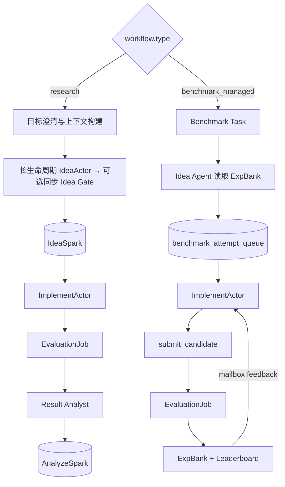

### 10.2 开放科研单轮主流程图

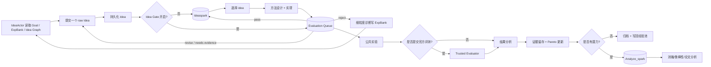

V1 只保留两个核心判断：

1. **idea 是否进入 Ideaspark**：默认按工作流策略直接准入；开启 Gate 时由 Goal Contract / Rubric 判断；
2. **branch 是否进入 Analyze_spark**：由结果分析和最低证据要求判断。

其它复杂情况，例如多目标 Pareto 冲突、跨分支合并、自动改写研究方向，先不作为 V1 主路径。

### 10.3 开放科研最小状态图

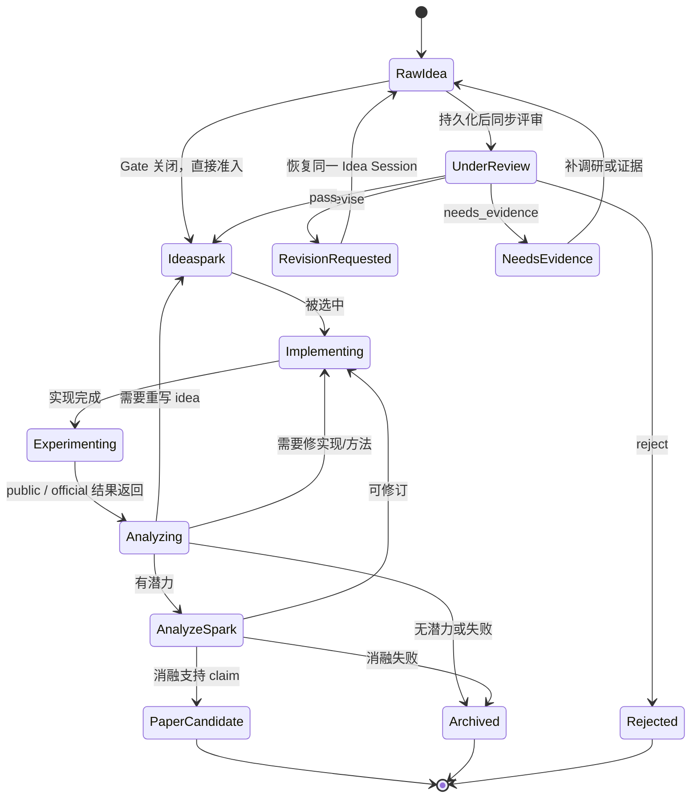

这个状态图刻意比完整科研流程简单。V1 不需要把 `OfficialEvaluating`、`NeedUserPreference`、`Ablating`、`PaperWriting` 都拆成独立状态；它们可以先作为 `Experimenting` / `AnalyzeSpark` 阶段里的子步骤，通过 artifact 和日志区分。

### 10.4 开放科研状态表

| 状态 | 含义 | V1 必须记录 |
|---|---|---|
| RawIdea | 刚生成、尚未执行准入策略的 idea | raw idea、来源经验、生成时间 |
| Rejected | gate 拒绝的 idea | 拒绝理由、相似 prior work、critic 结果 |
| Ideaspark | 直接准入或通过 Gate、等待实现的 idea | admission mode、可选 review、优先级、预期验证方式 |
| Implementing | 方法设计与代码实现 | method spec、code diff、config、测试结果 |
| Experimenting | public eval / optional official eval | run log、metrics、score.json、seed、环境 |
| Analyzing | 汇总结果、判断去向 | analysis report、evidence refs、decision record |
| AnalyzeSpark | 候选分支深度分析池 | 消融计划、鲁棒性计划、claim 草案 |
| PaperCandidate | 可以进入论文草稿的候选 | claim-evidence map、关键表格、限制 |
| Archived | 失败或暂不推进 | 归档原因、失败经验、可复用结论 |

### 10.5 开放科研淘汰 / 晋级规则

V1 只使用简单、可解释的规则，避免一开始就做复杂调度器。

| 节点 | 进入下一阶段的条件 | 不满足时 |
|---|---|---|
| RawIdea → Ideaspark | 新颖性基本成立；可实现；不违反 benchmark 规则；与用户目标相关 | Rejected，写明原因 |
| Ideaspark → Implementing | 优先级靠前；资源允许；验证成本可控 | 继续排队或延后 |
| Implementing → Experimenting | 代码可运行；基础测试通过；没有 evaluator / data 泄漏 | 修实现或归档 |
| Experimenting → Analyzing | public eval 完成；必要时 official eval 完成 | 修实验或归档 |
| Analyzing → AnalyzeSpark | 至少一个维度有明确潜力：分数、速度、解释性、机制、论文故事 | Archived 或回到 Implementing |
| AnalyzeSpark → PaperCandidate | 消融或鲁棒性证据支持核心 claim | 回到 Implementing 或 Archived |

### 10.6 Benchmark-managed Actor 状态与确定性路由

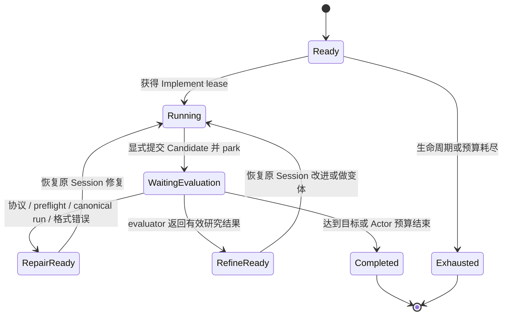

确定性路由规则：

| 结果发生阶段 | 语义 | 路由 |
|---|---|---|
| 未显式提交、入口缺失、语法/preflight 失败 | 工程错误 | 原 Actor `repair_ready` |
| canonical run 崩溃、非 benchmark 语义的超时、提交格式错误 | 工程错误 | 原 Actor `repair_ready` |
| evaluator 返回有效低分、`pass=false`、规则内 timeout/OOM | 有效科研结果 | ExpBank + 原 Actor `refine_ready` |
| evaluator 返回有效提升 | 有效科研结果 | 更新 Leaderboard + 原 Actor `refine_ready/completed` |

工程错误的代码、stdout、stderr 和诊断同样进入 ExpBank，但明确标为
`engineering_failed`，不能写成“该方法无效”。

### 10.7 V1 不做 / 暂缓的复杂能力

为了方便定位问题，以下能力建议先不放入 V1 主路径：

- 多分支自动合并；
- 复杂 Pareto 自动权重学习；
- 多个 Orchestrator 互相竞争；
- 自动根据 hidden score 反复微调提交策略；
- 过细状态拆分，例如每个消融实验单独状态机；
- 没有证据链的自动 paper claim 生成；
- 复杂的跨 benchmark 迁移策略。

这些可以在 V1 稳定后作为 V2/V3 能力逐步加。

## 11. 异步与并发：Idea、Implement、Evaluation 三个调度通道与有界队列

异步与并发是这个系统的关键能力：系统不应该是“一个 idea 跑完整个闭环，再下一个 idea”，而应该是 **异步生产 + 并发消费 + 分阶段晋级**。

当前 `AsyncOrchestrator` 创建三个长期存在的 `ThreadPoolExecutor`：Idea、Implement 和
Evaluation。这里的“三个通道”是调度语义，不表示 Evaluation 又拆成了 Experiment Pool
和 Evaluator Pool；一个 Evaluation worker 内部严格顺序执行
`BenchmarkFacility.run → validate_artifact → run_public_evaluation → EvaluationFacility.evaluate`。

两条工作流的 Idea 调度方式不同：

- `benchmark_managed` 使用独立 Idea executor 产生 attempt，因此 Idea Agent、Implement
  Agent 和 Evaluation worker 可以真正由三个线程池同时推进；
- `research` 的 IdeaActor 和可选 Idea Gate 目前仍在调度主线程中每个 tick 推进一次，
  同一 Idea Session 每回合提交一条 Idea。它不会被已经在后台运行的 Implement / Evaluation
  Future 阻塞，但尚不是一个独立的并行 Idea producer；`max_parallel_ideas` 主要控制
  benchmark-managed producer。

### 11.1 V1 队列设计

开放科研默认由 IdeaActor 直接向 Ideaspark 生产；显式开启 Idea Gate 后，两者形成同步对话。
IdeaActor 的主线程调用仍可以和已经在途的 Implement / Evaluation Future 重叠。完整 benchmark
没有 Idea Gate，使用独立 Idea producer 预取 attempt。真正需要长期异步等待的是 Implement
和 Evaluation：

| 执行池 | 执行内容 | 并发参数 |
|---|---|---|
| Idea 生产 | research 中由主调度线程恢复同一 Idea Session，按配置直接准入或同步调用 Gate；benchmark 中由独立 producer 并行产生 attempt | `max_parallel_ideas`（当前主要作用于 benchmark producer） |
| Implement Pool | 激活或恢复 ImplementActor，修改代码并显式提交 | `max_parallel_implementations` |
| Evaluation Pool | 对冻结 Candidate 顺序执行 run、校验和 evaluator | `max_parallel_evaluations` |

持久化层有四个浅队列，但两条工作流不会同时消费全部队列：

| 队列 | 放什么 | 谁生产 | 谁消费 |
|---|---|---|---|
| `ideaspark` | 开放科研中直接准入或通过 Goal/Rubric Idea Gate 的 idea | IdeaActor；可选 Idea Gate | Implement Pool |
| `benchmark_attempt_queue` | 完整 benchmark 中待实现或待恢复的 attempt | Benchmark Idea Agent / ResultRouter | Implement Pool |
| `evaluation_queue` | 已冻结、等待运行和正式评分的 Candidate | Implement Pool | Evaluation Pool |
| `analyze_spark` | 开放科研中值得做深度分析的 branch | Result Analyst | Analyze Workers |

业务上仍保持简单：每条工作流只有一个实现入口队列、一个统一 Evaluation 队列；
`analyze_spark` 只属于开放科研。

#### Ideaspark

`Ideaspark` 是 **按当前工作流策略准入、等待实现的候选 Idea 队列**。Gate 关闭时直接准入，开启时只接收 `pass` Idea。

V1 状态只保留：

```yaml
ideaspark_status:
  queued
  selected
  deferred
```

被拒绝的 raw idea 不进入 Ideaspark，只写入 Artifact / Evidence Store 和 Shared Experience Pool。

#### Benchmark Attempt Queue

`benchmark_attempt_queue` 不表示 Idea 已通过创新性判断。它只表示 benchmark-managed
下有一个可实现的新 Idea，或某个已有 Actor 收到反馈后已准备恢复。repair continuation
优先于 refine continuation 和新 Idea，但不抢占正在运行的 Agent。

#### Evaluation Queue

`evaluation_queue` 保存已经显式提交并冻结、等待统一 EvaluationJob 的 Candidate。

V1 状态只保留：

```yaml
evaluation_status:
  queued
  running
  finished
  failed
```

`evaluation_queue_capacity` 同时计算 queued 和 running。Implement admission 会把正在
运行且可能产生 Candidate 的 Implement 也纳入预留，避免评测较慢时无界堆积。

#### Analyze_spark

`Analyze_spark` 保存已经显示出潜力、值得做消融 / 鲁棒性 / 论文 claim 检查的 branch。

V1 状态只保留：

```yaml
analyze_status:
  queued
  running
  paper_candidate
  archived
```

### 11.2 V1 生产者-消费者结构图

当前异步主路径如下。Evaluation worker 内部的 run 和 evaluator 是顺序步骤，不是两个
独立池：

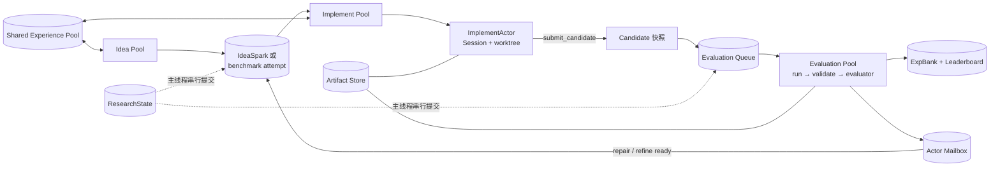

V1 的核心是：

- Idea 与 Implement 即使并发度都是 1，也可以彼此重叠；
- Candidate 一经提交立即冻结，评测读取快照而不是可变 worktree；
- Actor 提交后 park 并释放 Implement lease，慢评测不占用实现槽；
- 反馈返回后恢复原 Actor Session，不能由无关 Actor 代修；
- 每个 Actor 同时最多一个在途 Candidate；
- Evaluation worker 只做耗时执行，主线程串行更新状态、预算、ExpBank 和排行榜；
- 开放科研在 Evaluation 后进入 Result Analyst / AnalyzeSpark，完整 benchmark 则直接按官方结果迭代。

每个阶段失败时都能定位到 queue item、Actor、Candidate、ExpBank attempt 和 evidence ref。

### 11.3 V1 调度原则

V1 调度原则尽量简单：

| 队列 | 选择规则 | 并发建议 | 失败处理 |
|---|---|---|---|
| Idea / benchmark attempt | repair continuation 优先，其次 refine continuation，再到新 Idea | Implement 并发默认 1 | 工程失败恢复原 Actor；低分是有效科研结果 |
| Evaluation Queue | FIFO；同一 Actor 最多一个在途 Candidate | 由 benchmark 资源决定，当前 NatureBench 使用 3 | 保存 stdout/stderr/产物；按失败阶段确定性路由 |
| Analyze_spark | 优先分析最有论文潜力或最接近目标的 branch | 开放科研建议 1-2 | 消融不支持 claim 则归档或回实现 |

V1 不做复杂抢占式调度，只需要：

- FIFO + 少量确定性优先级；
- Idea 高水位和 Evaluation 容量共同形成背压；
- Actor 有墙钟、研究回合、canonical run、工程修复和可选正式评分预算；
- evaluator 全局调用预算可以为空，表示只受墙钟和队列背压限制；
- 所有失败都写 artifact；
- 队列状态写入 `ResearchState`。

#### New Idea / Refine Search Policy

> 状态：Pairwise Improve V1 已实现。更复杂的三阶段 DRR 与统一 Opportunity Judge 仍是
> 后续设计，不属于当前运行事实。

基础调度原先固定采用 `repair > refine > new idea`。它能保证 evaluator 反馈被及时消费，
但不能回答“下一个 Implement 槽位应该探索新方向，还是继续改进已有方法”；Pairwise Improve
V1 正是用于打破 Refine 和 New Idea 之间的固定选择。NatureBench 40 个有效 Run 的观察数据表明：

- New Idea 和 Refine 突破评分前全局 best 的比例分别为 `28.0%` 和 `25.1%`；
- 成功突破时，New Idea 的单次增益中位数为 `+0.02477`，约为 Refine
  `+0.01095` 的 2.3 倍；
- 最终最佳方案有 15 个来自 New Idea、24 个来自 Refine；
- 当前可比尝试数为 New Idea 143 次、Refine 271 次，尝试次数投入约为 `1:1.9`；
- 307 个 New Idea 中有 91 个在截止时未实现，同时有 41 个 Refine/Repair continuation
  未执行。

这些是异步运行下的观察结果，不是等预算随机实验，因此不能直接推出唯一最优比例；但足以
说明固定 `refine > new idea` 会系统性偏向局部利用。Search Policy 的目标是在固定研究墙钟内
最大化最终官方 best，同时保证方法空间探索不会被持续到达的 Refine 饿死。

##### 当前实现：Pairwise Improve

第一版不引入比例、固定权重或常驻 Judge Pool。获得有效 evaluator 结果的 Improve
continuation 被派发时，独立 Search Policy 从 IdeaSpark 临时租用一条 New Idea，并把两个选项
同时交给原 ImplementActor：

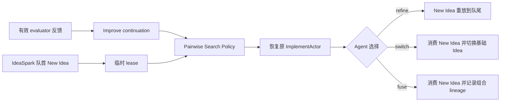

工程 Repair 确定性绕过配对，不读取也不消费 New Idea。ImplementAgent 必须在
`submit_candidate` 时显式提交：

```yaml
search_decision:
  action: refine | switch | fuse
  reason: 基于 evaluator 反馈、ExpBank 和预期上限的选择依据
  current_idea_id: 当前 lineage 的 Idea
  offered_idea_id: 临时提供的 New Idea
```

选择 `refine` 时并非把 Idea 放回原位置，而是保留同一个 `idea_id`、payload 和证据链，更新
`offer_count/last_defer_reason` 后重放到整个可派发 Idea 队列的末尾；若队列中存在更低优先级，
该条目的优先级会同步降到当前最低级，再用新的 `created_at` 保证同级 FIFO。这样同一 Idea
不会连续占据每个 Improve 回合。`switch/fuse` 才会把租约标记为已消费。Agent 异常、
Controller 重启和研究截止都通过持久化 `leased` 状态恢复或归档，不会静默丢失 Idea。

策略实现位于 `famou_scientist/loop/search/`，只依赖最小 `SearchQueue` 协议。Controller 只在
派发前调用 `prepare_dispatch()`、结果归一化时调用 `normalize_decision()`、结果收口时调用
`settle()`；Agent、Benchmark/Evaluator 与 Search Policy 彼此不直接依赖。

##### 决策边界

Search Policy 只在 **Implement lease 即将派发** 时选择下一类研究动作，不介入 Idea 生成、
Agent 内部实现或 evaluator 评分：

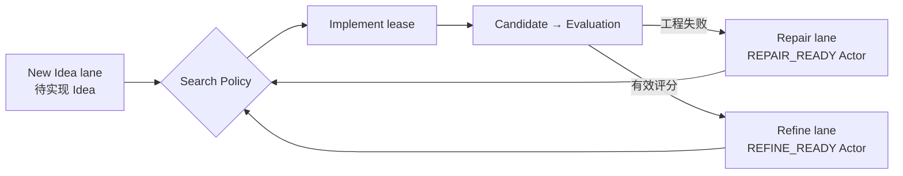

三类动作严格区分：

| 动作 | 来源 | 是否参与探索/利用平衡 |
|---|---|---|
| Repair | canonical、产物或 evaluator 前置阶段的可修复工程错误 | 否；只要满足修复预算就保持最高优先级 |
| New Idea | IdeaAgent 生成并进入待实现队列的新 `idea_id/lineage_id` | 是；代表探索 |
| Refine | 已获得有效官方评分、状态为 `REFINE_READY` 的原 ImplementActor | 是；代表利用 |

工程 Repair 不应挤占 New/Refine 的研究轮次统计，也不能因为修复成功而被误记为一种搜索策略。

##### 后续设计：延迟物化 Refine

Evaluator 返回有效结果后，原 Actor 先停留在 ActorStore 的 `REFINE_READY` 状态，不立即创建
高优先级 `actor_continuation` 队列项。只有 Search Policy 真正选择该 Actor 时，Controller 才
根据最新 mailbox、父 Candidate 和预算物化 continuation 并领取 Implement lease。

这样有三个直接收益：

1. Refine 和 New Idea 可以在同一个资源派发点比较，而不是由写死的队列 priority 提前决定；
2. `idea_queue_high_watermark` 只控制尚未实现的 New Idea 积压，`REFINE_READY` 是轻量状态，
   不会与 Idea 抢占队列容量；
3. 截止时可以准确区分未实现 New Idea、未选择 Refine 和已领取但未提交 Candidate。

每个 Actor 仍然同时最多有一个在途 Candidate；有 pending Candidate、预算耗尽或已进入终态的
Actor 不属于 Refine 候选。

##### 后续设计：三阶段策略

第一版采用确定性、可回放的三阶段策略。

| 阶段 | 进入条件 | New / Refine 规则 |
|---|---|---|
| 探索启动期 | 独立 lineage 的有效首评分少于 `seed_evaluated_lineages` | 有可执行 New Idea 时优先 New；New 不可用时允许 Refine，不能让 Implement 空转 |
| 平衡期 | 已获得足够独立 lineage，且未进入冲刺时间门控 | 按可配置 pattern 做 deficit round-robin；默认 `[new, refine]` |
| 冲刺期 | 剩余研究时间不高于 `sprint.trigger_remaining_sec` | 停止继续生产 Idea；将待实现 New Idea 与 `REFINE_READY` Actor 作为统一 Opportunity 排序 |

默认 `[new, refine]` 是资源派发模式，不是用户科研目标的权重。选择它的原因是当前历史调度已
向 Refine 投入约两倍尝试，而 New Idea 的全局突破率没有更低、成功突破幅度反而更大。后续应
通过同任务、等实现时间和等 evaluator 次数的对照实验比较 `[new, refine]` 与
`[new, refine, refine]`，再修改默认值。

Deficit round-robin 维护两条 lane 的调度欠账：如果 pattern 当前轮到 New，但 New 暂时不可用，
可以先派 Refine 保持资源利用率；当 New 再次可用时优先偿还 New 的欠账。反向同理。连续派发
上限防止某一 lane 因另一 lane 长时间不可用而在恢复后继续失衡。

异步并发下，策略统计必须同时计算 `selected + running + waiting_evaluation` 的研究动作，而不能
只看已经返回的 evaluator 结果。Controller 在主线程内原子写入 reservation 后再启动后台
Implement，避免多个并发槽基于同一份旧计数同时选择 New 或 Refine。

##### Refine 生命周期

Refine 继续沿用当前三轮研究预算：首次实现加最多两次研究 Refine，纯工程 Repair 不计入。
第一次 Refine 后即使分数下降，也不立即淘汰 lineage；当前三轮样本中有 `26.0%` 呈现
`先降后升`。因此第一版只使用 Actor 总轮次硬限制，并始终保留历史 best，不增加“一次下降即
终止”的规则。

平衡期内，同一 lane 默认按 `ready_at` 近似 FIFO，避免再引入一套不透明的固定加权公式。
冲刺期才使用可选 Opportunity Judge，读取：

- New Idea 的机制、证据、资源声明和与历史方法的互补性；
- Refine lineage 的当前分数、相邻增益、分项指标、剩余轮次和最新 mailbox；
- 剩余 Agent 研究时间、Implement 并发、Evaluation backlog 和可用资源。

Judge 从提升潜力、可实施性、时间适配、资源适配、证据支撑和方法互补性形成严格全序，但不把
这些维度伪造成固定权重总分。New 与 Refine 必须出现在同一份 Opportunity 排名中；当前仅排序
普通 Idea 的 `time_aware_idea_ranking` 需要扩展，而不是再增加一个常驻 Agent Pool。

冲刺排序正常只调用一次。进入冲刺后新 IdeaAgent 停止生产，避免临近截止继续堆积不会实现的
Idea；排序完成后到达的新 evaluator 反馈不再次调用 Judge，按已有确定性 lane 规则插入。

##### 最小配置

```yaml
infra:
  scheduling:
    search_policy:
      type: pairwise_improve
      enabled: true
```

V1 只有类型和开关，不同时提供 `new_ratio`、`refine_ratio`、pattern 和多组阈值。Actor 的
研究轮次、Repair 次数和墙钟预算继续使用现有约束。三阶段 DRR 若后续通过对照实验验证，再
单独扩展策略配置，不能把未验证参数提前压入第一版。

##### 决策证据

每次派发都写一条 `search_policy_decision`，至少包含：

```yaml
action: refine | switch | fuse
source: agent | controller_fallback
current_idea_id: idea_current
offered_idea_id: idea_new
offered_queue_item_id: benchmark_attempt_queue_item_x
lineage_idea_ids: [idea_current, idea_new]
reason: Agent 基于最新反馈选择该路线的依据
replayed: false
consumed: true
ignored: false
```

Branch、Actor 的 `search_decisions.jsonl`、ExpBank record、ArtifactStore 和队列 lease resolution
保留同一决策的不同证据视图。后续运行报告应据此汇总三类动作的派发数、有效评分数、刷新
全局 best 次数和最终 best 来源，才能判断配对策略是否优于旧的 Refine-first。

#### 当前已实现的普通 Idea 冲刺排序

> 状态：以下是现有 `time_aware_idea_ranking` 的执行事实。它仍只排序普通 New Idea，与
> Pairwise Improve V1 正交；统一 Opportunity 排序属于后续三阶段策略。

对于有明确墙钟预算、以正式指标寻优为主的任务，可以通过 config 开启
`time_aware_idea_ranking`。它不是新的常驻 Pool，而是 Controller 在 Implement 领取队列项
前执行的同步调度节点：

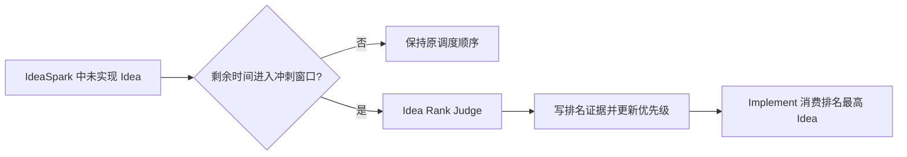

Judge 读取公开任务契约、当前最佳正式分数、ExpBank、剩余时间、CPU/GPU/内存和队列积压，
按 benchmark 对齐度、分数潜力、可行性、时间适配、资源适配、证据支撑、互补性、refine
价值和风险控制形成严格全序。维度可以使用 1-5 级 Rubric，但不编造用户目标权重，也不
使用固定加权公式。它只改变尚未实现的普通 Idea 之间的顺序：repair 与已评测后的 refine
continuation 仍保持原来的确定性高优先级。

该能力默认关闭；NatureBench 适配可显式开启并设置 `trigger_remaining_sec=3600`。进入
冲刺窗口后只尝试一次排序，不因为新的 Evaluation 事实或队列 fingerprint 变化再次调用。
Judge 失败时保留既有 FIFO，并写 `idea_ranking_failure`；只剩一个 Idea 或剩余时间不足
Judge 硬超时时直接跳过。这样可以避免 Ranking 反复占用冲刺阶段的研究时间。

达到队列容量时只停止派发新的 Implement，不 kill 在途 Agent。研究墙钟截止是唯一的
例外：此时终止尚未提交到 Evaluation Queue 的 Idea/Implement 激活并标记
`not_executed`，但截止时已经进入 Evaluation Queue 的 Candidate 必须全部完成并记录
结果；如果 Harness/Benchmark Adapter 声明并开启了最终 Judge，则它在研究预算之外执行；
普通 `loop run` 不会凭空增加一个最终 Judge。当前 V1 不做其他抢占，也不允许 continuation
绕过 Idea/attempt 队列高水位。

### 11.4 为什么仍然需要异步

即使 V1 简化，也应该保留异步队列，因为实验通常很慢：

- benchmark-managed 的 Idea producer 不应被训练任务阻塞；research 的 Idea 主线程调用也不
  等待后台 Implement / Evaluation Future；
- 实验运行时，系统还可以继续评审 idea 或分析其它结果；
- Analyze_spark 可以处理已完成分支，不影响前面继续探索；
- 出错时可以定位到具体队列和 branch。

### 11.5 V1 最小实现建议

当前 V1 已实现：

```text
queues/
  ideaspark.jsonl
  benchmark_attempt_queue.jsonl
  evaluation_queue.jsonl
  analyze_spark.jsonl

research_state.yaml
actors/<actor_id>/
  state.json
  mailbox.jsonl
candidates/<candidate_id>/
expbank/<attempt_id>/

artifacts/
  ideas/
  code_patches/
  runs/
  evaluator_scores/
  analysis_reports/
```

每个 queue item 至少包含：

```yaml
queue_item:
  id:
  type: idea | branch | analysis_task
  status: queued | running | finished | failed | archived
  priority:
  created_at:
  updated_at:
  input_refs:
  output_refs:
  evidence_refs:
  retry_count:
```

这些目录保持浅层、可直接检索。ExpBank 的 `INDEX.md` 保存方法摘要、结论、结果和
具体存储位置；Idea Agent 和 Implement Agent 都可以直接读取完整 ExpBank，不需要为
每种经验额外设计一个 LLM 工具。

---

## 12. 与 Famou Loop / Goal / Benchmark Harness 的集成

### 12.1 命令行与聊天启动

命令行：

```bash
famou-scientist --mode loop --goal-file goals/classification_algo_innovation.yaml

# 等价的显式 Loop 子命令入口
famou-scientist loop run --goal-file goals/classification_algo_innovation.yaml
```

对话中：

```text
/goal 在 dataset-1/2/3 上设计一个新的可解释分类算法，要求超过 baseline A/B/C 的综合分数，并准备 paper draft
```

`/goal` 不是“收到文本立即执行”的 shell 别名，而是聊天控制协议的入口。默认流程为：

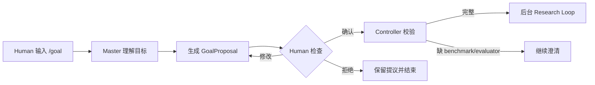

待确认内容至少包括：

- 主目标和原始用户指令；
- benchmark、正式 evaluator 和官方指标；
- 墙钟预算与 Idea/Implement/Evaluation 并发；
- 创新性、可解释性、速度等自然语言偏好；
- allow/reject pair、冲突时 tie-breaker；
- Master 所作假设和仍缺少的信息。

创新性、可解释性等不使用虚构的数值权重。正式分数只能来自 evaluator；目标描述完整
但缺少 benchmark/evaluator 时，Proposal 转为 `needs_clarification`，不能启动。

常用聊天命令：

| 输入 | 语义 |
|---|---|
| `/goal <目标>` | 生成待确认 Proposal，不启动 |
| `/goal confirm [proposal_id]` | 确认并后台启动 |
| `/goal reject [proposal_id]` | 拒绝但保留审计记录 |
| `/goal` | 查看当前 Proposal、策略和 Loop 状态 |
| `/goal pause` / `resume` / `stop` | 控制当前会话关联的 Loop |
| `/goal policy auto` | 明确授权当前会话后续由 Master 自动判定和启动 |
| `/goal policy confirm` | 撤销全自动，恢复每次确认 |
| `/goal auto <目标>` | 只对当前明确目标授权直接启动 |

普通对话也经过相同控制器。Master 可在用户描述明显需要“持续产生 idea、反复实现、调用
正式 evaluator、长时间自主寻优”时建议进入 Loop；问答、代码解释、一次性修改和没有可评测
目标的讨论留在聊天中。默认仍生成 Proposal 等待确认。

会话级全自动必须由用户明确选择，并把授权原文持久化。授权后，Master 才能对后续普通消息
输出 `enter_loop`、`stay_in_chat` 或 `needs_clarification`：

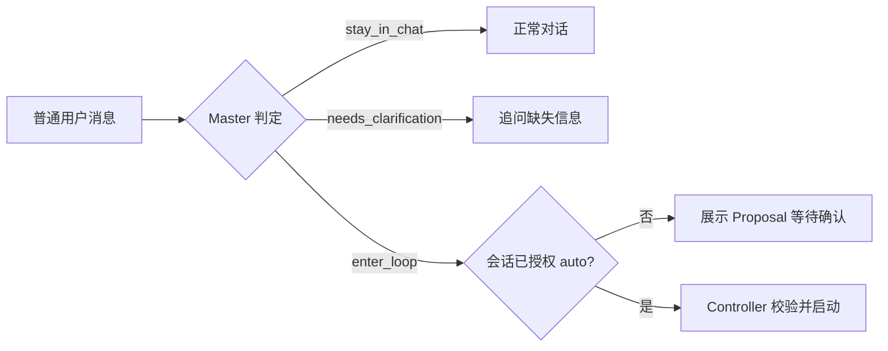

一次性 auto 必须把与 `raw_user_message` 完全一致的用户原文作为授权证据传给控制器。
不能从“继续”“你看着办”或历史行为推断全自动授权。即使处于 auto，缺 evaluator、存在关键
歧义或与当前活动 Loop 冲突时也必须停止启动并澄清。

### 12.2 goal file 示例

```yaml
goal:
  id: interpretable_fast_classifier
  name: interpretable_fast_classifier
  type: algorithm_innovation
  domain: classification

workflow:
  type: research

benchmarks:
  - name: classification_suite
    datasets: [dataset_1, dataset_2, dataset_3]
    adapter:
      type: command
      public_eval_cmd: python evaluators/classification_eval.py --mode public --submission {artifact}
      official_eval_cmd: python evaluators/classification_eval.py --mode official --submission {artifact}
      timeout_sec: 1800
    official_metric:
      name: accuracy
      direction: higher_is_better

baselines:
  - name: A
    repo: baselines/A
  - name: B
    repo: baselines/B
  - name: C
    repo: baselines/C

objective_brief:
  primary_goal: >
    在 dataset-1/2/3 上设计一个新的可解释分类算法，官方 accuracy 达到或接近 baseline A/B/C，
    同时形成可以写论文的清晰方法机制。
  official_metric:
    name: accuracy
    source: benchmark_adapter
    direction: higher_is_better
  preference_description: >
    用户更偏好机制清晰、可解释、可复现的方法；不希望系统只做超参搜索、简单 ensemble 或 benchmark trick。
    如果 accuracy 与解释性/速度冲突，需要把 trade-off 反馈给 Master，由用户进一步确认。
  allow_examples:
    - accuracy 与最强 baseline 基本持平，但模型更快、更简单，并有清晰可解释机制。
    - 对 baseline 做结构性改造，提出新的 loss / routing / representation，并用消融证明贡献。
    - 使用 public validation 做充分筛选，只在有必要时调用官方 evaluator。
  reject_examples:
    - 只通过 HPO 获得小幅提升。
    - 直接 ensemble 多个 baseline，但没有新算法贡献。
    - 使用 benchmark 禁止的外部数据或泄漏 hidden test 信息。
  tie_breakers:
    - 分数相近时，优先选择新颖性、可解释性、证据链更强的方案。
    - 论文故事更清晰的方案优先于纯工程 trick。

constraints:
  max_wall_time_hours: 72
  hidden_test_access: forbidden
  external_data: declare_and_approve

outputs:
  required: [method_code, experiment_report, ablation_tables, paper_draft]
```

### 12.3 Master 与 human 的关系

Master Agent 是 bridge，而不是 loop 内部研究员：

- 后台 loop 自主运行；
- human 可以随时插话；
- human 可以修改目标；
- human 可以暂停/恢复；
- human 可以要求解释当前分支；
- human 可以强制停止某个 branch；
- human 不需要每轮确认；
- Master 把 human 消息翻译成 `message`、`goal_change`、`pause/resume/stop` 或
  `clarification_response` 控制事件，交给 Loop Orchestrator；
- Loop Orchestrator 把需要 human 决策的事项压缩成 `clarification_request` 给 Master。

运行中用户仍可正常聊天。与当前研究相关的补充意见作为 `message` 追加到
`control/commands.jsonl`；澄清回答使用 `clarification_response`。用户提出新方向时，
Master 必须先询问是 `continue_current` 还是 `stop_current`，得到用户选择后才提交
`goal_change`，不能原地覆盖正在运行的 goal。

聊天控制面状态独立保存在 `.famou/goal-controller/`，Loop 内部状态仍保存在
`.famou/loop/<goal_id>/`。前者负责 Proposal、授权、会话到 Loop 的映射和启动审计；后者
负责 Ideaspark、Implement、Evaluator、ExpBank 和全部科研证据。这个边界保证 Master
不会进入 Loop 内部决策。

### 12.4 Harness-first / Embedded Agent Mode

对于 NatureBench、Terminal-Bench 等已经提供容器、任务协议、Evaluator 和自定义 Agent
入口的 benchmark，优先控制反转，让官方 Harness 启动 Famou：

```text
Benchmark Harness
  → famou-scientist agent run
  → Famou benchmark_managed 异步 Loop
  → Harness 提供的 Evaluator
  → 官方结果和轨迹
```

入口示例：

```bash
famou-scientist agent run \
  --task-id my-benchmark-task \
  --run-dir /workspace/.famou/run-001 \
  --problem-dir /task/public-problem \
  --workspace-dir /workspace \
  --evaluator-channel /workspace/.famou/evaluator-channel \
  --agent-runtime claude \
  --model glm-5.2
```

Harness-first 的职责边界：

- Harness 拥有任务镜像、公开数据、隐藏集和最终评测语义；
- Famou 拥有 Idea/Implement/Evaluation 调度、Actor、Candidate、ExpBank 和证据；
- Agent 只看到公开 problem 和脱敏 evaluator 反馈；
- 如果 Harness 只支持结束后统一评分，Evaluation Facility 使用 `deferred` 模式，Loop
  不能伪造在线官方分数；
- 对没有 Agent Harness 的传统 benchmark，使用 adapter-first 回退路径。

### 12.5 Agent 轨迹与成本观测

轨迹、Token、调用时长和供应商费用属于 Loop Infra，而不是 Benchmark 专用脚本。每次
Idea/Implement/Ranking 或 single-LLM 激活都由 Agent Adapter 返回增量 telemetry，Infra
统一追加到：

- `artifacts/agent_usage.jsonl`：激活级 usage ledger；
- `artifacts/agent_trajectory.jsonl`：带统一 envelope 的完整增量轨迹；
- `controller/agent_usage_summary.json`：按 role/runtime/model 汇总的派生摘要。

Resume 通过激活前后的 Session 文件偏移只记录新增事件。原始费用只接受 Agent
CLI/Adapter 明确返回值；如果 Goal/Harness 显式配置四类 Token 单价，Infra 另行生成
`calculated_cost` 和分项，但绝不覆盖 `cli_reported_cost`。CLI 美元等价成本不等同于
兼容网关的实际账单，配置价格重算值也必须携带来源和生效时间。
NatureBench、Harbor 等 adapter 从统一轨迹投影自己的提交格式，不要求
Core 解析 benchmark 私有目录。接口和导出命令见
`docs/operations/LOOP_AGENT_OBSERVABILITY_CN.md`。

---

## 13. 三设施接口设计

### 13.1 已实现的职责边界

当前代码通过 `famou_scientist/loop/facilities/` 隔离三个设施：

```text
Agent Facility
  → CandidateRef

Bench Facility.run(CandidateRef)
  → RunResult + ArtifactRef

Controller
  → EvaluationRequest(task_id, attempt_id, artifact_ref)

Evaluation Facility.evaluate(EvaluationRequest)
  → EvaluationResult
```

- Agent Facility 只负责 idea、implement 和开放科研分析，不持有 evaluator；
- Bench Facility 拥有公开任务契约、preflight、候选执行、产物校验和公开评测；
- Evaluation Facility 只执行 hidden/official 评分，不负责运行候选代码；
- Controller 是唯一能把 `ArtifactRef` 选为正式提交并构造 `EvaluationRequest` 的组件。

公共对象定义在 `facilities/contracts.py`。`CandidateRef` 引用冻结源码，但不要求 Python
或单一入口；`ArtifactRef` 引用 Bench 产生的文件或目录，包含 `kind`、受控存储路径、
生产者、元数据和确定性 SHA-256。创建与评分前都会拒绝符号链接，正式评分前还会重新
验证哈希，防止提交后被覆盖。

### 13.2 Bench 与 Evaluation 接口

```python
class BenchmarkFacility(Protocol):
    def task_view(self) -> TaskView: ...
    def preflight(self, candidate: CandidateRef, *, context=None) -> dict: ...
    def run(self, candidate: CandidateRef, *, context=None) -> RunResult: ...
    def validate_artifact(self, artifact: ArtifactRef) -> dict: ...
    def run_public_evaluation(self, artifact: ArtifactRef) -> dict: ...

class EvaluationFacility(Protocol):
    def evaluate(self, request: EvaluationRequest) -> EvaluationResult: ...
    def agent_view(self, result: dict, *, source=None) -> dict: ...
    def close(self) -> None: ...
```

`run_public_evaluation()` 属于 Bench Facility，因为它只能访问公开数据；
`evaluate()` 属于 Evaluation Facility，是 hidden/official 指标的唯一来源。

设施边界已经由 Loop Core 使用，但装配路径分为两种：

- `famou-scientist agent run` 的 Harness 路径通过插件 Registry 创建独立的 Agent、Bench 和
  Evaluation Facility，这是外部 benchmark 接入的正交主路径；
- `famou-scientist loop run` 当前仍从 goal 文件创建旧的 `ExperimentRunner + BenchmarkAdapter`，
  再由 `Orchestrator` 包装成 `RunnerBenchmarkFacility + AdapterEvaluationFacility`。这只是
  兼容装配，不代表 Core 重新跨边界调用旧接口；后续可以把直接 `loop run` 的装配也切换到
  同一 Registry。

NatureBench 的 `run.py`、`DATA_DIR`、`OUTPUT_DIR` 和 `submission` 约定位于
`loop/integrations/naturebench/benchmark.py`；通用 CandidateStore 和 Harness Core 不再
默认补 `run.py`。可信 evaluator transport 只由
`loop/integrations/naturebench/evaluation.py` 创建的 Evaluation Facility 持有。三类
Adapter 的注册和第三方接入方式见
`docs/design/FAMOU_ADAPTER_PLUGIN_ARCHITECTURE_CN.md`。

### 13.3 结果字段与脱敏

Benchmark integration 需要显式声明字段来源和可用性，例如：

```yaml
score_schema:
  official_metrics:
    accuracy:
      direction: higher_is_better
      source: hidden_or_official_eval
  optional_metrics:
    runtime_ms:
      available: false
  diagnostics:
    failure_cases:
      available: false
  evidence:
    stdout: retained_not_exposed_by_default
    stderr: retained_not_exposed_by_default
    extra: retained_and_redacted_for_agent
```

如果官方 evaluator 没有某字段，adapter 只能标记 `available: false`，不能让 agent 误以为它能从 hidden evaluator 获取这些粒度信息。

完整评测结果至少支持以下证据粒度：

```json
{
  "valid": true,
  "official_metrics": {"accuracy": 0.912},
  "diagnostics_public": {"format_check": "passed"},
  "stdout": "...",
  "stderr": "...",
  "extra": {},
  "error": null
}
```

`stdout`、`stderr` 和完整 `extra` 用于审计与定位，保存在 evaluator evidence 中；
`agent_view()` 只暴露允许的标量指标、公开诊断和 `extra_public`，避免日志或嵌套结构
泄漏 hidden 样本、标签和预测。

Evaluation Facility 支持三种语义：

| 类型 | 场景 | Loop 行为 |
|---|---|---|
| `online` | Harness 允许候选在线正式评分 | 每个有效 Candidate 可评分并反馈 Actor |
| `command` | 官方或本地可信命令适配 | Controller 受控执行并解析结构化结果 |
| `deferred` | 只允许 Agent 结束后统一评分 | Loop 只做公开检查，不声称获得在线官方分数 |

### 13.4 防泄漏策略

- hidden split、GT 和 evaluator 源码不挂载到 Agent workspace；
- evaluator 在独立可信进程、容器或 Harness service 中运行；
- evaluator 只返回 benchmark 明确公开的指标、诊断和扩展字段；
- Agent 只提交不可变 Candidate，不能指定或读取可信端任意路径；
- evaluator 响应通过受控 channel 返回；跨 Job 场景应签名校验响应；
- 提交次数可以由 benchmark 限制；benchmark 不要求时允许为空，并由墙钟和背压控制；
- 对频繁 probing 做 audit；
- 禁止 evaluator 源码被 agent 修改；
- external data usage 需要声明；
- 保留所有 Candidate、submission、原始 evaluator 输出和调用审计；
- 所有向 Agent 返回的结果必须经过字段级脱敏。

NatureBench 当前每个 case 采用一个 Task fm-job：Trusted Supervisor/Evaluator 以 root
运行，Idea/Implement/Candidate 通过 `setpriv + no-new-privs` 使用非特权 UID。两侧共享
该 fm-job 的 CPU/GPU/内存，但 `trusted/`、GT、私钥和 Judge 配置为 root `0700/0600`，
Agent 即使知道路径也无法读取。Controller 与 Evaluator 通过受控文件 channel 通信，响应
使用非对称签名。完整 evaluator response、进程 stdout/stderr、私有扩展和异常 traceback
写入 Agent 不可读的 `trusted/raw_evaluator_artifacts/`；公共 channel 与
`artifacts/evaluator_scores/` 只保存 benchmark 声明的白名单结果视图。
NatureBench 官方 `/evaluate` 明确公开的 `raw_scores` 和 `per_instance_improvement` 属于该
白名单，不应被 Famou 擅自删减。

---

## 14. V1 实现状态与后续蓝图

### 14.1 当前已实现的公共底座

- `--mode loop`、`loop run/status/pause/stop/resume/report/export`；
- `research` / `benchmark_managed` 工作流分流；
- 文件系统 ResearchState、四个浅队列、Artifact Store 和决策日志；
- Shared Experience Pool 与 ExpBank；
- benchmark Idea producer 与 Implement / Evaluation 执行器；research IdeaActor 可直接准入或与 Gate 同步交互，并可和在途实现、评测重叠；
- 开放科研长生命周期 IdeaActor：CLI Session 恢复、逐条 Idea 提交和可选同步 Idea Gate 反馈；
- `expbank/IDEAS.md + expbank/ideas/*.json` Idea Graph，Gate 前持久化全部 raw Idea；
- Idea Gate 四态协议：`pass / revise / reject / needs_evidence` 和 criterion-level 诊断；
- 目录级 branch/worktree 隔离和本地子进程隔离：canonical run 使用独立进程组，
  超时清理完整进程树；Harness 使用 Candidate 资源声明和 Resource Broker 动态装箱，
  资源等待不算失败，资源错误只回流原 ImplementActor，不影响其他 Candidate；
- 长生命周期逻辑 ImplementActor、Session 恢复和 mailbox；
- 显式 `submit_candidate`、不可变 Candidate 快照和单 Actor 单在途约束；
- 统一 EvaluationJob：run、产物校验、官方 evaluator；
- 工程失败与科研结果的确定性路由；
- evaluator 结果证据留存、Agent 视图脱敏和提交预算审计；
- Harness Agent CLI 与 NatureBench 可信 Evaluator 适配；二者同 Task Job、共享资源但权限隔离；
- NatureBench 的 Agent 侧运行快照排除 `evaluator_worker.py`、`evaluate_task.py`、
  `trajectory_adapter.py`、`judge_adapter.py` 等可信侧源码；
- NatureBench 完整 evaluator response、进程 stdout/stderr 和 traceback 写入 Agent 不可读
  的 `trusted/raw_evaluator_artifacts/<request_id>/`；生产 Harness 发布到 Agent 的响应
  必须带 `redacted_for_agent: true`，但保留官方声明公开的逐实例指标。
- Infra 保存 benchmark 无关 canonical evidence；NatureBench `TrajectoryAdapter` 在可信
  收尾阶段投影官方 transcript、`submissions.jsonl` 和 `run_summary.json`，再由独立
  `JudgeAdapter` 调用 `judge_core`。

### 14.2 Benchmark-managed 当前闭环

```text
Benchmark Task
  → Idea Agent 读取完整 ExpBank
  → benchmark attempt
  → ImplementActor 实现 / smoke / submit_candidate
  → Actor park
  → EvaluationJob
  → ExpBank + Leaderboard + mailbox
  → 原 Actor 恢复修复或 refine
  → 预算结束后提升最佳代码和产物
```

这条路径已经用于 NatureBench 端到端运行。它不创建 Master，也不调用额外 LLM judge。

### 14.3 Research 工作流目标闭环

开放科研模式继续沿用以下蓝图：

```text
Research Task Contract
  → 复现并理解 baseline / prior work
  → 恢复长生命周期 IdeaActor
  → 提交一条 raw Idea，并先写入 Idea Graph
  → 默认直接进入 Ideaspark
  → 可选同步 Goal/Rubric Idea Gate
  → 开启时 revise / needs_evidence 返回同一 Session
  → 开启时 pass 进入 Ideaspark；reject 保持可检索
  → 选择 Idea 实现
  → 公共实验 / 可信评测
  → 结果分析和下一轮
```

目标输出：

```text
runs/<goal_id>/
  research_state.yaml
  expbank/IDEAS.md
  expbank/ideas/<idea_id>.json
  expbank/<attempt_id>/
  artifact_index.jsonl
  decision_log.jsonl
  branches/
  experiments/
  evaluator_scores/
  evidence_bundle/
  reports/
  claim_evidence_map.yaml
  paper_draft.md

shared_experience_pool/
  external_baselines.jsonl
  literature_methods.jsonl
  attempted_ideas.jsonl
  failure_cases.jsonl
  reusable_artifacts.jsonl
```

当前公共底座可以承载这条链路，其中长生命周期 IdeaActor、可选同步 Idea Gate 和 Idea Graph 已实现；literature/baseline context、Evidence Gate、
AnalyzeSpark 深度消融和 paper candidate 的自动化质量仍需要继续迭代，不能把这些目标
节点标记成与 benchmark-managed 同等成熟。

---

## 15. 适合优先接入的基准类型

### 15.1 第一优先：明确隐藏评测器的刷分型 benchmark

例如：

- MLE-bench；
- NatureBench；
- AIRS-Bench；
- MLS-Bench；
- MLAgentBench；
- PostTrainBench；
- KernelBench；
- TritonBench；
- AIMO / MathArena；
- PutnamBench / Lean Eval。

原因：

- 分数明确；
- artifact 明确；
- evaluator 容易封装；
- 适合 loop 优化。

### 15.2 第二优先：workflow 型 benchmark

例如：

- Terminal-Bench Science；
- Agents' Last Exam；
- BioAgent Bench；
- sim-benchmark；
- Controlgym / Grid2Op / BOPTEST。

原因：

- 更接近真实科研；
- 但 adapter 和环境成本更高。

### 15.3 第三优先：开放 rubric / paper-review 型 benchmark

例如：

- ResearcherBench；
- LifeSciBench；
- MLR-Bench；
- PaperBench；
- HeurekaBench。

原因：

- 更接近论文质量；
- 但 judge / rubric 稳定性需要重点治理。

---

## 16. 主要风险

### 16.1 退化成调参机器

风险：

- 系统只做 HPO；
- 没有 novelty；
- 没有 paper claim。

缓解：

- 默认依赖严格的 IdeaAgent instruction；发现明显退化时开启 Goal/Rubric Idea Gate；
- 低 novelty 分支不能进入 paper candidate；
- 每个 idea 必须有 mechanism 和 claim。

### 16.2 benchmark overfitting

风险：

- 过度依赖公共验证；
- 频繁提交隐藏评测器；
- 根据 score 反推 hidden set。

缓解：

- evaluator submission budget；
- 只返回聚合指标；
- branch promotion 不能只看 hidden score；
- 使用多 benchmark / cross-dataset validation。

### 16.3 LLM judge 不稳定

风险：

- novelty / paper review 主观；
- judge 偏好长文本；
- judge 被 prompt hack。

缓解：

- 尽量将核心性能交给 deterministic evaluator；
- reviewer 多模型投票；
- rubric 固定；
- reviewer 输出结构化证据；
- human 可抽查。

### 16.4 代码不可复现

风险：

- 实验结果不可复现；
- seed 不固定；
- 环境漂移。

缓解：

- container；
- lockfile；
- config；
- artifact registry；
- rerun check；
- reproduction checklist。

### 16.5 证据链断裂

风险：

- 最终报告里有 claim，但找不到对应实验；
- 分支决策只有结论，没有理由；
- evaluator 分数和 public eval 混淆；
- 失败经验没有留存，后续重复踩坑。

缓解：

- artifact / evidence store 强制记录；
- 所有 decision 必须有 evidence_refs；
- paper claim 必须有 claim-evidence map；
- official / public / internal score 分源存储；
- goal 结束时生成 evidence bundle。

---

## 17. 结论

这个 multi-agent graph 的核心不是“多几个 agent 写代码”，而是构造一个可隔离、
可异步、可恢复、可审计的 **科研闭环系统**。

完整 benchmark 的 V1 主链路已经明确：

```text
Idea Pool
  → ImplementActor
  → explicit immutable Candidate
  → EvaluationJob
  → Trusted Evaluator
  → ExpBank / Leaderboard / Actor mailbox
  → resume 原 Session
```

开放科研的长期蓝图在这套执行底座之上增加：

```text
明确任务
  + 明确 benchmark
  + 多目标 objective
  + 共享经验池 / historical memory
  + 证据与产物留存 / evidence trail
  + 多分支 idea search
  + trusted evaluator
  + novelty / reviewer critic
  + ablation / robustness
  + paper readiness
```

两条工作流必须保持边界：`benchmark_managed` 忠实服从 benchmark 的任务和 evaluator
语义；`research` 才引入用户偏好、创新评审、消融和论文判断。只有在不泄漏 hidden
信息、不混淆工程失败与科研结论、所有产物可追溯的前提下，系统才可能从“自动刷分”
稳定升级到“自动算法创新”。
